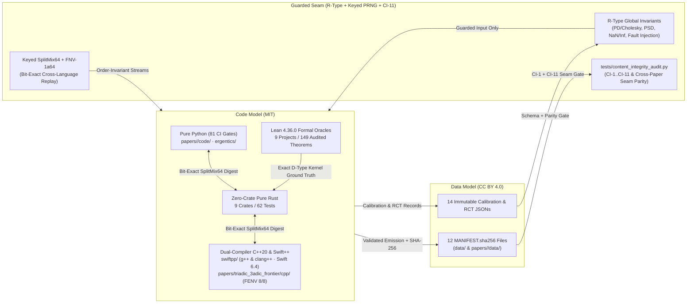

# Architecture

System layout, Code-vs-Data model boundaries, and multi-language toolchain organization for **Morpheus**.

## 1. Four-Plane Separation

Morpheus separates research artifacts into four non-overlapping planes so **Code** and **Data** are never conflated and archived baselines remain auditable:

| Plane | Directories | License | Role |
| :--- | :--- | :--- | :--- |
| **Manuscript** | `paper/`, `prime_cadences_paper.md`, `figures/`, `arxiv/`, `papers/<slug>/{paper,arxiv}/`, `papers/<slug>/*.md` | CC BY 4.0 | Canonical AMS `LaTeX`/PDFs (`6` papers), GFM mirrors, metadata-free vector figures, neutral `0/0` arXiv bundles |
| **Archived Baseline** | `code/`, `audits/`, `cleanroom/`, `papers/wp03*/cleanroom/` | MIT / CC BY 4.0 | Frozen upstream & clean-room baselines (`13/13` cryptographic SHA-256 locks enforced by `CI-10`, preserved unmodified per Rule 5) |
| **Code Model** *(maintained `[X]` work)* | `ergentics/`, `swiftpp/`, `lean/`, `rust/`, `tests/`, `papers/<slug>/{code,cpp,lean,rust}/`, `reconciliation/*/code/` | MIT | Deep, self-contained executable logic, formal proofs, freestanding hardware-`FENV` C++20 kernels, and SWE-sweep verifiers — **zero stray data blobs** (enforced by `CI-9`) |
| **Data Model** *(maintained `[X]` work)* | `data/`, `papers/<slug>/data/` | CC BY 4.0 | Immutable, schema-typed, SHA-256-checksummed calibration JSONs (`14` files across `12` repo-root-relative `MANIFEST.sha256` files, enforced by `CI-1` & `CI-11`) |

## 2. Boundary Flows (`Code ↔ Data`, `D ↔ R ↔ P`, & Live CI)



### Mandatory Seam Rules

1. **No circular audits:** Code modules recompute from axioms or first principles; they never assert on cached JSON outputs as proof of execution (`--check-only` recomputes from scratch and compares against the manifest-locked artifact).
2. **Guarded ingestion (`Data → R → Code`):** Any data read by executable code must pass `R-Type` schema, finiteness (`NaN`/`±Inf`), and global structural invariants (e.g. $\lambda_{\min} > 0$, Cholesky, Laplacian nullity-1, Bochner positivity) before reaching deterministic kernels.
3. **Keyed replay (`D ↔ P`):** Probabilistic tests, RCT splits, and randomized sweeps receive explicit local keyed `SplitMix64` PRNG streams; global RNG state is forbidden in new code.
4. **Clean build boundaries:** Build outputs (`.lake/`, `target/`, `.build/`, `build/`, `__pycache__/`) are excluded by [`.gitignore`](.gitignore) and never committed.

## 3. Multi-Language Role Allocation

| Layer | Directories | Primary Responsibilities |
| :--- | :--- | :--- |
| **Pure-Python Reference & Content Integrity** | `ergentics/`, `papers/<slug>/code/`, `tests/` | Zero-dependency from-scratch verifiers (`81/81` CI gates), `R-Type`/`P-Type` suites, figure generators, and the `11`-gate repository-wide audit harness ([`tests/content_integrity_audit.py`](tests/content_integrity_audit.py)) |
| **Dual-Compiler C++20 & Swift++** | `swiftpp/`, `papers/triadic_3adic_frontier/cpp/` | Three-way Swift++ verification (`ErgenticsCXX`, Pure Swift 6.4, live interop, `0.000e+00` delta) and freestanding zero-heap hardware-`FENV` C++20 interval oracles — compiled under **both `g++` and `clang++`** (`-Wall -Wextra -Werror`) in CI |
| **Formal Verification (Lean 4.36.0)** | `lean/`, `papers/<slug>/lean/` | Machine-checked `D-Type` algebraic, combinatorial, unimodular SNF, and integer/rational-bracket theorems across `9` zero-Mathlib projects (`149/149` `#print axioms`-audited theorems, `0 sorryAx`, `0 Lean.ofReduceBool`) |
| **Systems & SWE-Sweep Compute (Rust)** | `rust/`, `papers/<slug>/rust/` | `9` zero-crate Rust packages (`62/62` release tests): exact integer/rational/quaternion oracles, exhaustive Dhar burning, zero-PARI Manin modular symbols, adversarial fault injection, and bit-exact `SplitMix64` parity |

## 4. Live Multi-Paper Repository Layout

```text
Morpheus/
├── README.md, METHODOLOGY.md, ARCHITECTURE.md, CALIBRATIONS.md, ERGENTICS.md, NEGATIVES.md
├── CONTRIBUTIONS.md, PROVENANCE.md, POLICY.md, SECURITY.md, AGENTS.md, CHANGELOG.md
├── LICENSE, LICENSE-paper, LICENSES/, CITATION.cff, Makefile, requirements.txt
├── .github/workflows/                                  # CI: continuous-testing, security, release-assets
├── tests/                                              # Code Model: 11-gate content-integrity harness (MIT)
├── paper/, figures/, arxiv/, prime_cadences_paper.md   # Paper #01 Manuscript Plane (CC BY 4.0, v0.3.1)
├── code/, audits/, cleanroom/                          # Archived Baseline Plane (frozen per Rule 5)
├── ergentics/, swiftpp/, lean/, rust/                  # Paper #01 Code Model (MIT)
├── data/                                               # Paper #01 Data Model (CC BY 4.0, MANIFEST.sha256)
├── reconciliation/                                     # Audit dossiers, Round-1 packets & Retrospective (CC BY 4.0)
├── media/                                              # Educational videos, posters & MIT generators
└── papers/                                             # Multi-Paper Registry (Papers #02–#09+)
    ├── wp030_shape_propulsion/ ... wp035_tuft_hagedorn_repair/  # Frozen cleanroom/ + 3-plane [G4N] + [GB] R1
    ├── horizon_synthesis/                                       # Pieces I–III (v0.4.0 canonical PDFs & arXiv)
    ├── triadic_wreath_nauru/                                    # Paper PC-II (v0.7.1, 3-plane live CI)
    └── triadic_3adic_frontier/                                  # Paper PC-III (v0.8.0, 4-plane live CI incl. cpp/)
```

## 5. Cloud & Local Toolchain Baseline

Verified toolchain configuration on Ubuntu 24.04 (`x86_64`):

- **Lean 4:** `4.36.0` (`lake 5.0.0`, managed by `elan`)
- **Swift:** `6.4.3` (`swift`, `swiftc`, SwiftPM via `swiftly`, appended to `PATH` so system `clang++` remains default for C++)
- **C++:** `g++ 13.3.0`, `clang++ 18.1.3` (`cmake`, `make`, `ninja`)
- **Rust:** `rustc 1.100.0`, `cargo 1.100.0` (`rustup`)
- **LaTeX:** TeX Live minimal paper bundle (`pdflatex`, `latexmk`, `biber`, `lmodern`)
