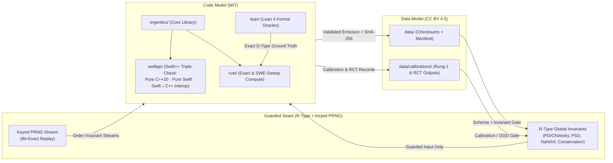

# Architecture

System layout, Code-vs-Data model boundaries, and multi-language toolchain organization for **Morpheus**.

## 1. Four-Plane Separation

Morpheus separates research artifacts into four non-overlapping planes so **Code** and **Data** are never conflated and archived baselines remain auditable:

| Plane | Directories | License | Role |
| :--- | :--- | :--- | :--- |
| **Manuscript** | `paper/`, `prime_cadences_paper.md`, `figures/`, `arxiv/` | CC BY 4.0 | Canonical LaTeX/PDF, GFM mirror, figures, arXiv bundle |
| **Archived Baseline** | `code/`, `audits/` | MIT / CC BY 4.0 | Imported Grok Bot baseline (preserved unmodified; known legacy code+JSON co-location) |
| **Code Model** *(new `[X]` work)* | `ergentics/`, `swiftpp/`, `lean/`, `rust/` | MIT | Deep, self-contained executable logic, formal proofs, kernels, and SWE-sweep verifiers — **zero cached data blobs** |
| **Data Model** *(new `[X]` work)* | `data/` | CC BY 4.0 | Immutable, schema-typed, SHA-256-checksummed tables, calibration outputs, RCT records, and external snapshots (e.g. LMFDB) |

## 2. Boundary Flows (`Code ↔ Data` and `D ↔ R ↔ P`)



### Mandatory Seam Rules

1. **No circular audits:** Code modules recompute from axioms or first principles; they never assert on cached JSON outputs as proof of execution.
2. **Guarded ingestion (`Data → R → Code`):** Any data read by executable code must pass `R-Type` schema, finiteness (`NaN`/`±Inf`), and global structural invariants (e.g. $\lambda_{\min} > 0$, Cholesky, aggregate conservation) before reaching deterministic kernels.
3. **Keyed replay (`D ↔ P`):** Probabilistic tests, RCT splits, and randomized sweeps receive explicit local keyed PRNG streams; global RNG state is forbidden in new code.
4. **Clean build boundaries:** Build outputs (`.lake/`, `target/`, `.build/`, `build/`, `__pycache__/`) are excluded by [`.gitignore`](.gitignore) and never committed.

## 3. Multi-Language Role Allocation

| Layer | Directory | Primary Responsibilities |
| :--- | :--- | :--- |
| **Ergentics Core Library** | `ergentics/` | Shared Correspondence contracts, `R-Type` invariant guards, `P-Type` Rung-1 calibration & RCT primitives, and keyed PRNG seam specs (see [`ERGENTICS.md`](ERGENTICS.md)) |
| **Swift++ Triple-Check** | `swiftpp/` | Three-way verification at every turn comparing **Pure C++20**, **Pure Swift 6.4**, and live **Swift ↔ C++20 interop** against each other (see [`ERGENTICS.md`](ERGENTICS.md)) |
| **Formal Verification** | `lean/` | Machine-checked `D-Type` algebraic, combinatorial, and graph theorems in Lean 4 (zero `sorry`, zero unreviewed axioms) |
| **Systems & SWE-Sweep Compute** | `rust/` | Exact integer/rational/cyclotomic oracles, adversarial float-cancellation sweeps, `R-Type` fault injection, and high-throughput `P-Type`/RCT calibration runners |

## 4. Target Directory Layout (Pre-Code Blueprint)

```text
Morpheus/
├── README.md, METHODOLOGY.md, ARCHITECTURE.md, CALIBRATIONS.md, ERGENTICS.md, NEGATIVES.md
├── CONTRIBUTIONS.md, PROVENANCE.md, POLICY.md, SECURITY.md, AGENTS.md
├── LICENSE, LICENSE-paper, LICENSES/, CITATION.cff, Makefile, requirements.txt
├── paper/, figures/, arxiv/, prime_cadences_paper.md   # Manuscript Plane (CC BY 4.0)
├── code/, audits/                                      # Archived Baseline Plane
├── ergentics/                                          # Code Model: Core Library (MIT)
├── swiftpp/                                            # Code Model: Swift++ Modules (MIT)
├── lean/                                               # Code Model: Lean 4 Proofs (MIT)
├── rust/                                               # Code Model: Rust Verifiers (MIT)
└── data/                                               # Data Model: Checksummed Artifacts (CC BY 4.0)
    ├── MANIFEST.sha256
    ├── schemas/
    ├── snapshots/                                      # External snapshots (e.g. LMFDB)
    └── calibrations/                                   # Rung-1 calibration & RCT outputs
```

## 5. Cloud & Local Toolchain Baseline

Verified toolchain configuration on Ubuntu 24.04 (`x86_64`):

- **Lean 4:** `4.36.0` (`lake 5.0.0`, managed by `elan`)
- **Swift:** `6.4.3` (`swift`, `swiftc`, SwiftPM via `swiftly`, appended to `PATH` so system `clang++` remains default for C++)
- **C++:** `g++ 13.3.0`, `clang++ 18.1.3` (`cmake`, `make`, `ninja`)
- **Rust:** `rustc 1.100.0`, `cargo 1.100.0` (`rustup`)
- **LaTeX:** TeX Live minimal paper bundle (`pdflatex`, `latexmk`, `biber`, `lmodern`)
