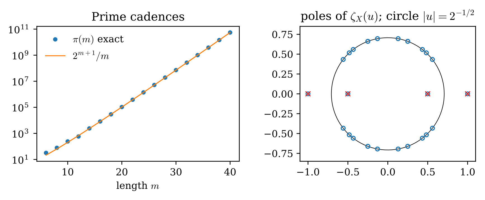
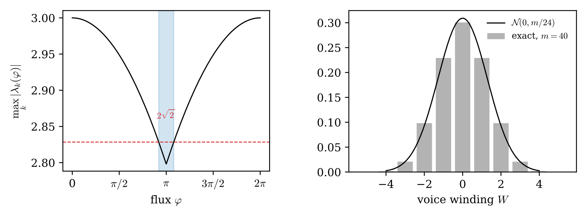
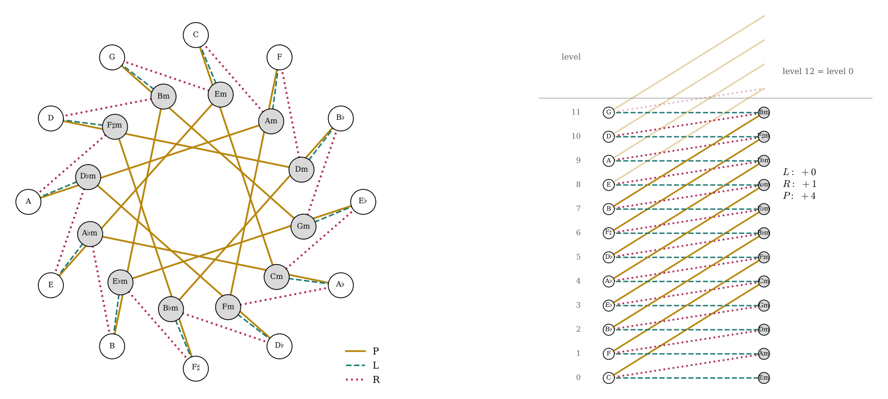

<div align="center">

# Prime cadences: Ihara zeta, graphene, and voice-leading homology on the Tonnetz

**Ergentics**

*November 2026 · version 0.2.0*

[](paper/prime-cadences.pdf)
[](paper/prime-cadences.tex)
[](README.md)

</div>

> This Markdown mirror is generated from `paper/prime-cadences.tex`. Numbering matches the PDF, which is authoritative. Contribution tags: `[GB]` Grok Bot, `[E]` Ergentics, `[E→GB]` direction by Ergentics with proof and computation by Grok Bot, `[lit.]` literature, `[X]` Ergentics' own program (see [`CONTRIBUTIONS.md`](CONTRIBUTIONS.md)).

---

## Abstract

The 24 major and minor triads, joined by the neo-Riemannian moves $`P`$, $`L`$, $`R`$, form a 3-regular graph $`X`$. We call the primes of its Ihara zeta function *prime cadences* and prove a number of exact statements about them. $`X`$ is the honeycomb lattice on a 12-cell torus; its zeta zeros are the tight-binding band energies, equal to the moduli of the triad’s discrete Fourier coefficients, and $`X`$ is Ramanujan. Over $`\mathbb{Q}`$, $`\zeta_X^{-1}`$ factors into Weil polynomials over $`\mathbb{F}_2`$. The sequence of moving notes alone determines a cadence (*tune theorem*), and in every equal-tempered system with any step set the tune determines the cadence, apart from one explicit family. The voices’ net winding is a torus homology coordinate, asymptotically Gaussian with variance $`m/24`$; its fourth cumulant is isotropic and hexagonal anisotropy first appears at order six. Twisting by it preserves the Riemann hypothesis on an explicit window. Three involutions of $`PGL_2(\mathbb{Q}_2)`$, one per move, generate a Schottky group whose Mumford curve $`C`$ has genus 13, reduction graph $`X`$ and automorphism group the transposition/inversion group. We compute its component group and gonality, find its order-12 factor in an explicit genus-5 curve over $`\mathbb{F}_2`$ (genus 5 is minimal), and show via a trace invariant and a 2-adic edge-length argument that $`C`$ admits no Čerednik–Drinfeld uniformisation except possibly by a group with torsion at a ramified or inert place above 2. No Shimura curve with torsion-free uniformisation has reduction graph $`X`$ over a totally real field of degree at most 5, or of degree at least 15. We separate known results from new ones.

---

## Contents

- [1. Introduction](#sec-1)
- [2. Set-up](#sec-2)
   - [2.1 Triads, moves and the chord graph](#sec-2-1)
   - [2.2 The Ihara zeta function](#sec-2-2)
   - [2.3 Tonnetz coordinates](#sec-2-3)
- [3. Spectrum, graphene and arithmetic](#sec-3)
   - [3.1 The arithmetic of the spectrum](#sec-3-1)
   - [3.2 Eisenstein ideals: refuted and corrected](#sec-3-2)
- [4. Melody: the tune theorem](#sec-4)
   - [4.1 Other tuning systems](#sec-4-1)
- [5. Voice threads and the winding law](#sec-5)
   - [5.1 Flux](#sec-5-1)
- [6. The homology law](#sec-6)
   - [6.1 Higher cumulants and hexagonal anisotropy](#sec-6-1)
- [7. The geometric object: a 2-adic Mumford curve](#sec-7)
   - [7.1 A Schottky group generated by $P$, $L$, $R$](#sec-7-1)
   - [7.2 The tower over the two-line curve](#sec-7-2)
   - [7.3 Tropical invariants: sandpile group and gonality](#sec-7-3)
   - [7.4 Curves over $\mathbb{F}_2$](#sec-7-4)
   - [7.5 No Shimura curve over $\mathbb{Q}$](#sec-7-5)
   - [7.6 No arithmetic uniformisation of $C$ at all](#sec-7-6)
   - [7.7 Other Schottky groups with quotient $X$](#sec-7-7)
- [8. What is known and what is new](#sec-8)
   - [Data and code availability](#sec-data-and-code-availability)
- [Contributions and provenance](#sec-contributions-and-provenance)
- [References](#references)

---

<a id="sec-1"></a>

## 1. Introduction

Euler drew a lattice of fifths and thirds in 1739 [[20](#ref-20)]; Riemann’s harmonic dualism and its neo-Riemannian revival [[30](#ref-30), [12](#ref-12), [13](#ref-13), [14](#ref-14)] turned that lattice into a space of chords linked by parsimonious moves. Douthett and Steinbach [[17](#ref-17)] identified the chord graph as the hexagonal “chicken-wire torus”, and Crans, Fiore and Satyendra [[15](#ref-15)] showed that the $`PLR`$-group is dihedral of order 24 and acts simply transitively. Tymoczko and collaborators [[51](#ref-51), [9](#ref-9), [52](#ref-52)] placed these structures inside continuous voice-leading orbifolds.

On the number-theoretic side, Ihara [[24](#ref-24)] attached a zeta function to discrete subgroups of $`PGL_2`$ over $`p`$-adic fields; Serre observed that it is the zeta function of a finite regular graph, and Sunada, Hashimoto and Bass [[46](#ref-46), [22](#ref-22), [6](#ref-6)] developed the general theory (see also [[45](#ref-45), [48](#ref-48)]). Ramanujan graphs [[32](#ref-32)], named after Ramanujan’s conjecture on $`\tau(n)`$ [[41](#ref-41)] (proved by Deligne [[16](#ref-16)]), are those whose zeta functions satisfy the analogue of the Riemann hypothesis.

This note joins these lines. Throughout, a *cadence* is a closed walk in the chord graph, and a *prime cadence* is an Ihara prime. The results are of three kinds: identifications that are classical once stated (graphene, Coxeter groups); theorems that we believe are new (tune theorem, winding law, Riemann window, the arithmetic of the spectrum); and one refuted conjecture with its correction (Eisenstein ideals). All numerical claims were checked in exact or 50-digit arithmetic; Section 8 lists what is known.

<a id="sec-2"></a>

## 2. Set-up

<a id="sec-2-1"></a>

### 2.1 Triads, moves and the chord graph

Pitch classes are $`\mathbb{Z}_{12}`$. A major triad with root $`r`$ is $`\{r,r+4,r+7\}`$ and a minor triad with root $`r`$ is $`\{r,r+3,r+7\}`$. The moves are
``` math
\begin{align*}
P&:\ \{r,r+4,r+7\}\leftrightarrow\{r,r+3,r+7\},\\ L&:\ \{r,r+4,r+7\}\leftrightarrow\{r+4,r+7,r+11\},\\ R&:\ \{r,r+4,r+7\}\leftrightarrow\{r+9,r,r+4\}.
\end{align*}
```
Each move keeps two notes and moves the third by a semitone ($`P`$, $`L`$) or a whole tone ($`R`$). Let $`X`$ be the graph with the 24 triads as vertices and an edge for each move; it is 3-regular with $`V=24`$, $`E=36`$, and bipartite (major/minor).

**Proposition 2.1** ([[15](#ref-15)]). `[lit.]` The group generated by $`P,L,R`$ acting on triads is dihedral of order 24 and acts simply transitively. Hence $`X`$ is the Cayley graph
``` math
X\cong \mathrm{Cay}(D_{12},\{P,L,R\}),\qquad P=L(LR)^4,\quad R=L(LR).
```

Let $`W_3=\mathbb{Z}_2*\mathbb{Z}_2*\mathbb{Z}_2=\langle p,l,r\rangle`$ be the universal Coxeter group of rank 3; its Cayley graph is the 3-regular tree $`T_3`$, which is the Bruhat–Tits tree of $`PGL_2(\mathbb{Q}_2)`$.

**Corollary 2.2**. `[GB]` The kernel $`K`$ of $`W_3\to D_{12}`$ equals $`\pi_1(X)`$ and is free of rank $`E-V+1=13`$. Non-backtracking walks in $`X`$ are reduced words in $`W_3`$, and prime cadences are in bijection with the primitive conjugacy classes of $`K`$. Thus $`\zeta_X`$ is the Ihara–Selberg zeta function of the lattice $`K`$ acting on $`T_3`$, Ihara’s original setting with $`q=2`$.

<div class="proof">

*Proof.* $`X=K\backslash T_3`$ since $`D_{12}`$ acts simply transitively. A free action on a tree gives a free group of rank $`E-V+1`$. Closed non-backtracking, tailless walks up to rotation correspond to cyclically reduced words up to cyclic permutation, i.e. conjugacy classes in $`K`$. ◻

</div>

<a id="sec-2-2"></a>

### 2.2 The Ihara zeta function

For a finite graph, $`\zeta_X(u)=\prod_{[\gamma]}(1-u^{\ell(\gamma)})^{-1}`$ over prime cycles. For $`X`$ $`(q+1)`$-regular,
``` math
\begin{equation}
\label{eq:ib}
\zeta_X(u)^{-1}=(1-u^2)^{E-V}\det(I-uA+qu^2I)=\det(I-uB),
\end{equation}
```
where $`A`$ is the adjacency matrix and $`B`$ is the $`2E\times 2E`$ Hashimoto (non-backtracking) matrix [[24](#ref-24), [22](#ref-22), [6](#ref-6), [28](#ref-28)]. $`X`$ is *Ramanujan* if every eigenvalue $`\lambda\neq\pm(q+1)`$ of $`A`$ satisfies $`|\lambda|\le 2\sqrt q`$; equivalently all nontrivial poles lie on $`|u|=q^{-1/2}`$.

<a id="sec-2-3"></a>

### 2.3 Tonnetz coordinates

Let $`\mathbb{Z}^2\ni(a,b)`$ map to the pitch class $`7a+4b`$ (fifths and major thirds). The kernel is the lattice $`\Lambda`$ with basis $`P_u=(4,-4)`$, $`P_v=(0,3)`$; $`\mathbb{Z}^2/\Lambda\cong\mathbb{Z}_{12}`$. With unit edges at $`60^\circ`$ the Gram matrix of $`(P_u,P_v)`$ is $`G=\left(\begin{smallmatrix}16&-6\\-6&9\end{smallmatrix}\right)`$, $`\det G=108`$. Triads are the triangles of the triangulated plane modulo $`\Lambda`$ (the Tonnetz torus), and $`P,L,R`$ are flips across the three edge directions. Dually, $`X`$ is the honeycomb lattice modulo $`\Lambda`$ (Figure 1).

<p align="center"></p>

**Figure 1.** Left: the Tonnetz with the six triads containing C; the length-6 prime cadence around them (a held-note hexagon) is a hexagonal face of the honeycomb. Right: the twelve Fourier coefficients $`f_k`$ of the major triad: units (red), the Gaussian primes $`2\mp i`$ (blue), $`\pm i\sqrt3`$ (green).

<a id="sec-3"></a>

## 3. Spectrum, graphene and arithmetic

Write $`\zeta=e^{2\pi i/12}`$, $`\omega=\zeta^4`$, and $`f_k=\zeta^{0}+\zeta^{4k}+\zeta^{7k}`$, the $`k`$-th Fourier coefficient of the indicator of $`\{0,4,7\}`$.

**Theorem 3.1** (spectrum). `[E→GB]` The adjacency eigenvalues of $`X`$ are $`\pm|f_k|`$, $`k\in\mathbb{Z}_{12}`$. Explicitly: $`\pm3`$ $`(k=0)`$; $`\pm1`$ three times each $`(k=2,6,10)`$; $`\pm\sqrt5`$ twice $`(k=3,9)`$; $`\pm\sqrt3`$ twice $`(k=4,8)`$; $`\pm2\cos\frac{\pi}{12}`$ and $`\pm2\cos\frac{5\pi}{12}`$ twice each $`(k=1,5,7,11)`$. In particular $`X`$ is Ramanujan, with largest nontrivial eigenvalue $`\sqrt5<2\sqrt2`$.

<div class="proof">

*Proof.* Index triads by (type, root). From the major triad of root $`r`$, $`P`$, $`L`$, $`R`$ lead to the minor triads of roots $`r`$, $`r+4`$, $`r+9`$. Thus $`A=\left(\begin{smallmatrix}0&C\\C^*&0\end{smallmatrix}\right)`$ with $`C`$ the circulant $`I+S^4+S^9`$ ($`S`$ the shift). Fourier diagonalisation gives $`C\mapsto g_k=1+\zeta^{4k}+\zeta^{9k}`$, and the eigenvalues of $`A`$ are $`\pm|g_k|`$. Now $`\{0,4,9\}=9+\{0,3,7\}`$ and $`\{0,3,7\}=7-\{0,4,7\}`$; translation multiplies a Fourier coefficient by a root of unity and reflection conjugates it, so $`|g_k|=|f_k|`$. The values follow by direct evaluation. (This is an instance of the spectrum of a dihedral Cayley graph; cf. the discussion in [[35](#ref-35)].) The 1-dimensional representations of $`D_{12}`$ give $`k=0,6`$ and the 2-dimensional ones $`\rho_j`$ give $`k=7j`$. ◻

</div>

**Remark 3.2** (graphene). $`C`$ is the Bloch matrix of nearest-neighbour hopping on the honeycomb with bonds from cell $`r`$ to cells $`r,r+4,r+9`$; the spectrum is $`\pm|\Delta(\mathbf k)|`$ (Wallace [[55](#ref-55)]) sampled at the 12 momenta of $`\Lambda^*/\mathbb{Z}^{2*}`$. The identification of these numbers with the triad Fourier magnitudes is in Marín Mu noz [[35](#ref-35)]. The Ramanujan property means that no allowed momentum lies in the cap $`|\Delta|>2\sqrt2`$ around $`\Gamma`$ (4.8% of the Brillouin zone). The note Tonnetz is the “square” of the honeycomb: $`A^2`$ restricted to major triads is $`3I+\mathrm{Cay}(\mathbb{Z}_{12},\{\pm3,\pm4,\pm5\})`$, a square-root-lattice relation in the sense of [[2](#ref-2)].

**Theorem 3.3** (counting). `[GB]` Let $`N_m=\operatorname{tr}B^m`$ and $`\pi(m)`$ the number of prime cadences of length $`m`$. Then $`N_m=\sum_{j=1}^{48}u_j^{-m}+12(1+(-1)^m)`$ where $`u_j`$ are the zeros of $`\det(I-uA+2u^2)`$, $`\pi(m)=0`$ for $`m`$ odd, $`\pi(m)=\frac1m\sum_{d\mid m}\mu(m/d)N_d`$, and $`\pi(m)\sim 2^{m+1}/m`$ for even $`m\to\infty`$.

<div class="proof">

*Proof.* Take logarithmic derivatives in (2.1); the factor $`(1-u^2)^{12}`$ contributes $`12(1+(-1)^m)`$. Möbius inversion of $`N_m=\sum_{d\mid m}d\,\pi(d)`$ gives $`\pi(m)`$. Bipartiteness kills odd $`m`$, and the poles $`u=\pm\frac12`$ dominate, the others having $`|u|\ge 2^{-1/2}`$. ◻

</div>

<div id="tab:counts">

| $`m`$ | 6 | 8 | 10 | 12 | 14 | 16 | 20 | 24 | 40 |
|---:|---:|---:|---:|---:|---:|---:|---:|---:|---:|
| $`\pi(m)`$ | 32 | 78 | 240 | 576 | 2400 | 8196 | 105096 | 1394120 | 54975717792 |
| $`\pi(m)\,m/2^{m+1}`$ | 1.500 | 1.219 | 1.172 | 0.844 | 1.025 | 1.000 | 1.002 | 0.997 | 1.000 |

**Table 1.** Prime cadences by length (exact, by transfer matrix; verified against (2.1)).

</div>

<p align="center"></p>

**Figure 2.** Left: prime cadence counts against the prime number theorem $`2^{m+1}/m`$. Right: poles of $`\zeta_X`$; the 44 nontrivial ones lie on $`|u|=2^{-1/2}`$ (Riemann hypothesis); crosses mark $`u=\pm1,\pm\frac12`$.

Chebotarev for graph coverings [[45](#ref-45), [22](#ref-22)]: $`X`$ is a $`\mathbb{Z}_{12}`$ (transposition) cover of the theta graph, so long cadences return to their starting chord with density $`1/12`$; we observed maximal deviation below $`10^{-6}`$ at $`m=40`$.

<a id="sec-3-1"></a>

### 3.1 The arithmetic of the spectrum

**Theorem 3.4**. `[E→GB]` The coefficients $`f_k`$ lie in $`\mathbb{Z}[\zeta]`$, and

1.  $`f_3=2-i`$, $`f_9=2+i`$: the split Gaussian primes above $`5`$;

2.  $`f_4=i\sqrt3=1+2\omega`$, $`f_8=-i\sqrt3`$: the ramified prime of $`\mathbb{Z}[\omega]`$ above $`3`$;

3.  for $`k\in\{1,5,7,11\}`$, $`f_k`$ is a unit of $`\mathbb{Z}[\zeta]`$, with $`|f_5|^2=|f_7|^2=2+\sqrt3=\varepsilon`$, the fundamental unit of $`\mathbb{Q}(\sqrt3)`$, and $`|f_1|^2=|f_{11}|^2=\varepsilon^{-1}`$; the minimal polynomial of $`f_1`$ is $`x^4-2x^3+2x^2+2x+1`$.

The Galois group $`(\mathbb{Z}/12)^\times`$ acts by $`\sigma_a f_k=f_{ak}`$. The element $`\sigma_{11}`$ is induced by inversion $`x\mapsto -x`$, an automorphism of $`X`$ exchanging major and minor. The elements $`\sigma_5,\sigma_7`$ are induced by the multiplications $`M_5,M_7`$; they are not automorphisms of $`X`$, but $`M_7`$ maps the 24 consonant triads bijectively onto the 24 transpositions and inversions of the set class $`[0,1,4]`$ and maps $`X`$ isomorphically onto the graph of single-note parsimonious moves among them.

<div class="proof">

*Proof.* (1)–(2): $`f_3=1+\zeta^{12}+\zeta^{21}=2+\zeta^9=2-i`$, and $`f_4=1+\zeta^{16}+\zeta^{28}=1+2\omega`$ with $`(1+2\omega)^2=-3`$. (3): the minimal polynomial of $`f_1`$ (computed exactly) has constant term $`1`$, so $`N_{\mathbb{Q}(\zeta)/\mathbb{Q}}(f_1)=1`$ and $`f_1`$ is a unit; its conjugates are the $`f_k`$, $`k\in(\mathbb{Z}/12)^\times`$. Further $`f_5=1+\zeta^{8}+\zeta^{11}`$, so $`|f_5|^2=3+2(\cos240^\circ+\cos330^\circ+\cos90^\circ)=2+\sqrt3`$, and $`|f_1|^2|f_5|^2=N(f_1)=1`$. Galois: $`\sigma_a(\zeta^{kx})=\zeta^{akx}`$. $`M_7\{0,4,7\}=\{0,4,1\}`$; the edge correspondence was checked on all 36 edges. ◻

</div>

So, read arithmetically, the eigenvalue $`\sqrt5`$ (the augmented-triad / diminished-seventh character of order 4) is the modulus of a Gaussian prime, $`\sqrt3`$ (the order-3 character) the modulus of the Eisenstein prime, and the primitive characters give square roots of $`\varepsilon^{\pm1}`$.

**Theorem 3.5** ($`\zeta_X`$ over $`\mathbb{Q}`$). `[GB]` The characteristic polynomial of $`A`$ is $`(x-3)(x+3)(x-1)^3(x+1)^3(x^2-5)^2(x^2-3)^2(x^4-4x^2+1)^2`$, and
``` math
\zeta_X(u)^{-1}=(1-u^2)^{12}(1-u)(1-2u)(1+u)(1+2u)\,L_1^3\,L_1'^3\,L_2^2\,L_2'^2\,L_4^2,
```
with $`L_1=1-u+2u^2`$, $`L_1'=1+u+2u^2`$, $`L_2=1-u^2+4u^4`$, $`L_2'=1+u^2+4u^4`$, $`L_4=1+4u^2+9u^4+16u^6+16u^8`$. Each of $`L_1,L_1',L_2,L_2',L_4`$ is the reversed characteristic polynomial of Frobenius of a simple isogeny class of abelian varieties over $`\mathbb{F}_2`$ (Honda–Tate [[47](#ref-47), [23](#ref-23)]); in LMFDB [[49](#ref-49)] labels: $`L_1`$: `1.2.ab`, the curve $`y^2+xy=x^3+x^2+1`$, Frobenius field $`\mathbb{Q}(\sqrt{-7})`$, which is the Euler factor at 2 of the CM newform `49.2.a.a`; $`L_1'`$: `1.2.b`; $`L_2`$: `2.2.a_ab`, a Jacobian with endomorphism algebra $`\mathbb{Q}(\sqrt{-3},\sqrt5)`$; $`L_2'`$: `2.2.a_b`, endomorphism algebra $`\mathbb{Q}(\sqrt3,\sqrt{-5})`$; $`L_4`$: `4.2.a_e_a_j`, a simple fourfold that is not a Jacobian. The factor $`(1-u)(1-2u)`$ is the zeta denominator of $`\mathbb P^1_{\mathbb{F}_2}`$.

<div class="proof">

*Proof.* For each eigenvalue $`\lambda`$ the Ihara factor is $`1-\lambda u+2u^2`$; multiply over Galois orbits. A polynomial $`1-\lambda u+2u^2`$ with $`|\lambda|\le2\sqrt2`$ has reciprocal roots of modulus $`\sqrt2`$, so each orbit product is a Weil $`2`$-polynomial; irreducibility over $`\mathbb{Q}`$ was checked, and the labels and endomorphism data were read from LMFDB. ◻

</div>

**Remark 3.6**. The Ramanujan property of $`X`$ is here literally the Hasse–Weil bound for these isogeny classes; the total dimension $`3\cdot1+3\cdot1+2\cdot2+2\cdot2+2\cdot4=22`$ equals the number of nontrivial eigenvalues. This is a factor-by-factor identification; we do not claim a variety over $`\mathbb{F}_2`$ whose zeta function is $`\zeta_X`$. Over $`\mathbb{F}_4`$ both surfaces become squares of elliptic curves with CM by $`\mathbb{Q}(\sqrt{-15})`$, and $`\mathbb{Q}(\sqrt{-3},\sqrt5)`$ is the Hilbert class field of $`\mathbb{Q}(\sqrt{-15})`$.

<a id="sec-3-2"></a>

### 3.2 Eisenstein ideals: refuted and corrected

It is tempting to view the Tonnetz as $`\mathbb{Z}[\omega]`$ modulo an ideal. This fails.

**Proposition 3.7**. `[E→GB]` No additive surjection $`\mathbb{Z}[\omega]\to\mathbb{Z}_{12}`$ sending $`1`$ and $`1+\omega`$ to a fifth and a major third (any of the 12 assignments of the Tonnetz axes) has an ideal as kernel; the multiplier ring of each kernel is $`\mathbb{Z}+12\mathbb{Z}[\omega]`$. Moreover $`\mathbb{Z}_{12}`$ is not a quotient ring of $`\mathbb{Z}[\omega]`$, $`\mathbb{Z}[i]`$ or $`\mathbb{Z}[\zeta]`$.

<div class="proof">

*Proof.* A ring quotient $`\mathbb{Z}[\omega]\to\mathbb{Z}_{12}`$ needs a root of $`x^2+x+1`$ modulo 4, and there is none since $`2`$ is inert; similarly $`x^2+1`$ has no root mod 4 and $`\Phi_{12}=x^4-x^2+1`$ has no root mod 3 or mod 4. The multiplier rings were computed exactly for all 12 maps. For example, with $`\psi(a+b\omega)=7a+9b`$, $`\psi(-12-8\omega)=0`$ but $`\psi(\omega(-12-8\omega))=8`$. ◻

</div>

**Theorem 3.8**. `[E→GB]` Let $`\mathcal O=\mathbb{Z}[\sqrt{-3}]`$, the order of conductor 2 in $`\mathbb{Q}(\sqrt{-3})`$. The ring map $`\psi(x+y\sqrt{-3})=x+3y`$ induces
``` math
\mathbb{Z}_{12}\;\cong\;\mathcal O\big/\big(\sqrt{-3}\,(1+\sqrt{-3})\big),
```
a principal ideal of norm 12, under which the minor third is $`\sqrt{-3}`$, the major third $`1+\sqrt{-3}`$, the fifth $`1+2\sqrt{-3}`$ and the semitone $`1`$. Multiplication by $`\sqrt{-3}`$ acts on pitch classes as $`x\mapsto3x`$. Among the orders $`\mathbb{Z}[f\omega]`$, exactly those with $`f`$ even admit $`\mathbb{Z}_{12}`$ as a quotient ring.

<div class="proof">

*Proof.* $`\psi`$ is a ring map since $`\psi(\sqrt{-3})^2=9\equiv-3`$. Its kernel contains $`3-\sqrt{-3}=-\sqrt{-3}(1+\sqrt{-3})`$, of norm 12, and $`\psi`$ is onto, so this is the kernel. The basis $`\{\sqrt{-3},1+\sqrt{-3}\}`$ is unimodular, so the triangulation by minor and major thirds is preserved. For $`\mathbb{Z}[f\omega]`$ one needs a root of $`x^2+fx+f^2`$ (the minimal polynomial of $`f\omega`$) mod 4 and mod 3; mod 4 this exists iff $`f`$ is even. ◻

</div>

**Remark 3.9**. The torus $`\mathbb{C}/\mathcal O`$ has $`j=54000`$. It is not the equilateral (musical) torus: there the triad sides are equal, the period ratio is $`\tau=-\frac38+\frac{3\sqrt3}{8}i`$ with minimal form $`(9,-6,13)`$ of discriminant $`-432`$ and class number $`6`$, and the multiplier ring is the order of conductor 12. So the *geometry* of harmony has conductor 12 while its *arithmetic* lives in conductor 2. The obstruction at 2 vanishes because $`\mathcal O/(2)\cong\mathbb{F}_2[\epsilon]/(\epsilon^2)`$ is non-reduced; the major third $`1+\sqrt{-3}`$ is the factor in $`4=(1+\sqrt{-3})(1-\sqrt{-3})`$.

<a id="sec-4"></a>

## 4. Melody: the tune theorem

Along a non-backtracking cadence $`c=(T_0,T_1,\dots,T_m=T_0)`$ exactly one note changes at each step; let $`n_i`$ be the note that arrives at step $`i`$. The *tune* of $`c`$ is the cyclic word $`(n_1,\dots,n_m)`$.

**Lemma 4.1**. `[E→GB]` (L1) At each triad the three moves change three different notes. (L2) Only the backtracking move changes the note that has just arrived. (L3) No major or minor triad contains two notes 1 or 2 semitones apart, while every move changes a note by 1 or 2 semitones.

<div class="proof">

*Proof.* Exhaustive check over the 72 directed edges; (L3) since the intervals of $`\{0,4,7\}`$ and $`\{0,3,7\}`$ are $`3,4,5`$ up to inversion. ◻

</div>

**Theorem 4.2** (tune theorem). `[E→GB]` The tune of a non-backtracking cadence determines the cadence. Consequently the map from prime cadences to tunes is injective and preserves primitivity: no prime cadence has a periodic tune.

<div class="proof">

*Proof.* By (L2), $`T_i\ni n_{i-1},n_i`$. If the voices moved at $`i`$ and $`i-2`$ differ, then $`T_i=\{n_{i-2},n_{i-1},n_i\}`$ is a consonant triad. If they coincide, then $`n_{i-2}\to n_i`$ is a single move of one voice and by (L3) $`\{n_{i-2},n_{i-1},n_i\}`$ is not consonant. Hence the tune determines which steps move the same voice, hence the partition of steps into voices, hence each $`T_i=\{n_i,n_{i-1},\text{latest arrival of the third voice}\}`$. If only two voices ever move (the 24 held-note hexagons), the held note is the unique note completing every consecutive pair to a triad. The decoding is local and commutes with rotation, so the period of the tune equals the period of the cadence. ◻

</div>

We verified the decoder on all $`174{,}864`$ rooted primes of length $`\le16`$ ($`131{,}136`$ of them have length 16; the earlier version quoted only this last figure, a slip found in Ergentics’ program `[X]`).

<a id="sec-4-1"></a>

### 4.1 Other tuning systems

Let $`N\ge5`$, let $`S\subset\{1,\dots,\lfloor N/2\rfloor\}`$ be a set of *step* sizes, and let $`\mathcal C`$ be a transposition (or transposition/inversion) class of three-note chords in $`\mathbb{Z}_N`$ such that no two notes of a chord are a step apart. Join two chords when they differ in one note and that note moves by a step. The 12-tone case is $`S=\{1,2\}`$ with the consonant triads.

**Theorem 4.3** (general reduction). `[E→GB]` In any such system, the tune of a closed non-backtracking walk determines the full path of every voice that moves at least once: the note $`n_j`$ arriving at step $`j`$ leaves at the first later step $`i`$ for which $`n_i-n_j\in\pm S`$. In particular the tune determines the walk whenever all three voices move, and the theorem can only fail through the held notes of walks in which one voice never moves.

<div class="proof">

*Proof.* At step $`i`$ the departing note $`d`$ lies in $`T_{i-1}`$ and $`n_i-d\in\pm S`$. Any other $`x\in T_{i-1}\setminus\{d\}`$ lies in $`T_i`$ together with $`n_i`$, so $`n_i-x\notin\pm S`$. Thus $`d`$ is the unique note of $`T_{i-1}`$ at step distance from $`n_i`$, and a note present in the chord stays until the first arrival at step distance from it. ◻

</div>

It remains to identify held notes. The *link* $`\mathrm{Lk}(b)`$ of a note $`b`$ is the graph on notes in which $`u\sim w`$ when $`\{b,u,w\}\in\mathcal C`$.

**Theorem 4.4** (held notes). `[E→GB; independently X]` Let $`N`$, $`S`$ and $`\mathcal C`$ be as in Theorem 4.3.

1.  If exactly two voices move, a single step determines the held note. Hence the tune determines the walk.

2.  If exactly one voice moves, the tune determines the walk unless $`8\mid N`$, $`\mathcal C`$ is the transposition/inversion class of $`\{0,\frac N8,\frac N2\}`$, and $`\frac N4\in S`$. In that case take the held pairs $`\{0,\frac N2\}`$ and $`\{\frac N4,\frac{3N}4\}`$, with the moving voice running through $`\frac N8,\frac{7N}8,\frac{5N}8,\frac{3N}8`$. They give two different closed non-backtracking walks with the same tune.

3.  Hence the tune of a closed non-backtracking walk determines the walk for every $`N`$ and every $`S`$ outside the family in (b). For $`S\subseteq\{1,2\}`$ the only exception is $`N=8`$, $`S=\{2\}`$ with the class of $`\{0,1,4\}`$. For $`S=\{1\}`$ and $`S=\{1,2\}`$ there is none.

<div class="proof">

*Proof.* By Theorem 4.3, two walks with the same tune move the same voices along the same paths, so they can differ only in what is held. Let the chord have intervals $`x,y,z`$ with $`x+y+z=N`$. The chords through $`b`$ are at most three transpositions and three inversions. If $`x,y,z`$ are distinct, the six edges of $`\mathrm{Lk}(b)`$ form the hexagon $`b{+}x,\,b{-}z,\,b{+}y,\,b{-}x,\,b{+}z,\,b{-}y`$. If one interval is $`N/2`$, two opposite vertices coincide and the hexagon becomes two triangles sharing a vertex. If two intervals are equal, $`\mathrm{Lk}(b)`$ has at most three edges. In no case does $`\mathrm{Lk}(b)`$ contain a 4-cycle. (a) Suppose held notes $`h\ne h'`$ both fit a step that moves $`a`$ to $`a'`$ and keeps $`b`$. Then $`\{h,a,b\}`$, $`\{h,a',b\}`$, $`\{h',a,b\}`$ and $`\{h',a',b\}`$ are chords, so $`h,a,h',a'`$ is a 4-cycle in $`\mathrm{Lk}(b)`$, which is impossible. (b) The moving voice visits $`m\ge3`$ distinct notes, and each of them completes the held pair. A pair with difference $`d`$ fills an oriented interval $`\pm x,\pm y,\pm z`$ of the chord. At most one of $`x,y,z`$ is $`\equiv d`$ and at most one is $`\equiv-d`$, so a pair has at most two completions unless $`2d\equiv0`$. Hence some interval, say $`y`$, equals $`N/2`$. The held pair is then $`Q=\{h,h+\frac N2\}`$ with completions $`W_Q=h+\{\pm x\}+H`$, where $`H=\{0,\frac N2\}`$ and $`x+z=\frac N2`$. For a second such pair $`Q'=Q+t`$, the intersection $`W_Q\cap W_{Q'}`$ is a union of $`H`$-cosets with at least three points, so $`W_{Q'}=W_Q`$. Since $`t\notin H`$, this gives $`t\equiv\pm2x`$ and $`4x\equiv0\pmod{N/2}`$, so $`x\in\{\frac N8,\frac{3N}8\}`$ ($`x=\frac N4`$ would give $`x=z`$). Differences in $`H`$ are not steps, because $`N/2`$ is an interval. So the walk uses the four edges between $`x+H`$ and $`-x+H`$, whose differences are $`\pm\frac N4`$, and therefore $`\frac N4\in S`$. Conversely, the walks in (b) are valid. (c) This follows from (a) and (b): $`\frac N4\in S\subseteq\{1,2\}`$ with $`\frac N8\notin S`$ forces $`N=8`$ and $`S=\{2\}`$. ◻

</div>

The earlier exact checks agree with Theorem 4.4: 6028 systems with $`N\le72`$ and $`S=\{1\}`$ or $`\{1,2\}`$, by two implementations, and brute force for $`N\le24`$. We also confirmed the link lemma for all $`N\le60`$, and part (b) against a brute-force search over all step sets for $`N\le26`$. Finally, we checked the whole statement against all closed non-backtracking walks of length $`\le8`$, for all step sets with $`N\le16`$; every tune collision found lies in the family of (b). Non-backtracking is needed: $`C\to Cm\to C`$ and $`E\to A\flat m\to E`$ both have the tune $`(E\flat,E)`$ up to rotation.

**Corollary 4.5**. `[X]` In the setting of Theorem 4.3, the tune determines the walk whenever $`\mathcal C`$ is a transposition class, or $`8\nmid N`$, or $`S`$ is closed under halving ($`2d\in S\Rightarrow d\in S`$). In particular it does so for every $`S=\{1,\dots,k\}`$.

<div class="proof">

*Proof.* In the exceptional family of Theorem 4.4(b), halving $`\frac N4\in S`$ would put $`\frac N8`$ in $`S`$, but $`\frac N8`$ is the distance between two notes of the chord $`\{0,\frac N8,\frac N2\}`$, which a step may not be. ◻

</div>

**Independent confirmation** `[X]`. Ergentics’ own program reached the same classification independently, starting from the earlier version of this paper. It proves that two notes have at most two common link edges, which disposes of walks with two moving voices, and it finds the family of Theorem 4.4(b) in the form $`N=8m`$, chord class $`\{0,m,4m\}`$, $`2m\in S`$, with the minimal case $`N=8`$, $`S=\{2\}`$, chord $`\{0,1,4\}`$: the walks holding $`\{0,4\}`$ and $`\{2,6\}`$ both have the tune $`(3,5,7,1)`$. These statements are machine-checked there in Lean 4, and an exhaustive sweep over the maximal step set of every chord class with $`N\le72`$ finds exactly nine collisions, one for each $`N=8,16,\dots,72`$. Our re-check (see *Contributions and provenance*) reproduces the link bound, the nine collisions, the absence of any other collision for all step sets with $`N\le24`$, and the $`N=8`$ example.

<a id="sec-5"></a>

## 5. Voice threads and the winding law

Track each voice continuously (in $`\mathbb{Z}`$, not $`\mathbb{Z}_{12}`$). Around a closed cadence the total displacement of the three voices is $`12W`$ for an integer $`W`$, the *winding*. A cadence also has a homology class $`(u,v)\in H_1(\text{torus})\cong\mathbb{Z}^2`$ with respect to $`P_u,P_v`$.

**Theorem 5.1** ($`W=-u`$). `[GB]` Every flip moves one vertex of the triangle by
``` math
\delta\in\{\pm(1,-2),\pm(1,1),\pm(-2,1)\},
```
all in the coset lattice $`\{2a+b\equiv0\bmod 3\}`$, and the voice moves by $`-\delta_a`$ semitones. Hence each voice stays in a fixed coset and its continuous pitch is $`-a+\text{const}`$, and $`W=-u`$. The $`u`$-period permutes the three voices cyclically, the $`v`$-period fixes them. In particular the voices return home exactly when $`u=0`$, and every voice moves by an octave exactly when $`u=\pm3`$.

<div class="proof">

*Proof.* For a flip, the moving vertex is reflected across the opposite edge; in Tonnetz coordinates the six possible displacements are as listed (checked on all 72 directed moves), and the pitch change $`7\delta_a+4\delta_b`$ reduces to $`-\delta_a`$ in $`\{\pm1,\pm2\}`$, e.g. $`\delta=(1,-2)`$ gives $`7-8=-1`$. Summing along a closed cadence the $`a`$-displacements total the $`a`$-component of $`uP_u+vP_v`$, and since the triangle returns to itself translated by $`uP_u+vP_v`$, the three vertex tracks together have $`a`$-displacement $`3\cdot4u=12u`$; so the total voice displacement is $`-12u`$. The $`u`$-period $`(4,-4)`$ changes $`2a+b`$ by $`4\equiv1\pmod3`$, cycling the cosets; $`(0,3)`$ changes it by $`3\equiv0`$. ◻

</div>

The first prime cadences with $`u=\pm3`$ occur at length 24, for example the alternating cadence $`(RL)^{12}`$ through all 24 triads, along which each voice rises by exactly one octave. The voice colouring of honeycomb edges is the Kekulé ($`\sqrt3\times\sqrt3`$) colouring; it lives on the triple cover $`W\bmod3`$, not on the torus.

<a id="sec-5-1"></a>

### 5.1 Flux

For $`\varphi\in\mathbb{R}`$, let $`A_\varphi`$ be the adjacency operator twisted by $`e^{i\theta s}`$ on a move that shifts a voice by $`s`$ semitones, $`\theta=\varphi/12`$. On closed walks the total phase is $`e^{i\varphi W}`$, so $`A_\varphi`$ is the twist by the unitary character $`\chi_\varphi:\pi_1(X)\to U(1)`$, $`\gamma\mapsto e^{i\varphi W(\gamma)}`$; for $`\varphi=2\pi j/n`$ it is an Artin–Ihara $`L`$-function of the $`\mathbb{Z}_n`$ winding cover. The Bass identity holds for unitary twists, $`\det(I-uB_\varphi)=(1-u^2)^{12}\det(I-uA_\varphi+2u^2)`$.

**Theorem 5.2** (twisted spectrum). `[GB]` The eigenvalues of $`A_\varphi`$ are $`\pm\lambda_k(\varphi)`$ with $`\lambda_k(\varphi)=|1+\zeta^{4k}+e^{i\varphi/4}\zeta^{9k}|`$, $`k\in\mathbb{Z}_{12}`$.

<div class="proof">

*Proof.* From the major triad of root $`r`$, $`P`$ and $`L`$ shift a voice by $`-1`$ and $`R`$ by $`+2`$. So the twisted block is $`C_\theta=e^{-i\theta}(I+S^4)+e^{2i\theta}S^9`$, with Fourier symbol $`e^{-i\theta}\big(1+\zeta^{4k}+e^{3i\theta}\zeta^{9k}\big)`$ and $`3\theta=\varphi/4`$. ◻

</div>

**Theorem 5.3** (Riemann window). `[E→GB]` For $`\varphi\in[0,2\pi)`$, all eigenvalues of $`A_\varphi`$ satisfy $`|\lambda|\le2\sqrt2`$ (the Riemann hypothesis for $`L(u,\chi_\varphi)`$) if and only if
``` math
\varphi\in\big[\,4\arccos\tfrac34,\;2\pi-4\arccos\tfrac34\,\big]\approx[2.8909,\,3.3922].
```
Consequently, among the cyclic winding covers $`X_n`$ ($`\mathbb{Z}_n`$-covers through $`W\bmod n`$), $`X_n`$ is Ramanujan iff $`n\le2`$. The double cover $`X_2`$ (48 triads, voice parity) is a Ramanujan $`2`$-lift in the sense of Bilu–Linial [[8](#ref-8)], with top new eigenvalue $`\sqrt{5+2\sqrt2}\approx2.798`$.

<div class="proof">

*Proof.* If $`4k\not\equiv0\pmod{12}`$ then $`|1+\zeta^{4k}|=1`$ and $`\lambda_k\le2<2\sqrt2`$. If $`k\in\{0,3,6,9\}`$ then $`\zeta^{4k}=1`$ and $`\lambda_k^2=|2+e^{i(\varphi/4+j\pi/2)}|^2=5+4\cos(\varphi/4+j\pi/2)`$, $`j=0,3,2,1`$. The condition $`\lambda^2\le8`$ reads $`\cos(\cdot)\le\frac34`$. For $`\varphi/4\in[0,\pi/2)`$ the largest of the four cosines is $`\max(\cos\frac\varphi4,\sin\frac\varphi4)`$, so the condition is $`\frac\varphi4\in[\arccos\frac34,\arcsin\frac34]`$, and $`4\arcsin\frac34=2\pi-4\arccos\frac34`$. The cover $`X_n`$ is Ramanujan iff all characters $`\varphi=2\pi j/n`$, $`1\le j<n`$, lie in the window; for $`n\ge3`$, $`j=1`$ gives $`\varphi\le2\pi/3<2.89`$. For $`n=2`$, $`\varphi=\pi`$ gives $`\max\lambda^2=5+2\sqrt2`$. ◻

</div>

**Remark 5.4**. At $`\varphi=2\pi/3`$ the flux lands on a Dirac point ($`\lambda_k=0`$ for some $`k`$), which the untwisted torus lacks. Ramanujan signings of $`X`$ are not rare: of the $`8191`$ nontrivial classes of signings ($`2^{13}`$ characters of $`\pi_1`$ to $`\pm1`$), $`7675`$ are Ramanujan, the best with top eigenvalue $`1+\sqrt2`$; the voice-parity signing ranks $`7372`$ of $`8192`$. Thus the musical double cover is canonical but not extremal, and the existence theorem of Marcus–Spielman–Srivastava [[34](#ref-34)] adds nothing specific here.

<p align="center"></p>

**Figure 3.** Left: the largest twisted eigenvalue against flux; the shaded band is the Riemann window of Theorem 5.3. Right: distribution of the voice winding $`W`$ over all $`5.5\times10^{10}`$ prime cadences of length 40, against $`\mathcal N(0,40/24)`$.

<a id="sec-6"></a>

## 6. The homology law

**Theorem 6.1** (winding law). `[GB]` Let $`\pi(m,w)`$ be the number of prime cadences of length $`m`$ (even) with winding $`W=w`$. Then, uniformly for $`w=O(\sqrt m)`$,
``` math
\pi(m,w)\sim\frac{2^{m+1}}{m}\sqrt{\frac{12}{\pi m}}\;e^{-12w^2/m},
```
so $`W`$ is asymptotically Gaussian with variance $`m/24`$. More generally the homology class $`(u,v)`$ has covariance $`\frac m2G^{-1}=m\left(\begin{smallmatrix}1/24&1/36\\1/36&2/27\end{smallmatrix}\right)`$: isotropic Brownian motion on the Tonnetz plane with unit mean-square displacement per step.

<div class="proof">

*Proof sketch.* By Theorems 5.2 and (2.1) for $`B_\varphi`$, $`\operatorname{tr}B_\varphi^m=\sum_k(\alpha_k^m+\beta_k^m)+12(1+(-1)^m)`$, where $`\alpha,\beta`$ solve $`x^2-\lambda x+2=0`$. The dominant branch near $`\varphi=0`$ is $`\lambda(\varphi)=|2+e^{i\varphi/4}|=\sqrt{5+4\cos(\varphi/4)}`$, with $`\rho(\varphi)=\frac12(\lambda+\sqrt{\lambda^2-8})`$. Expanding, $`\lambda\approx3-\varphi^2/48`$, $`d\rho/d\lambda=2`$ at $`\lambda=3`$, so $`\log\rho(\varphi)=\log2-\varphi^2/48+O(\varphi^4)`$. The number of closed non-backtracking walks with winding $`w`$ is $`\frac1{2\pi}\int\operatorname{tr}B_\varphi^me^{-i\varphi w}d\varphi`$; the Riemann window theorem shows that away from $`\varphi=0`$ (and $`\varphi=\pm2\pi`$-periodic images, handled by the bipartite branch) the integrand is exponentially smaller, so Laplace’s method gives a Gaussian of variance $`2m/48=m/24`$; Möbius inversion passes to primes. For the full class, repeat with a two-parameter twist; the Hessian of $`-\log\rho`$ equals $`\frac12G^{-1}`$, and $`\operatorname{tr}(\frac12G^{-1}G)=1`$ is the mean-square displacement: non-backtracking honeycomb steps have length $`1/\sqrt3`$ and persistence factor $`3`$. ◻

</div>

Exact check: at $`m=40`$, $`\operatorname{Var}(W)/m=0.041668`$ versus $`1/24=0.041667`$ (Figure 3). Theorem 6.1 is the graph instance of the prime geodesic theorems in homology classes [[39](#ref-39), [25](#ref-25), [29](#ref-29), [40](#ref-40)]; for graphs see [[31](#ref-31), [33](#ref-33)].

<a id="sec-6-1"></a>

### 6.1 Higher cumulants and hexagonal anisotropy

Theorem 6.1 is a statement about second moments. The next terms are also exact, and they show how the hexagonal lattice behind the Tonnetz enters the statistics of long cadences.

**Theorem 6.2** (higher cumulants). `[X]` Let $`\ell`$ be a non-zero linear function of the homology class $`(u,v)`$, and let $`\kappa_j`$ be the cumulants of $`\ell`$ over the prime cadences of length $`m`$ (even). The odd cumulants vanish, and up to exponentially small errors
``` math
\frac{\kappa_4}{\kappa_2^2}=-\frac{17}{2m},\qquad\frac{\kappa_6}{\kappa_2^3}=\frac{1470+\cos6\alpha}{4m^2},
```
where $`\alpha`$ is the angle between $`\ell`$ and $`4u+3v`$ in the inner product given by the covariance of Theorem 6.1. Equivalently, in coordinates $`\xi=r(\cos\alpha,\sin\alpha)`$ in which the covariance per step is $`\frac12|\xi|^2`$, the cumulant generating function per step is
``` math
-\frac{r^2}{4}-\frac{17\,r^4}{192}-\Bigl(\frac{49}{768}+\frac{\cos6\alpha}{23040}\Bigr)r^6+O(r^8).
```
For the winding $`W=-u`$ (where $`\cos6\alpha=-1`$) the cumulant rates are $`\kappa_2/m=\frac1{24}`$, $`\kappa_4/m=-\frac{17}{1152}`$, $`\kappa_6/m=\frac{1469}{55296}`$.

So the fourth cumulant is isotropic, like the covariance, and the six-fold symmetry of the honeycomb first appears at order six. The extreme directions are $`4u+3v`$ ($`\cos6\alpha=1`$, ratio $`1471/4m^2`$) and $`W`$ and $`v`$ ($`\cos6\alpha=-1`$, ratio $`1469/4m^2`$).

**Proposition 6.3** (all cumulants of the winding). `[GB]` Up to exponentially small errors, $`\log\mathbb E\,e^{i\varphi W}=m\log\frac{\rho(\varphi)}2`$ over the prime cadences of length $`m`$, where $`\rho=\frac12\bigl(\lambda+\sqrt{\lambda^2-8}\bigr)`$ and $`\lambda=\sqrt{5+4\cos(\varphi/4)}`$. Expanding gives every cumulant of $`W`$; for example $`\kappa_8/m=-\frac{887099}{7962624}`$.

<div class="proof">

*Proof sketch of Theorem 6.2 and Proposition 6.3.* As in the proof of Theorem 6.1, twist the edges by a character $`e^{i\langle\xi,\cdot\rangle}`$ of the homology class. The twisted adjacency matrix has a simple top eigenvalue $`\mu(\xi)`$ near $`3`$, and the twisted Hashimoto matrix has the eigenvalue $`\rho(\xi)`$ with $`\rho^2-\mu\rho+2=0`$, its bipartite partner $`-\rho(\xi)`$, and otherwise eigenvalues of modulus at most $`\sqrt2`$ near $`\xi=0`$ (Theorem 3.1). Hence, over closed non-backtracking walks, the characteristic function of the class is $`\rho(\xi)^m\bigl(1+(-1)^m\bigr)/N_m`$ up to a relative error $`O(2^{-m/2})`$, and Möbius inversion to primes changes it by a further exponentially small amount. Cumulants are Taylor coefficients at $`\xi=0`$, so by Cauchy’s estimates they equal $`m`$ times those of $`\log(\rho/2)`$ up to exponentially small errors. The series of $`\mu`$ follows from perturbation theory around the constant eigenvector, and for $`W`$ the top eigenvalue is $`|2+e^{i\varphi/4}|`$ in closed form by Theorem 5.2. ◻

</div>

**Verification.** `[X]`: the exact power sums and series are machine-checked in Lean 4, and the predictions were tested in C++, Swift and Rust against the exact distributions at $`m=40`$. `[GB]`: an independent exact computation of the perturbation series of $`\mu`$, from a twisted adjacency matrix built from scratch, gives $`\kappa_4/\kappa_2^2=-17/2`$ per step along six functionals ($`W`$, $`v`$, $`4u+3v`$, $`u+v`$, $`2u+v`$, $`u+2v`$) and $`\kappa_6/\kappa_2^3=(1470+\cos6\alpha)/4`$ exactly along each. The exact distributions over the $`54{,}975{,}717{,}792`$ prime cadences of length 40 give $`m\kappa_4/\kappa_2^2=-8.4952`$, $`-8.4898`$, $`-8.4909`$ and $`m^2\kappa_6/\kappa_2^3=366.3`$, $`368.6`$, $`368.2`$ for $`W`$, $`v`$, $`4u+3v`$.

**Remark 6.4** (Edgeworth corrections). `[X]` At $`m=40`$, Edgeworth corrections built from Theorem 6.2 reduce the total-variation distance between the exact law of $`W`$ and its approximation from $`1.09\cdot10^{-2}`$ (Gaussian) to $`9.95\cdot10^{-4}`$ (fourth order) and $`1.44\cdot10^{-4}`$ (sixth order), with each approximant normalised over $`|w|\le24`$. Truncated Edgeworth densities become negative far in the tail (at $`w=\pm5`$ for $`m=40`$). They must be clipped there, and the comparison should then use a bounded divergence such as Jensen–Shannon rather than Kullback–Leibler, which is infinite once the clipped density vanishes where the exact one does not. We reproduced these values to relative accuracy $`10^{-12}`$.

<a id="sec-7"></a>

## 7. The geometric object: a 2-adic Mumford curve

The Ihara zeta function was born in $`p`$-adic geometry [[24](#ref-24), [44](#ref-44)]: the Bruhat–Tits tree $`\mathcal T`$ of $`PGL_2(\mathbb{Q}_2)`$ is 3-regular, a finite 3-regular graph is a quotient $`\Gamma\backslash\mathcal T`$, and when $`\Gamma`$ is a Schottky group Mumford’s construction [[36](#ref-36), [21](#ref-21)] turns $`\Gamma\backslash\mathcal T`$ into the reduction graph of an algebraic curve. This section carries that out explicitly for the chord graph and asks how far the resulting curve is arithmetic.

<a id="sec-7-1"></a>

### 7.1 A Schottky group generated by $`P`$, $`L`$, $`R`$

Vertices of $`\mathcal T`$ are homothety classes of $`\mathbb{Z}_2`$-lattices in $`\mathbb{Q}_2^2`$; the three neighbours of $`v_0=[\mathbb{Z}_2^2]`$ are its index-2 sublattices, indexed by $`\mathbb P^1(\mathbb{F}_2)`$. Put
``` math
\sigma_P=\begin{pmatrix}0&1\\2&0\end{pmatrix},\qquad \sigma_L=\begin{pmatrix}0&2\\1&0\end{pmatrix},\qquad \sigma_R=\begin{pmatrix}-1&1\\1&1\end{pmatrix}\in PGL_2(\mathbb{Q}_2).
```

**Theorem 7.1** (Schottky realisation). `[GB]` 

1.  Each $`\sigma_s`$ satisfies $`\sigma_s^2=2I`$, so it is an involution of $`PGL_2(\mathbb{Q}_2)`$; it swaps $`v_0`$ with one of its neighbours, and the three neighbours reached are distinct.

2.  $`W=\langle\sigma_P,\sigma_L,\sigma_R\rangle\cong\mathbb{Z}_2*\mathbb{Z}_2*\mathbb{Z}_2`$, and $`W`$ acts simply transitively on the vertices of $`\mathcal T`$.

3.  Let $`K`$ be the kernel of $`W\to PLR\cong D_{12}`$, $`\sigma_s\mapsto s`$. Then $`K`$ is a Schottky group, free of rank 13, and $`K\backslash\mathcal T\cong X`$.

4.  The Mumford curve $`C=K\backslash\Omega`$ has genus 13. Its stable reduction is 24 copies of $`\mathbb P^1_{\mathbb{F}_2}`$, one per triad, glued at 36 $`\mathbb{F}_2`$-rational nodes, one per move, so the dual graph is $`X`$ (Figure 4). Every $`\mathbb{F}_2`$-point of every component is a node, $`\#C_0(\mathbb{F}_{2^n})=24\cdot2^n-12`$, and $`J(C)`$ has split toric reduction.

<div class="proof">

*Proof.* (a) $`\sigma_P(x,y)=(y,2x)`$ maps $`\mathbb{Z}_2^2`$ onto $`\mathbb{Z}_2\oplus2\mathbb{Z}_2`$ and that lattice onto $`2\mathbb{Z}_2^2\sim\mathbb{Z}_2^2`$. Up to scalars, $`\sigma_L=g\sigma_Pg^{-1}`$ with $`g=\left(\begin{smallmatrix}0&1\\1&0\end{smallmatrix}\right)`$ and $`\sigma_R=h\sigma_Ph^{-1}`$ with $`h=\left(\begin{smallmatrix}1&0\\1&1\end{smallmatrix}\right)`$. Both $`g,h\in GL_2(\mathbb{Z}_2)`$ fix $`v_0`$ and send the line $`\langle e_1\rangle`$ of $`\mathbb{F}_2^2`$ to $`\langle e_2\rangle`$ and $`\langle e_1+e_2\rangle`$. (b) The orbit map $`w\mapsto wv_0`$ sends the Cayley tree of $`\mathbb{Z}_2^{*3}`$ to $`\mathcal T`$, and the neighbours of $`wv_0`$ are $`w\sigma_sv_0`$. So the map is a local bijection of 3-regular trees, hence an isomorphism. This forces both freeness of the product and simple transitivity. (c) $`K`$ is normal of index 24 and lies in the even (bipartition-preserving) subgroup, so it acts without inversions. It meets no vertex stabiliser, so it acts freely and is free [[44](#ref-44)]. It is discrete and cocompact with no elliptic elements, so it is Schottky [[24](#ref-24), [21](#ref-21)]. $`K\backslash\mathcal T`$ is the coset graph of $`W/K`$, which is the Cayley graph $`X`$, and its rank is $`E-V+1=13`$. (d) This is Mumford’s theorem [[36](#ref-36)]: components correspond to vertices of $`K\backslash\mathcal T`$ and double points to its edges. The point count is $`24(2^n+1)-36`$. ◻

</div>

*Verification.* We computed the 13 Schreier generators of $`K`$ from a spanning tree of $`X`$ as integer matrices. Their determinants are $`2^6`$, $`2^8`$ and $`2^{10}`$; each is hyperbolic ($`2v_2(\operatorname{tr})<v_2(\det)`$), and its translation length on $`\mathcal T`$ equals the length (6 or 8) of its cycle in $`X`$. For example, the hexagon $`(LP)^3`$ at $`E`$ is $`\operatorname{diag}(64,1)`$, and the word $`PLRLPRPL`$ is $`\left(\begin{smallmatrix}-5&12\\12&-80\end{smallmatrix}\right)`$, with determinant $`2^8`$ and trace $`-85`$. We also checked simple transitivity on the ball of radius 7 (382 reduced words, all giving distinct vertices).

**Proposition 7.2** (symmetries). `[E→GB]` $`\operatorname{Aut}(C)\cong D_{12}`$. It acts on the reduction graph as the group of transpositions and inversions, the centraliser of the $`PLR`$-group.

<div class="proof">

*Proof.* $`\operatorname{Aut}(C)=N(K)/K`$ [[36](#ref-36), [21](#ref-21)], and this group injects into $`\operatorname{Aut}(X)`$. Indeed, if $`n\in N(K)`$ acts trivially on $`X`$, then after multiplying by an element of $`K`$ it fixes $`v_0`$. Local bijectivity of $`\mathcal T\to X`$ then makes it fix every vertex, and $`PGL_2(\mathbb{Q}_2)`$ acts faithfully on $`\mathcal T`$. A direct computation gives $`|\operatorname{Aut}(X)|=24`$. The group $`W/K`$ already supplies 24 automorphisms, and they preserve the edge colours $`P,L,R`$. So they commute with the $`PLR`$-action, and they are Lewin’s dual $`T/I`$ group [[30](#ref-30), [15](#ref-15)]. ◻

</div>

In words: the moves $`P,L,R`$ build the curve, and transposition and inversion are its symmetries.

**Proposition 7.3** (not arithmetic). `[E→GB]` No finite-index subgroup of $`K`$ is contained in an arithmetic lattice of $`PGL_2(\mathbb{Q}_2)`$ coming from a quaternion algebra over $`\mathbb{Q}`$.

<div class="proof">

*Proof.* A cocompact arithmetic lattice of $`PGL_2(\mathbb{Q}_2)`$ defined over $`\mathbb{Q}`$ comes from the $`\mathbb{Z}[\frac12]`$-units of an order in a quaternion algebra $`B/\mathbb{Q}`$ that is split at 2 and definite. Its non-central elements have reduced trace $`t`$ and norm $`n>0`$ with $`t^2<4n`$. The quantity $`\operatorname{tr}^2/\det`$ is conjugation-invariant, and an element that is hyperbolic at the real place stays hyperbolic in all its powers. The generator above has $`\operatorname{tr}^2/\det=85^2/2^8>4`$. ◻

</div>

Proposition 7.3 concerns this particular $`K`$. Other Schottky groups with quotient $`X`$ exist (move the fixed-point pairs of the three involutions). Whether one of them is arithmetic is the subject of §7.5.

<p align="center"></p>

**Figure 4.** Left: the reduction graph of $`C`$. Vertices are the 24 components $`\mathbb P^1_{\mathbb{F}_2}`$, edges are the 36 nodes, and solid, dashed and dotted lines are $`P`$, $`L`$ and $`R`$. Majors sit on the outer ring and minors on the inner ring, at their level $`\ell`$ (Theorem 7.4), which runs through the circle of fifths. Right: the same graph as the $`\mathbb{Z}/12`$ cover of $`\Theta`$, drawn as twelve levels with ramps $`L:+0`$, $`R:+1`$, $`P:+4`$; faint ramps wrap from level 11 to level 0.

<a id="sec-7-2"></a>

### 7.2 The tower over the two-line curve

**Theorem 7.4** (the $`\mathbb{Z}/12`$ tower). `[E→GB]` Let $`W^+=\langle\sigma_P\sigma_L,\sigma_L\sigma_R\rangle`$ be the even subgroup.

1.  $`W^+`$ is a Whittaker group (the index-2 even subgroup of a group generated by three involutions), and $`H=W^+\backslash\Omega`$ is a hyperelliptic Mumford curve of genus 2 [[21](#ref-21)]. Its stable reduction is two copies of $`\mathbb P^1_{\mathbb{F}_2}`$, “major” and “minor”, glued pointwise along $`\mathbb P^1(\mathbb{F}_2)=\{P,L,R\}`$. The dual graph is the theta graph $`\Theta`$ (Figure 5).

2.  $`C\to H`$ is an unramified Galois cover with group $`W^+/K\cong\mathbb{Z}/12`$. On reduction graphs, $`X`$ is the $`\mathbb{Z}/12`$ voltage cover of $`\Theta`$ with voltages $`P:4`$, $`L:0`$, $`R:1`$, reading off $`P=L\rho^4`$, $`R=L\rho`$, $`\rho=LR`$. The level of a major triad with root $`r`$ is $`5r`$, and that of a minor triad with root $`r`$ is $`5(r-4)`$ mod 12: the levels run through the circle of fifths.

3.  A loop on $`\Theta`$ with net voltage $`v`$ lifts to a cycle of length $`2\cdot12/\gcd(v,12)`$. The loops $`PL`$, $`PR`$, $`LR`$ have voltages $`4`$, $`3`$, $`\pm1`$, and they lift to the hexatonic 6-cycle, the octatonic 8-cycle and the Hamiltonian 24-cycle.

4.  $`C\to\mathbb P^1=W\backslash\Omega`$ is a $`D_{12}`$-cover branched over six points, the two fixed points of each $`\sigma_s`$, each with monodromy an involution.

<div class="proof">

*Proof.* (a) $`W^+\backslash\mathcal T`$ has two vertices (the bipartition classes) and three edges. (b) $`W^+/K`$ is the rotation subgroup of $`D_{12}`$, cyclic of order 12 and generated by $`\rho`$. The voltage of an edge records the power of $`\rho`$ picked up when the edge is crossed from major to minor, and the levels follow by solving these congruences. We checked all 36 edges. (c) A lift closes after $`12/\gcd(v,12)`$ laps of two edges. (d) Riemann–Hurwitz: $`24=24(-2)+72`$, and the 72 comes from $`6\times12`$ ramification points of index 2. ◻

</div>

<p align="center"></p>

**Figure 5.** The genus-2 curve $`H`$ underneath $`C`$: two lines meeting in the three points $`P`$, $`L`$, $`R`$, and its dual graph $`\Theta`$. The chord graph is the $`\mathbb{Z}/12`$ cover of $`\Theta`$ (Figure 4, right).

**Corollary 7.5** (Ihara factors are characters of the cover). `[E→GB]` With $`\varphi_k=1+\zeta^k+\zeta^{4k}`$ and $`\zeta=e^{2\pi i/12}`$ (the voltages $`L,R,P\mapsto0,1,4`$; for each order $`d`$ the values $`|\varphi_k|`$ are those of the $`|f_k|`$ of Section 3, possibly permuted within the class),
``` math
\zeta_X(u)^{-1}=\prod_{k=0}^{11}L_\Theta(u,\chi_k)^{-1},\qquad L_\Theta(u,\chi_k)^{-1}=(1-u^2)\big((1+2u^2)^2-|\varphi_k|^2u^2\big).
```
Grouping the characters by their order $`d`$ gives the rational factorisation of Theorem 3.5:

<div class="center">

| $`d`$ | $`k`$ | $`|\varphi_k|`$ | factor (without $`(1-u^2)`$) |
|:---|:---|:---|:---|
| 1 | 0 | 3 | $`(1-u)(1+u)(1-2u)(1+2u)`$ |
| 2 | 6 | 1 | $`(1-u+2u^2)(1+u+2u^2)`$ |
| 3 | 4, 8 | $`\sqrt3`$ | $`(1+u^2+4u^4)^2`$ |
| 4 | 3, 9 | $`\sqrt5`$ | $`(1-u^2+4u^4)^2`$ |
| 6 | 2, 10 | 1 | $`(1-u+2u^2)^2(1+u+2u^2)^2`$ |
| 12 | 1, 5, 7, 11 | $`2\cos\frac{\pi}{12},\,2\cos\frac{5\pi}{12}`$ | $`(1+4u^2+9u^4+16u^6+16u^8)^2`$ |

</div>

Correspondingly, Chevalley–Weil gives an isogeny $`J(C)\sim J(H)\times A_2\times A_3\times A_4\times A_6\times A_{12}`$, where $`A_d`$ is the part on which $`\mathbb{Z}/12`$ acts through characters of exact order $`d`$. The dimensions are $`2,1,2,2,2,4`$.

<div class="proof">

*Proof.* This is the Artin–Ihara factorisation for abelian covers [[45](#ref-45), [48](#ref-48)]. The twisted adjacency of $`\Theta`$ at $`\chi_k`$ is $`\left(\begin{smallmatrix}0&\varphi_k\\\bar\varphi_k&0\end{smallmatrix}\right)`$. We checked the identity exactly in SymPy. ◻

</div>

**Remark 7.6**. The Ihara factors are *not* the Frobenius polynomials of the reduction of $`J(C)`$, which is a split torus. The bridge between the two is the cover $`X\to\Theta`$, not a congruence relation; compare §7.5.

<a id="sec-7-3"></a>

### 7.3 Tropical invariants: sandpile group and gonality

**Theorem 7.7**. `[E→GB]` The critical (sandpile) group of $`X`$ is
``` math
\begin{gather*}
K(X)\cong\mathbb{Z}/2\oplus\mathbb{Z}/2\oplus\mathbb{Z}/8\oplus\mathbb{Z}/736\oplus\mathbb{Z}/6624,\\ |K(X)|=156{,}008{,}448=2^{15}\cdot3^2\cdot23^2 .
\end{gather*}
```
Its order is $`\frac1{24}\cdot6\prod_{k\ne0}(9-|\varphi_k|^2)`$, and the factor $`23^2`$ comes from the order-12 characters: $`(9-(2-\sqrt3))(9-(2+\sqrt3))=46`$. By Raynaud [[42](#ref-42)], $`K(X)`$ is the group of components of the Néron model of $`J(C)`$. The cycle-pairing matrix on $`H_1(X,\mathbb{Z})`$, which gives the valuations of the multiplicative periods of $`J(C)`$, has determinant $`|K(X)|`$ and cokernel $`K(X)`$.

<div class="proof">

*Proof.* Smith normal form of $`3I-A`$ (PARI); Kirchhoff’s matrix-tree theorem [[26](#ref-26)]; the eigenvalues of $`3I-A`$ are $`3\pm|\varphi_k|`$. ◻

</div>

**Theorem 7.8** (gonality). `[E→GB]` The divisorial gonality of $`X`$ [[4](#ref-4)] is 6, with witness $`2\,C+2\,Am+D\flat+A\flat m`$, which is invariant under the inversion exchanging $`C`$ and $`Am`$. No involution of $`X`$ has a tree quotient, so the metric graph is not hyperelliptic [[11](#ref-11)]. Hence $`C`$ is not hyperelliptic [[3](#ref-3), Cor. 3.5], while $`H`$ is.

<div class="proof">

*Proof.* By vertex-transitivity, a rank-$`\ge1`$ divisor class contains a divisor $`D\ge(C)`$. We searched all effective $`D`$ of degree $`\le6`$ of this form, using Dhar burning to compute $`q`$-reduced divisors. The search was done twice, with independent implementations (compiled and pure Python). We enumerated all 13 involutions of $`X`$. ◻

</div>

<a id="sec-7-4"></a>

### 7.4 Curves over $`\mathbb{F}_2`$

**Proposition 7.9**. `[E→GB]` The degree-44 polynomial $`P_{44}(u)=\prod_{d>1}`$(factors above) is a $`2`$-Weil polynomial, but it is not the zeta numerator of any curve over $`\mathbb{F}_2`$. Its point counts would be $`N_n=3,39,9,75,33,27,\dots`$, and $`N_6<N_2`$ is impossible. Every irreducible factor is a factor of the $`L`$-polynomial of an explicit curve over $`\mathbb{F}_2`$ (checked by point counting): $`y^2+xy=x^3+x^2+1`$ and $`y^2+xy=x^3+1`$ ($`1\mp u+2u^2`$); $`y^2+(x^2+x)y=x^5+x^3+x^2+x`$ ($`1-u^2+4u^4`$); $`y^2+(x^2+x+1)y=x^5+x^3+x^2+1`$ ($`1+u^2+4u^4`$); and, for the order-12 octic (isogeny class 4.2.a_e_a_j, which contains no Jacobian [[49](#ref-49)]), the genus-6 curve
``` math
\begin{gather*}
y^2+(x^6+x^5+x^4+x^3+1)\,y=x^{13}+x^3+x,\\ L(u)=(1-3u^2+4u^4)(1+4u^2+9u^4+16u^6+16u^8).
\end{gather*}
```

We searched all smooth hyperelliptic models over $`\mathbb{F}_2`$ of genus 4, 5, 6 and 7, up to $`y\mapsto y+t(x)`$ (1536, 6144, 24576 and 98304 models). Among these hyperelliptic models the octic occurs only in genus 6, where 12 models have it. The minimal genus is smaller once non-hyperelliptic curves are allowed:

**Proposition 7.10** (the octic in genus 5). `[E→GB]` No curve of genus $`\le4`$ over $`\mathbb{F}_2`$ has the octic $`1+4u^2+9u^4+16u^6+16u^8`$ as a factor of its $`L`$-polynomial, and two curves of genus 5 do. They are the smooth complete intersections in $`\mathbb P^4=\{(T:U:X:Y:Z)\}`$
``` math
\begin{align*}
A:\quad&TX+TZ+Y^2+YZ+Z^2=0,\\
&T^2+TU+TY+TZ+U^2+UX+UZ+XZ+Y^2=0,\\
&TY+U^2+UX+UZ+X^2+XY+XZ+Y^2+YZ+Z^2=0;\\
B:\quad&TX+TZ+Y^2+YZ+Z^2=0,\qquad TX+UX+UY+UZ=0,\\
&TU+U^2+UX+UY+UZ+X^2+XY+XZ+Y^2+Z^2=0,
\end{align*}
```
with $`L_A=(1-u+2u^2)\cdot\text{octic}`$ and $`L_B=(1+u+2u^2)\cdot\text{octic}`$, so their Jacobians are isogenous to $`E\times A_{12}`$ for the two elliptic curves of Proposition 7.9.

<div class="proof">

*Proof.* Genus 4 would need $`L=`$ octic itself, i.e. $`(N_1,N_2,N_3,N_4)=(3,13,9,21)`$, and this class contains no Jacobian [[49](#ref-49)]; we confirmed it by enumerating all hyperelliptic models and all quadric–cubic complete intersections in $`\mathbb P^3`$ over $`\mathbb{F}_2`$. Genus $`\le3`$ is excluded by degree. In genus 5 the cofactor is $`1-au+2u^2`$ with $`a\in\{0,\pm1,\pm2\}`$; $`a=0`$ would give a negative number of closed points of degree 4, and Dragutinović’s complete census of genus-5 curves over $`\mathbb{F}_2`$ [[18](#ref-18)] has exactly the two classes above (none with $`a=\pm2`$). We recomputed the point counts of $`A`$ and $`B`$ over $`\mathbb{F}_{2^k}`$, $`k\le5`$, and verified smoothness by Gröbner bases. ◻

</div>

<a id="sec-7-5"></a>

### 7.5 No Shimura curve over $`\mathbb{Q}`$

By Čerednik–Drinfeld [[53](#ref-53), [19](#ref-19)], in the form used by Ribet [[43](#ref-43)], the Shimura curve $`X_0^D(N)`$ with $`2\mid D`$ has a 2-adic reduction graph. It is the bipartite double of the 2-Brandt graph of an Eichler order of level $`N`$ in the definite algebra of discriminant $`D/2`$. Its adjacency spectrum is $`\pm3`$ together with $`\pm a_2(f)`$, for $`f`$ running over the $`D/2`$-new part of $`S_2(\Gamma_0(DN/2))`$.

**Theorem 7.11**. `[E→GB]` No Shimura curve over $`\mathbb{Q}`$ of the form $`X_0^D(N)`$ with $`2\mid D`$, nor any of its $`\Gamma_H`$-variants with 24 components, has reduction graph $`X`$.

<div class="proof">

*Proof.* Genus 13 leaves exactly 18 pairs $`(D,N)`$: $`D=2p`$ for 16 pairs, plus $`D=546`$ and $`D=570`$ with three odd primes. It also leaves four $`\Gamma_H`$ cases. For each, PARI’s Hecke matrices give the multiset $`\{|a_2(f)|\}`$. In the 11 torsion-free cases it has exactly 11 elements, consistent with the Brandt class number 12. None equals the spectrum $`\{1,1,1,\sqrt5^{\,2},\sqrt3^{\,2},(2\cos\frac\pi{12})^2,(2\cos\frac{5\pi}{12})^2\}`$ of $`X`$ (exponents are multiplicities). The nearest cases, $`(D,N)=(26,9)`$ and $`(570,1)`$, agree on $`1,1,1,\sqrt3,\sqrt3`$ but have $`1+\sqrt2`$ in place of the rest. ◻

</div>

**Remark 7.12**. The coincidence with $`X_0(49)`$ noted in Theorem 3.5 therefore reflects a single factor with $`a_2=1`$, not an arithmetic structure. Over larger totally real fields see §7.6 and §7.7.

<a id="sec-7-6"></a>

### 7.6 No arithmetic uniformisation of $`C`$ at all

We now remove the restriction to $`\mathbb{Q}`$ as far as the curve $`C`$ itself is concerned. Call a subgroup $`\Gamma\subset PGL_2(F_v)`$, for a number field $`F`$ and a finite place $`v`$, *arithmetic* if it is commensurable with the image of $`G(\mathcal O_E[1/v])`$ for an inner form $`G`$ of $`PGL_2`$ over a subfield $`E\subset F_v`$ with $`G(E_v)\cong PGL_2(F_v)`$ and $`G(E\otimes\mathbb R)`$ compact. Discreteness and cocompactness force exactly these conditions (a non-compact archimedean factor would make the image dense), so $`E`$ is totally real. The groups of Čerednik–Drinfeld uniformisation of Shimura curves over totally real fields are of this kind [[53](#ref-53), [19](#ref-19)]: they come from the totally definite algebra $`\bar B`$ obtained by interchanging the invariants at $`v`$ and at one real place.

**Theorem 7.13** (trace obstruction). `[E→GB]` Let $`F`$ be any number field, $`v`$ any finite place, $`L\supset F_v`$ any complete extension, and $`\Gamma\subset PGL_2(F_v)`$ any torsion-free arithmetic group. Then $`C_L\not\cong\Gamma\backslash\Omega_L`$. More strongly, no conjugate of a finite-index subgroup of $`K`$ by an element of $`PGL_2(L)`$ is commensurable with an arithmetic group.

<div class="proof">

*Proof.* The function $`\tau(g)=\operatorname{tr}(g)^2/\det(g)`$ is well defined on $`PGL_2`$, invariant under conjugation, and is a regular function defined over the base on every inner form (on $`B^\times/E^\times`$ it is $`\operatorname{trd}^2/\operatorname{nrd}`$). If $`\gamma`$ lies in an arithmetic $`\Gamma`$, some power $`\gamma^m`$ lies in $`G(\mathcal O_E[1/v])`$, so $`\tau(\gamma^m)\in E`$ and every real conjugate of $`\tau(\gamma^m)`$ is the value of $`\tau`$ on an element of a compact form, i.e. of $`\mathbb H^\times/\mathbb R^\times`$, where $`0\le\tau\le4`$. For $`\gamma_0=PLRLPRPL=\pm\left(\begin{smallmatrix}-5&12\\12&-80\end{smallmatrix}\right)`$ we have $`\tau(\gamma_0)=7225/256`$, and if $`\mu`$ is the ratio of the eigenvalues then $`\tau(\gamma_0^m)=2+\mu^m+\mu^{-m}`$ is a rational number $`>4`$ for every $`m\ge1`$, since $`\mu>0`$, $`\mu\ne1`$. It is fixed by every embedding of $`E`$ and violates the bound. This proves the second statement, because $`\gamma_0\in K`$ (Proposition 7.3). For the first, an isomorphism $`C_L\cong\Gamma\backslash\Omega_L`$ with $`\Gamma`$ torsion-free is, by the uniqueness of the Schottky group of a Mumford curve [[36](#ref-36), [21](#ref-21)], a conjugacy $`gKg^{-1}=\Gamma`$ in $`PGL_2(L)`$. ◻

</div>

Theorem 7.13 is insensitive to the field, the place, the residue degree and passage to commensurable or conjugate groups. The only uniformisations it does not see are those by groups *with torsion*, whose quotient is $`C`$ even though the group is not a Schottky group (Shimura curves with elliptic points). These are controlled by edge lengths. Normalise lengths on the Bruhat–Tits tree $`\mathcal T_v`$ of $`PGL_2(F_v)`$ so that $`v(2)=1`$; an edge then has length $`1/e_v`$, where $`e_v`$ is the ramification index of $`F_v/\mathbb{Q}_2`$. The skeleton of $`C`$ is $`X`$ with all 36 edges of length 1, every vertex of valence 3 and every component of genus 0.

**Lemma 7.14** (edge lengths). `[E→GB]` Let $`\Gamma\subset PGL_2(F_v)`$ be discrete and cocompact and $`e`$ an edge of $`\mathcal T_v`$ whose pointwise stabiliser $`\Gamma_e`$ is non-trivial and not inverted. Then the image of $`e`$ in the skeleton of $`\Gamma\backslash\Omega`$ has length at least $`2/e_v`$.

<div class="proof">

*Proof.* $`\Gamma_e`$ is finite and acts on the open annulus $`A_e`$ of points of $`\Omega^{\mathrm{an}}`$ retracting to the interior of $`e`$, preserving both ends. Pick $`\sigma\in\Gamma_e`$ of prime order $`\ell`$. If $`\ell`$ is odd, $`\sigma`$ is conjugate to $`z\mapsto\zeta z`$ with $`|\zeta-1|=1`$, the circles of $`A_e`$ are centred at a fixed point, and $`w=z^\ell`$ multiplies log-radii by $`\ell`$. If $`\ell=2`$, $`\sigma`$ is conjugate to $`z\mapsto-z`$ or is unipotent, and on a disc $`|z-c|\le r`$ fixed by $`\sigma`$ one has $`|z^2-c^2|=|z-c|\,|z+c|=|z-c|^2`$ whenever $`|2c|<r`$, so again the log-modulus is doubled (we confirmed both the doubling and its failure off the fixed region numerically). The further quotient by $`\Gamma_e/\langle\sigma\rangle`$ does not shrink moduli: a finite map of open annuli preserving ends is given by a Laurent series whose dominant exponent on each circle is a positive integer, so the log-modulus of the target is at least that of the source. The quotient of an annulus by a finite group preserving the ends is an annulus [[5](#ref-5)]. ◻

</div>

**Theorem 7.15** (no 2-adic uniformisation with $`F_v=\mathbb{Q}_2`$). `[E→GB]` Let $`F`$ be a totally real field and $`v\mid2`$ a place with $`F_v\cong\mathbb{Q}_2`$ (a prime of norm 2 that is unramified, or any degree-one place of a larger field). Let $`\Gamma\subset PGL_2(F_v)`$ be any arithmetic group, with or without torsion, for example the group attached to a connected component of a Shimura curve over $`F`$ uniformised at $`v`$. Then $`\Gamma\backslash\Omega`$ is not isomorphic to $`C`$ over any extension of $`\mathbb{Q}_2`$.

<div class="proof">

*Proof.* Suppose $`\Gamma\backslash\Omega_L\cong C_L`$. The quotient $`\Gamma\backslash\Omega^{\mathrm{an}}`$ retracts onto $`\Gamma\backslash\mathcal T_v`$, the fibres being open discs because every type-2 point of $`\Gamma\backslash\Omega^{\mathrm{an}}`$ has genus 0 (it is dominated by a $`\mathbb P^1`$; Lüroth). Hence the minimal skeleton $`X`$ is the core of the metric graph $`\Gamma\backslash\mathcal T_v`$, with valence-2 points smoothed [[7](#ref-7), [5](#ref-5)]. Here $`e_v=1`$, so an edge of $`\mathcal T_v`$ has length 1 and an inverted edge folds to a leaf of length $`\tfrac12`$, outside the core. By Lemma 7.14 an edge with non-trivial stabiliser has length $`\ge2`$. A skeleton edge of $`X`$ has length exactly 1, so it is the image of a single edge of $`\mathcal T_v`$ with trivial stabiliser, and there is no valence-2 point on it. Every vertex of $`\Gamma\backslash\mathcal T_v`$ therefore has valence 3 in the core (valence 2 would create a skeleton edge of length $`\ge2`$), so its three neighbours lie in three different $`\Gamma_x`$-orbits; thus $`\Gamma_x`$ fixes the three edges at $`x`$, and $`\Gamma_x=1`$. With no inversions either, $`\Gamma`$ acts freely on $`\mathcal T_v`$ and is torsion-free [[44](#ref-44)], contradicting Theorem 7.13. ◻

</div>

**Remark 7.16** (what Theorems 7.13 and 7.15 leave). The curve $`C`$ is not a Shimura curve, nor a connected component of one, for any 2-adic Čerednik–Drinfeld uniformisation by a torsion-free group (any $`F`$, any place), nor for any uniformisation at a place with $`F_v\cong\mathbb{Q}_2`$. The one case not covered is a group *with torsion* at a place $`v\mid2`$ with $`e_v\ge2`$ or residue degree $`f_v\ge2`$. There Lemma 7.14 bounds a stabilised edge only by $`2/e_v`$, which can equal 1, and the residue field $`\mathbb{F}_{2^{f}}`$ rules out reduction graph $`X`$ for the standard groups but not for every group with torsion. Proposition 7.17 narrows this case.

**Proposition 7.17** (torsion at a place above 2). `[E→GB]` Let $`\Gamma\subset PGL_2(F_v)`$ be discrete and cocompact with $`\Gamma\backslash\Omega_L\cong C_L`$, and let $`q=2^{f_v}`$.

1.  If $`e_v=1`$, the core of $`\Gamma\backslash\mathcal T_v`$ is $`X`$. Its 36 edges are single edges of $`\mathcal T_v`$ with trivial stabilisers. At each of its 24 vertices the stabiliser $`\Gamma_x`$ permutes the three core directions freely, so $`3|\Gamma_x|\le q+1`$. The other $`q+1-3|\Gamma_x|`$ directions lead into finite trees of groups, which become open discs in $`C`$. Hence $`\Gamma\cong A_1*\dots*A_{24}*F_{13}`$, where each $`A_i`$ is generated by elements of finite order and $`F_{13}`$ is a Schottky group with quotient graph $`X`$.

2.  If $`f_v=1`$, $`\Gamma`$ is torsion-free (Theorem 7.15). If $`f_v=2`$, all 24 core stabilisers are trivial and each core vertex has exactly two contracted directions, so all torsion lies off the core. If $`f_v\ge3`$, the valence count allows core stabilisers of order up to $`(2^{f_v}+1)/3`$. For example, an element of order 3 in $`PGL_2(\mathbb{F}_8)`$ permutes the nine points of $`\mathbb P^1(\mathbb{F}_8)`$ in three free orbits.

3.  If $`e_v\ge2`$, each edge of $`X`$ is a chain of edges of $`\mathcal T_v`$ whose lengths add up to 1. Unstabilised edges have length $`1/e_v`$ and stabilised edges have length at least $`2/e_v`$. For $`e_v=2`$ an edge of $`X`$ is therefore either two unstabilised edges meeting at a core vertex of valence 2, or a single stabilised edge for which Lemma 7.14 is an equality.

<div class="proof">

*Proof.* (a) As in the proof of Theorem 7.15, an edge of $`X`$ is a single unstabilised edge of $`\mathcal T_v`$, and core vertices have valence 3. So the three core directions at $`x`$ lie in different $`\Gamma_x`$-orbits, each of size $`|\Gamma_x|`$. The rest of the quotient is a forest of finite trees attached to the core. Every point of $`\Gamma\backslash\Omega^{\mathrm{an}}`$ has genus 0, so these trees retract onto the core through discs. In the graph of groups the core edges carry the trivial group. By Bass–Serre theory [[44](#ref-44)], $`\Gamma`$ is therefore the free product of $`\pi_1(X)\cong F_{13}`$ with the fundamental groups $`A_x`$ of the trees of groups hanging at the core vertices; each $`A_x`$ is generated by its finite vertex groups. Lifting a spanning tree of $`X`$ realises $`F_{13}`$ as a group acting freely on a 3-regular subtree of $`\mathcal T_v`$ with quotient $`X`$; the map from the universal cover of $`X`$ is locally injective, hence injective. A finitely generated, discrete, torsion-free subgroup is a Schottky group [[24](#ref-24), [21](#ref-21)]. (b) We have $`q+1=3|\Gamma_x|+r`$ with $`r\ge0`$. For $`q=2`$ this forces $`|\Gamma_x|=1`$ and $`r=0`$; for $`q=4`$ it forces $`|\Gamma_x|=1`$ and $`r=2`$. An element of order 3 lies in a non-split torus, because $`3`$ divides $`q+1=9`$, so it has no fixed point on $`\mathbb P^1(\mathbb{F}_8)`$. (c) This is Lemma 7.14 together with the smoothing of points of valence 2. ◻

</div>

For $`f_v=2`$, the curves $`C`$ and $`F_{13}\backslash\Omega_{F_{13}}`$ agree after removing two residue discs at each core vertex. An isomorphism of such affinoids need not extend over the discs, so $`F_{13}`$ is not known to be conjugate to $`K`$. This is the remaining gap: if $`F_{13}`$ were conjugate to $`K`$, Theorem 7.13 would apply to $`\gamma_0\in F_{13}\subset\Gamma`$ and exclude the case.

<a id="sec-7-7"></a>

### 7.7 Other Schottky groups with quotient $`X`$

A different question is whether *some* Shimura curve has reduction graph $`X`$; its uniformising group would be torsion-free with quotient graph $`X`$, but its curve need not be $`C`$. For a totally real $`F`$ of degree $`n`$ with a prime $`v`$ of norm 2, a totally definite algebra of finite discriminant $`D''`$ and an Eichler order of level $`N`$ (with $`v\nmid D''N`$, $`n+|D''|`$ even), the dual graph is the bipartite double of the Brandt graph at $`v`$, which needs exactly 12 classes, all with trivial unit group modulo $`\mathcal O_F^\times`$. Eichler’s mass formula then forces
``` math
2^{1-n}\,|\zeta_F(-1)|\,h_F\prod_{\mathfrak p\mid D''}(N\mathfrak p-1)\prod_{\mathfrak p^e\parallel N}N\mathfrak p^{e-1}(N\mathfrak p+1)=12 .
```
We consider torsion-free uniformising groups, the Schottky case of $`C`$ itself. When $`F_v\cong\mathbb{Q}_2`$ and the reduction graph is $`X`$ with unit edge lengths, the argument of Theorem 7.15 shows this is automatic. Torsion would appear as classes whose unit group is larger than $`\mathcal O_F^\times`$.

**Proposition 7.18** (graph-level search). `[E→GB]` Let $`F`$ be a totally real field of degree $`n\le4`$ and narrow class number 1, with a prime $`v`$ of norm 2. No Shimura curve over $`F`$ that is 2-adically uniformised at $`v`$ has reduction graph $`X`$. In more detail:

1.  For real quadratic $`F`$, the only solutions of the mass equation are $`\mathbb{Q}(\sqrt{41})`$ with $`N=v'\mathfrak p_5`$ (two choices) and $`\mathbb{Q}(\sqrt{137})`$ with $`N=v'`$, where $`v'`$ is the conjugate of $`v`$. All have torsion: the class numbers are 14 and 13.

2.  For cubic fields of discriminant $`\le5200`$ and quartic fields of discriminant $`\le60000`$ (by $`|\zeta_F(-1)|\ge d_F^{3/2}/(2\pi^2)^n`$ these contain every solution), the mass equation has 13 solutions. Six have torsion, with class numbers between 13 and 18: discriminant 564 ($`D''=\mathfrak p_{17}`$), 13448 ($`N=\mathfrak p_5`$, two choices), 13676 ($`N=\mathfrak p_5`$), 6809 ($`N=\mathfrak p_{17}`$) and 10273 ($`N=\mathfrak p_8`$).

3.  The other seven are torsion-free, with 12 classes and trivial unit groups: discriminant 733 ($`D''=\mathfrak p_{13}`$), 148 ($`D''=\mathfrak p_{25}`$, $`N=\mathfrak p_5`$), 469 ($`D''=\mathfrak p_4`$, $`N=\mathfrak p_7`$, two choices), 316 ($`D''=\mathfrak p_{37}`$) and 2777 ($`N=\mathfrak p_{71}`$, or $`N=\mathfrak p_8^2`$). For every choice of $`v`$, none of their Brandt matrices $`B(v)`$ has the factor $`t^4-4t^2+1`$ in its characteristic polynomial. That factor is forced by the eigenvalues $`\pm2\cos\frac\pi{12},\pm2\cos\frac{5\pi}{12}`$ of $`X`$, so none of these reduction graphs is $`X`$.

<div class="proof">

*Proof.* The fields, class groups and $`\zeta_F(-1)`$ were computed with PARI/GP [[50](#ref-50)]: `nflist`, `bnrclassno`, and Siegel’s formula cross-checked by `lfun`. For each solution and each choice of $`D''`$, $`N`$ and $`v`$ (22 configurations in all), we computed the Brandt graph at $`v`$ directly, with no external data. We built the definite algebra and its Eichler order with PARI’s `alg` functions. We then enumerated the right ideal classes by $`v`$-neighbours, the three index-$`N(v)^2`$ sub-ideals of each ideal, in the spirit of [[27](#ref-27)]. Two ideals $`J,R`$ with $`\operatorname{nrd}(R)/\operatorname{nrd}(J)=(\nu)`$, $`\nu\gg0`$, are equivalent if and only if the positive definite form $`\operatorname{Tr}_{F/\mathbb{Q}}(\operatorname{nrd}(x)/\nu)`$ takes the value $`n`$ on the transporter $`\{x: xJ\subseteq R\}`$, by the arithmetic–geometric mean inequality and $`h^+=1`$. Unit groups were counted in the same way.

Three independent checks support the result. First, the weighted class count $`\sum_i 1/[\mathcal O_i^\times:\mathcal O_F^\times]`$ equals the mass 12 in all 22 configurations. Second, recomputing $`B(v)`$ by counting elements of norm $`\pi\nu`$ (the theta coefficients) gives the same matrix. Third, the same code reproduces the Hecke eigenvalues of the LMFDB Hilbert newforms [[49](#ref-49)] in the six cases where they are available (733, 148, one choice for 469, both for 316, and 2777 at $`\mathfrak p_{71}`$). It also reproduces the $`a_2`$ of $`X_0^{26}(9)`$ and $`X_0^{570}(1)`$ computed with PARI’s modular forms. Fourth, a separate scheduled query of the LMFDB used Jacquet–Langlands with the Hilbert newforms of the matching levels, counted with multiplicity. It found the spectrum $`\{|a_v(f)|\}`$ equal to the Brandt spectrum in all seven configurations it covers, including 2777 at $`\mathfrak p_8^2`$ (to $`10^{-6}`$). ◻

</div>

**Theorem 7.19** (any narrow class number). `[E→GB]` Let $`F`$ be a totally real field of degree $`n`$. Suppose a connected component of a Shimura curve over $`F`$ is $`2`$-adically uniformised at $`v`$ by a torsion-free group and has reduction graph $`X`$. Write $`u=h_F^+/h_F`$.

1.  $`N(v)=2`$, and $`2^{1-n}|\zeta_F(-1)|\prod_{\mathfrak p\mid D''}(N\mathfrak p-1)\prod_{\mathfrak p^e\parallel N}N\mathfrak p^{e-1}(N\mathfrak p+1)=12u`$.

2.  $`d_F^{1/n}\le(8\pi^2)^{2/3}(9/4)^{2/(3n)}`$ (about $`24.1`$, $`22.0`$, $`21.1`$, $`20.5`$, $`20.1`$ for $`n=2,\dots,6`$), and $`n\le14`$.

3.  There is no such curve for $`n\le5`$, nor for $`n=6`$ when $`h_F^+=h_F`$ or $`d_F\le8{,}256{,}125`$. The equation in (a) has 55 solutions with $`h_F^+>1`$ for $`n\le4`$, four for $`n=5`$ (one of them with $`h_F^+=2`$) and none for the sextic fields covered. None of them gives $`X`$.

<div class="proof">

*Proof.* (a) A torsion-free group acts freely on $`\mathcal T_v`$, so its quotient graph is $`(N(v)+1)`$-regular. It is $`X`$, so $`N(v)=2`$ and the component has genus 13. Over $`\mathbb C`$ the component is $`\Gamma\backslash\mathfrak H`$, where $`\Gamma`$ is the image of the units of totally positive norm in an Eichler order $`\mathcal O`$ of level $`N`$. Here $`\mathcal O`$ lies in the indefinite algebra ramified at $`D''\cup\{v\}`$ and at $`n-1`$ real places. The group $`\Gamma`$ has no elliptic points, because these correspond to fixed points in $`\Omega`$ of torsion elements of the $`2`$-adic group. Its area is therefore $`2\pi(2\cdot13-2)=48\pi`$. The volume formula [[54](#ref-54)] gives $`\mathcal O^1/\{\pm1\}`$ the coarea $`4\pi\,2^{1-n}|\zeta_F(-1)|\prod(N\mathfrak p-1)\prod N\mathfrak p^{e-1}(N\mathfrak p+1)`$, with the first product over $`D''\cup\{v\}`$ and $`N(v)-1=1`$. Moreover $`\Gamma`$ contains $`\mathcal O^1/\{\pm1\}`$ with index $`[\mathcal O_F^{\times,+}:\mathcal O_F^{\times2}]=u`$, by Eichler’s norm theorem and the exact sequence $`\mathcal O_F^\times\to\{\pm1\}^n\to\mathrm{Cl}^+_F\to\mathrm{Cl}_F\to1`$. (b) We have $`|\zeta_F(-1)|=d_F^{3/2}\zeta_F(2)/(2\pi^2)^n`$, and $`\zeta_F(2)\ge\frac43`$ from the Euler factor at $`v`$. With $`u\le2^{n-1}`$ and both products at least 1, this gives $`d_F^{3/2}\le\frac94(8\pi^2)^n`$. For every $`n\ge15`$, Odlyzko’s unconditional explicit formula [[37](#ref-37), [38](#ref-38)], with the contribution of the prime $`v`$ of norm 2, makes $`d_F^{1/n}`$ larger than this bound. (c) For $`n\le4`$ we took all totally real fields within the bound from PARI’s `nflist`: 2583 fields. For $`n=5`$ we took the LMFDB list of totally real quintic fields [[49](#ref-49)], which is complete for $`d_F\le10^8`$ and so covers the bound: 2507 fields. For $`n=6`$ the LMFDB list is complete for $`d_F\le481{,}890{,}304`$, but we could retrieve it only up to $`d_F=8{,}256{,}125`$ (300 fields) before the server began to refuse automated queries. With $`u=1`$ the bound in (b) becomes $`d_F^{3/2}\le288(2\pi^2)^6`$, that is $`d_F\le6.63\cdot10^6`$, so this covers every sextic field with $`h_F^+=h_F`$. For $`n=5,6`$ we first discarded fields for which the Euler product of $`\zeta_F(2)`$ over $`p<2000`$, a lower bound, already gives $`|\zeta_F(-1)|>12u\,2^{n-1}`$; this was confirmed on a random sample by computing $`\zeta_F(-1)`$ exactly. The values of $`\zeta_F(-1)`$ come from PARI’s $`L`$-functions, rounded to rationals with error $`<10^{-35}`$; for quadratic fields they agree with Siegel’s formula. Restricted to $`h_F^+=1`$ and $`n\le4`$, the scan reproduces exactly the fields of Proposition 7.18. We ran every other solution through the Brandt computation generalised to arbitrary narrow class number. It enumerates all right ideal classes, by $`v`$-neighbours together with neighbours at a few further primes. It tests equivalence over the totally positive units modulo squares, checks the class count against the mass and recounts by theta series. It then builds the Brandt graph at $`v`$ on all classes and its bipartite double. In every case the double has exactly $`h_F^+`$ connected components, matching the number of geometric components of the curve, and none is isomorphic to $`X`$. Of the 55 configurations with $`h_F^+>1`$ in degree $`\le4`$, 44 are torsion-free. In degree 5 the field of discriminant $`106069`$ with $`D''`$ of norm 13 gives a near miss: 12 classes, trivial unit groups and a connected bipartite 3-regular reduction graph on 24 vertices. But its Brandt matrix at $`v`$ has characteristic polynomial $`t(t-3)(t+1)(t^4+3t^3-4t-1)(t^5-t^4-8t^3+8t^2+15t-16)`$, with no factor $`t^4-4t^2+1`$, so the graph is not $`X`$. ◻

</div>

<a id="sec-8"></a>

## 8. What is known and what is new

**Known.** The chord graph as a torus and its dihedral group [[17](#ref-17), [13](#ref-13), [15](#ref-15)]; triad Fourier magnitudes and the $`M_5/M_7`$ duality [[30](#ref-30), [1](#ref-1)]; the identification of the Tonnetz spectrum with Fourier magnitudes [[35](#ref-35)]; the honeycomb spectrum [[55](#ref-55)]; Ihara–Bass, Artin–Ihara $`L`$-functions and graph Chebotarev [[24](#ref-24), [46](#ref-46), [22](#ref-22), [6](#ref-6), [45](#ref-45)]; homology-class prime geodesic theorems [[39](#ref-39), [25](#ref-25), [29](#ref-29), [40](#ref-40), [31](#ref-31), [33](#ref-33)]; the $`[0,1,4]`$ Tonnetz family [[13](#ref-13), [10](#ref-10)]; Honda–Tate and LMFDB data [[47](#ref-47), [23](#ref-23), [49](#ref-49)]; Schottky groups, Bruhat–Tits trees and Mumford curves, including Whittaker groups [[24](#ref-24), [44](#ref-44), [36](#ref-36), [21](#ref-21)]; graph Jacobians and component groups [[26](#ref-26), [42](#ref-42), [4](#ref-4)]; specialisation and hyperelliptic graphs [[3](#ref-3), [11](#ref-11)]; Čerednik–Drinfeld uniformisation [[53](#ref-53), [19](#ref-19), [43](#ref-43)]; the volume formula for Shimura curves [[54](#ref-54)]; Odlyzko’s discriminant bounds [[37](#ref-37), [38](#ref-38)]; Bass–Serre theory [[44](#ref-44)].

**New, to the best of our search.** The Coxeter description of prime cadences as primitive classes of a rank-13 free lattice in $`W_3`$ (an easy observation); Theorem 4.2 (tune theorem); Theorem 5.1 ($`W=-u`$); Theorem 5.3 (Riemann window, only the double winding cover is Ramanujan); the constant $`1/24`$ and the isotropic covariance in Theorem 6.1; the arithmetic reading of Theorem 3.4; the Galois-twin isomorphism with the $`[0,1,4]`$ flip graph stated for $`X`$; the factorisation of Theorem 3.5 into named isogeny classes; and the ideal presentation of Theorem 3.8. In Section 7: the explicit Schottky group generated by $`P,L,R`$ and its genus-13 Mumford curve with $`\operatorname{Aut}=T/I`$ (Theorem 7.1, Proposition 7.2); the $`\mathbb{Z}/12`$ tower over the two-line curve and the reading of the Ihara factors as its characters (Theorem 7.4, Corollary 7.5); the sandpile group and gonality (Theorems 7.7, 7.8); the octic inside a genus-6 hyperelliptic Jacobian over $`\mathbb{F}_2`$ (Proposition 7.9) and minimal genus 5 for it (Proposition 7.10, using the census [[18](#ref-18)]); the exclusion of Shimura curves over $`\mathbb{Q}`$ (Theorem 7.11); the trace obstruction and the 2-adic edge-length argument (Theorems 7.13, 7.15); the graph-level search with direct Brandt-graph computations (Proposition 7.18); its extension to any narrow class number, with the degree bound and the computations in degrees $`\le5`$ and in part of degree 6 (Theorem 7.19); the structure of uniformisations with torsion when $`e_v=1`$ (Proposition 7.17); the general reduction for other tuning systems (Theorem 4.3); and the held-note theorem, which completes it for every step set (Theorem 4.4; found independently in Ergentics’ program). From Ergentics’ program `[X]`: Theorem 6.2 (isotropic fourth cumulant, hexagonal anisotropy at order six), Corollary 4.5, and the Edgeworth calibration of Remark 6.4; Proposition 6.3 extends Theorem 6.2 for $`W`$ to all orders.

**Refuted.** The Tonnetz as $`\mathbb{Z}[\omega]/I`$, $`\mathbb{Z}[i]/I`$ or $`\mathbb{Z}[\zeta]/I`$ (Proposition 3.7); a genus-22 curve over $`\mathbb{F}_2`$ with zeta numerator $`P_{44}`$; hyperellipticity of $`C`$; an arithmetic (Shimura) realisation over $`\mathbb{Q}`$; any arithmetic uniformisation of $`C`$ by a torsion-free group (any totally real field, any place), and any at a place with $`F_v\cong\mathbb{Q}_2`$; a genus-4 curve over $`\mathbb{F}_2`$ containing the octic; a Shimura curve with reduction graph $`X`$ and torsion-free uniformisation over a totally real field of degree $`\le5`$, whatever its narrow class number, over a sextic field with $`h_F^+=h_F`$, or of degree $`\ge15`$; injectivity of tunes for arbitrary step sets (Theorem 4.4(b); the smallest counterexample is $`N=8`$, $`S=\{2\}`$).

**Open.** (1) Is $`C`$ uniformised by an arithmetic group *with torsion* at a place $`v\mid2`$ with $`e_v\ge2`$ or $`f_v\ge2`$? By Proposition 7.17, when $`e_v=1`$ the torsion must sit in contracted trees (or at core vertices, only if $`f_v\ge3`$), and the group is $`A_1*\dots*A_{24}*F_{13}`$ with $`F_{13}`$ a Schottky group with quotient $`X`$. It would suffice to show that $`F_{13}`$ is conjugate to $`K`$. (2) Does some Shimura curve with torsion-free uniformisation have reduction graph $`X`$? This is excluded over $`\mathbb{Q}`$, over every totally real field of degree $`\le5`$ whatever its narrow class number, over every sextic field with $`h_F^+=h_F`$ or $`d_F\le8{,}256{,}125`$, and in every degree $`\ge15`$ (Proposition 7.18, Theorem 7.19). The remaining sextic fields ($`8.26\cdot10^6<d_F\le6.68\cdot10^7`$ with $`h_F^+>h_F`$) and degrees 7 to 14 are open, but they reduce to a finite computation over the totally real fields of root discriminant below about $`20.1`$. (3) The same question for groups with torsion. There the reduction graph is the core of $`\Gamma\backslash\mathcal T_v`$, and the genus-13 condition becomes $`24+\sum_i(1-1/e_i)=2(q-1)\bar M`$, where the $`e_i`$ are the orders of the elliptic points and $`\bar M`$ is the definite mass of the component. This is a mass equation of the same kind, with more solutions. The held-note question of the earlier version is now settled (Theorem 4.4, Corollary 4.5).

<a id="sec-data-and-code-availability"></a>

### Data and code availability

All computations are reproducible from the scripts accompanying this paper (directory `code/` of the source repository): exact prime counts to $`m=40`$, 50-digit zeta checks, the decoder test, the signing census, multiplier rings and LMFDB look-ups (Python, SymPy, mpmath); Section 7 (PARI/GP via cypari2, SymPy, numba, networkx); Sections 4.1, 7.6, 7.7 and Proposition 7.10. Each part has an independent audit script; together they pass $`31/31`$, $`36/36`$, $`23/23`$, $`59/59`$ and $`47/47`$ checks (the last extended for Theorems 4.4, 7.19 and Proposition 7.17, 14 new checks). The cross-check of the results from Ergentics’ program (directory `code/xcheck/`, see *Contributions and provenance*) recomputes everything from scratch and passes $`32/32`$ checks.

<a id="sec-contributions-and-provenance"></a>

## Contributions and provenance

**Author contributions.** Ergentics is the sole author. Ergentics chose the research direction and set every question pursued here, wrote the prompts that steered the work, and reviewed the results. Grok Bot, an AI assistant working with Ergentics, carried out the proofs, computations, audits, figures and literature checks listed below. In line with standard practice on AI disclosure, Grok Bot is not listed as an author, and responsibility for the content rests with the author.

**Marker scheme.** Each numbered result carries a tag: `[GB]` statement, proof and computation by Grok Bot; `[E]` by Ergentics; `[E→GB]` question or direction set by Ergentics, with the statement, proof and computation by Grok Bot; `[lit.]` a result from the cited literature, re-checked by Grok Bot; `[X]` cross-verified, or changed, in Ergentics’ own program, which is a separate forum and toolchain; `[independently X]` marks a result found there independently. Tags were reconstructed from the working record and are subject to the author’s review.

**Ergentics.** The starting point: the Tonnetz and the graph Riemann hypothesis. The phasor (Fourier) prompt behind the spectral and arithmetic readings (Theorems 3.1, 3.4). The melodic-primes question and the redirect “Where does the melody fit?” (Section 4). The push towards Eisenstein integers (Proposition 3.7, Theorem 3.8). The call that the geometric object deserves its own focus (Section 7). The instruction to chase down the open questions (Sections 4.1, 7.6, 7.7, Proposition 7.10), and the follow-up “Can’t you attempt to derive them or find alternatives?”, which led to Theorems 4.4, 7.19 and Proposition 7.17. Review of the drafts.

**Grok Bot.**

- Sections 2–3: the Coxeter description; Theorems 3.1, 3.3, 3.4, 3.5 (graphene identification, exact counts to $`m=40`$, cyclotomic arithmetic, Weil factorisation and the explicit curves); Proposition 3.7 and Theorem 3.8 (Eisenstein refutation and the order of conductor 2).

- Sections 4–6: Lemma 4.1, Theorem 4.2 and its decoder test; Theorem 4.3 and the held-note criterion for 6028 systems; Theorems 5.1, 5.2, 5.3, 6.1 (winding, flux, Riemann window, homology law); Proposition 6.3; the independent cross-check of every `[X]` result (see *Contributions and provenance*).

- Section 7: the Schottky group and the curve $`C`$ (Theorem 7.1, Propositions 7.2, 7.3); the $`\mathbb{Z}/12`$ tower and Corollary 7.5; the sandpile group and gonality (Theorems 7.7, 7.8); Propositions 7.9, 7.10; Theorem 7.11; the trace obstruction, edge-length lemma and 2-adic theorem (Theorems 7.13, 7.15, Lemma 7.14); the mass-formula search and the direct Brandt-graph computations (Proposition 7.18); the extension to any narrow class number, the Odlyzko degree bound and the computations in degrees $`\le5`$ and part of degree 6 (Theorem 7.19); the torsion structure at a place above 2 (Proposition 7.17); the held-note theorem (Theorem 4.4).

- All figures; the independent audit scripts (31, 36, 23, 59, 47 and 32 checks); verification of every citation (bibliographic data and DOIs); the separation of known, new, refuted and open results (Section 8); the accompanying explanatory videos and their audio, which are not part of this paper.

**Cross-verification `[X]`.** Ergentics’ own program is a separate forum with its own toolchain: Lean 4 proofs without Mathlib, and independent verifiers in C++20, Swift and Rust, written with the AI assistant Gemini 4 Neon under Ergentics’ direction. Working from the earlier version of this paper, it contributed:

- new results: Theorem 6.2, Corollary 4.5 and Remark 6.4;

- an independent derivation of Theorem 4.4;

- the correction of the decoder count after Theorem 4.2;

- independent re-verification, without reading our data files, of Proposition 2.1, Corollary 2.2, Theorems 3.1, 3.3, 3.4, 3.5, Proposition 3.7, Theorem 3.8, Lemma 4.1, Theorems 4.2, 4.3, 5.1, 5.2, 5.3, 6.1, 7.1, Proposition 7.2, Theorem 7.4, Corollary 7.5, Theorems 7.7, 7.8, Propositions 7.9, 7.10 and Theorem 7.13. Lean 4 proofs cover Proposition 2.1, Corollary 2.2, Lemma 4.1 and the non-backtracking counterexample, the obstructions in Proposition 3.7, Theorem 3.8, the integrality in Theorem 5.1, part (a) of Theorem 7.1, and Theorem 7.13 for all powers.

Not yet re-derived there: Proposition 7.3, Theorem 7.11, Lemma 7.14, Theorem 7.15, Proposition 7.18, and the results added after that version (Theorem 7.19, Proposition 7.17). Grok Bot re-checked every new claim independently (directory `code/xcheck/` of the source repository, $`32/32`$ checks), and the program’s results agree with ours throughout; no conclusion of this paper changed. The ledger is in the repository file `CONTRIBUTIONS.md`.

**Acknowledgements.** We thank the LMFDB collaboration for open data, and D. Dragutinović for making the census of genus-5 curves over $`\mathbb{F}_2`$ public.

---

## References

<a id="ref-1"></a>**\[1\]** Emmanuel Amiot, *Music through Fourier space: Discrete Fourier transform in music theory*, Springer, 2016. [doi:10.1007/978-3-319-45581-5](https://doi.org/10.1007/978-3-319-45581-5).

<a id="ref-2"></a>**\[2\]** Joel Arkinstall, Mohammad H. Teimourpour, Liang Feng, Ramy El-Ganainy, and Henning Schomerus, *Topological tight-binding models from nontrivial square roots*, Phys. Rev. B **95** (2017), 165109. [doi:10.1103/physrevb.95.165109](https://doi.org/10.1103/physrevb.95.165109).

<a id="ref-3"></a>**\[3\]** Matthew Baker, *Specialization of linear systems from curves to graphs*, Algebra Number Theory **2** (2008), 613–653. [doi:10.2140/ant.2008.2.613](https://doi.org/10.2140/ant.2008.2.613).

<a id="ref-4"></a>**\[4\]** Matthew Baker and Serguei Norine, *Riemann–Roch and Abel–Jacobi theory on a finite graph*, Adv. Math. **215** (2007), 766–788. [doi:10.1016/j.aim.2007.04.012](https://doi.org/10.1016/j.aim.2007.04.012).

<a id="ref-5"></a>**\[5\]** Matthew Baker, Sam Payne, and Joseph Rabinoff, *On the structure of non-archimedean analytic curves*, Tropical and Non-Archimedean Geometry, Contemp. Math., vol. 605, Amer. Math. Soc., 2013, pp. 93–121. [doi:10.1090/conm/605/12113](https://doi.org/10.1090/conm/605/12113).

<a id="ref-6"></a>**\[6\]** Hyman Bass, *The Ihara–Selberg zeta function of a tree lattice*, Internat. J. Math. **3** (1992), 717–797. [doi:10.1142/s0129167x92000357](https://doi.org/10.1142/s0129167x92000357).

<a id="ref-7"></a>**\[7\]** Vladimir G. Berkovich, *Spectral theory and analytic geometry over non-Archimedean fields*, Math. Surveys Monogr., vol. 33, Amer. Math. Soc., 1990. [doi:10.1090/surv/033](https://doi.org/10.1090/surv/033).

<a id="ref-8"></a>**\[8\]** Yonatan Bilu and Nathan Linial, *Lifts, discrepancy and nearly optimal spectral gap*, Combinatorica **26** (2006), 495–519. [doi:10.1007/s00493-006-0029-7](https://doi.org/10.1007/s00493-006-0029-7).

<a id="ref-9"></a>**\[9\]** Clifton Callender, Ian Quinn, and Dmitri Tymoczko, *Generalized voice-leading spaces*, Science **320** (2008), 346–348. [doi:10.1126/science.1153021](https://doi.org/10.1126/science.1153021).

<a id="ref-10"></a>**\[10\]** Michael J. Catanzaro, *Generalized Tonnetze*, J. Math. Music **5** (2011), 117–139. [doi:10.1080/17459737.2011.614448](https://doi.org/10.1080/17459737.2011.614448).

<a id="ref-11"></a>**\[11\]** Melody Chan, *Tropical hyperelliptic curves*, J. Algebraic Combin. **37** (2013), 331–359. [doi:10.1007/s10801-012-0369-x](https://doi.org/10.1007/s10801-012-0369-x).

<a id="ref-12"></a>**\[12\]** Richard Cohn, *Maximally smooth cycles, hexatonic systems, and the analysis of late-romantic triadic progressions*, Music Analysis **15** (1996), 9–40. [doi:10.2307/854168](https://doi.org/10.2307/854168).

<a id="ref-13"></a>**\[13\]** ———, *Neo-Riemannian operations, parsimonious trichords, and their *Tonnetz* representations*, J. Music Theory **41** (1997), 1–66. [doi:10.2307/843761](https://doi.org/10.2307/843761).

<a id="ref-14"></a>**\[14\]** ———, *Audacious euphony: Chromatic harmony and the triad’s second nature*, Oxford University Press, 2012. [doi:10.1093/acprof:oso/9780199772698.001.0001](https://doi.org/10.1093/acprof:oso/9780199772698.001.0001).

<a id="ref-15"></a>**\[15\]** Alissa S. Crans, Thomas M. Fiore, and Ramon Satyendra, *Musical actions of dihedral groups*, Amer. Math. Monthly **116** (2009), 479–495. [doi:10.1080/00029890.2009.11920965](https://doi.org/10.1080/00029890.2009.11920965).

<a id="ref-16"></a>**\[16\]** Pierre Deligne, *La conjecture de Weil. I*, Publ. Math. IHÉS **43** (1974), 273–307. [doi:10.1007/bf02684373](https://doi.org/10.1007/bf02684373).

<a id="ref-17"></a>**\[17\]** Jack Douthett and Peter Steinbach, *Parsimonious graphs: a study in parsimony, contextual transformations, and modes of limited transposition*, J. Music Theory **42** (1998), 241–263. [doi:10.2307/843877](https://doi.org/10.2307/843877).

<a id="ref-18"></a>**\[18\]** Dušan Dragutinović, *Computing binary curves of genus five*, J. Pure Appl. Algebra **228** (2024), no. 4, 107522. [doi:10.1016/j.jpaa.2023.107522](https://doi.org/10.1016/j.jpaa.2023.107522).

<a id="ref-19"></a>**\[19\]** V. G. Drinfeld, *Coverings of $`p`$-adic symmetric regions*, Funct. Anal. Appl. **10** (1976), 107–115, Russian original: Funktsional. Anal. i Prilozhen. **10** (1976), no. 2, 29–40. [doi:10.1007/bf01077936](https://doi.org/10.1007/bf01077936).

<a id="ref-20"></a>**\[20\]** Leonhard Euler, *Tentamen novae theoriae musicae*, St. Petersburg Academy, 1739, Eneström index E33.

<a id="ref-21"></a>**\[21\]** Lothar Gerritzen and Marius van der Put, *Schottky groups and Mumford curves*, Lecture Notes in Math., vol. 817, Springer, 1980. [doi:10.1007/bfb0089957](https://doi.org/10.1007/bfb0089957).

<a id="ref-22"></a>**\[22\]** Ki-ichiro Hashimoto, *Zeta functions of finite graphs and representations of $`p`$-adic groups*, Adv. Stud. Pure Math. **15** (1989), 211–280. [doi:10.1016/b978-0-12-330580-0.50015-x](https://doi.org/10.1016/b978-0-12-330580-0.50015-x).

<a id="ref-23"></a>**\[23\]** Taira Honda, *Isogeny classes of abelian varieties over finite fields*, J. Math. Soc. Japan **20** (1968), 83–95. [doi:10.2969/jmsj/02010083](https://doi.org/10.2969/jmsj/02010083).

<a id="ref-24"></a>**\[24\]** Yasutaka Ihara, *On discrete subgroups of the two by two projective linear group over $`p`$-adic fields*, J. Math. Soc. Japan **18** (1966), 219–235. [doi:10.2969/jmsj/01830219](https://doi.org/10.2969/jmsj/01830219).

<a id="ref-25"></a>**\[25\]** Atsushi Katsuda and Toshikazu Sunada, *Closed orbits in homology classes*, Publ. Math. IHÉS **71** (1990), 5–32. [doi:10.1007/bf02699875](https://doi.org/10.1007/bf02699875).

<a id="ref-26"></a>**\[26\]** Gustav Kirchhoff, *Ueber die Auflösung der Gleichungen, auf welche man bei der Untersuchung der linearen Vertheilung galvanischer Ströme geführt wird*, Ann. Phys. Chem. **72** (1847), 497–508. [doi:10.1002/andp.18471481202](https://doi.org/10.1002/andp.18471481202).

<a id="ref-27"></a>**\[27\]** Markus Kirschmer and John Voight, *Algorithmic enumeration of ideal classes for quaternion orders*, SIAM J. Comput. **39** (2010), no. 5, 1714–1747. [doi:10.1137/080734467](https://doi.org/10.1137/080734467).

<a id="ref-28"></a>**\[28\]** Motoko Kotani and Toshikazu Sunada, *Zeta functions of finite graphs*, J. Math. Sci. Univ. Tokyo **7** (2000), 7–25.

<a id="ref-29"></a>**\[29\]** Steven P. Lalley, *Renewal theorems in symbolic dynamics, with applications to geodesic flows, noneuclidean tessellations and their fractal limits*, Acta Math. **163** (1989), 1–55. [doi:10.1007/bf02392732](https://doi.org/10.1007/bf02392732).

<a id="ref-30"></a>**\[30\]** David Lewin, *Generalized musical intervals and transformations*, Yale University Press, 1987.

<a id="ref-31"></a>**\[31\]** D. Liu, *Asymptotic expansion for cycles in homology classes for graphs*, 2004.

<a id="ref-32"></a>**\[32\]** Alexander Lubotzky, Ralph Phillips, and Peter Sarnak, *Ramanujan graphs*, Combinatorica **8** (1988), 261–277. [doi:10.1007/bf02126799](https://doi.org/10.1007/bf02126799).

<a id="ref-33"></a>**\[33\]** Y. Luo and A. Roy, *Homological spectral graph theory and weighted cycle counting*, 2024.

<a id="ref-34"></a>**\[34\]** Adam W. Marcus, Daniel A. Spielman, and Nikhil Srivastava, *Interlacing families I: bipartite Ramanujan graphs of all degrees*, Ann. of Math. **182** (2015), 307–325. [doi:10.4007/annals.2015.182.1.7](https://doi.org/10.4007/annals.2015.182.1.7).

<a id="ref-35"></a>**\[35\]** C. Marín Muñoz, *The Tonnetz spectrum is the generating triad’s Fourier balance profile*, Preprint, Zenodo, 2026. [doi:10.5281/zenodo.23121105](https://doi.org/10.5281/zenodo.23121105).

<a id="ref-36"></a>**\[36\]** David Mumford, *An analytic construction of degenerating curves over complete local rings*, Compositio Math. **24** (1972), 129–174.

<a id="ref-37"></a>**\[37\]** Andrew M. Odlyzko, *Discriminant bounds (tables)*, <https://www-users.cse.umn.edu/~odlyzko/unpublished/discr.bound.tables.txt>, 1976.

<a id="ref-38"></a>**\[38\]** ———, *Bounds for discriminants and related estimates for class numbers, regulators and zeros of zeta functions: a survey of recent results*, J. Théor. Nombres Bordeaux **2** (1990), 119–141. [doi:10.5802/jtnb.22](https://doi.org/10.5802/jtnb.22).

<a id="ref-39"></a>**\[39\]** Ralph Phillips and Peter Sarnak, *Geodesics in homology classes*, Duke Math. J. **55** (1987), 287–297. [doi:10.1215/s0012-7094-87-05515-3](https://doi.org/10.1215/s0012-7094-87-05515-3).

<a id="ref-40"></a>**\[40\]** Mark Pollicott and Richard Sharp, *Asymptotic expansions for closed orbits in homology classes*, Geom. Dedicata **87** (2001), 123–160. [doi:10.1023/a:1012097314447](https://doi.org/10.1023/a:1012097314447).

<a id="ref-41"></a>**\[41\]** Srinivasa Ramanujan, *On certain arithmetical functions*, Trans. Cambridge Philos. Soc. **22** (1916), 159–184.

<a id="ref-42"></a>**\[42\]** Michel Raynaud, *Spécialisation du foncteur de Picard*, Publ. Math. IHÉS **38** (1970), 27–76. [doi:10.1007/bf02684651](https://doi.org/10.1007/bf02684651).

<a id="ref-43"></a>**\[43\]** Kenneth A. Ribet, *On modular representations of $`\mathrm{Gal}(\overline{\mathbb Q}/\mathbb Q)`$ arising from modular forms*, Invent. Math. **100** (1990), 431–476. [doi:10.1007/bf01231195](https://doi.org/10.1007/bf01231195).

<a id="ref-44"></a>**\[44\]** Jean-Pierre Serre, *Trees*, Springer, 1980, Translation of *Arbres, amalgames, $`SL_2`$*, Astérisque 46, 1977. [doi:10.1007/978-3-642-61856-7](https://doi.org/10.1007/978-3-642-61856-7).

<a id="ref-45"></a>**\[45\]** Harold M. Stark and Audrey A. Terras, *Zeta functions of finite graphs and coverings*, Adv. Math. **121** (1996), 124–165. [doi:10.1006/aima.1996.0050](https://doi.org/10.1006/aima.1996.0050).

<a id="ref-46"></a>**\[46\]** Toshikazu Sunada, *$`L`$-functions in geometry and some applications*, Curvature and Topology of Riemannian Manifolds, Lecture Notes in Math., vol. 1201, Springer, 1986, pp. 266–284. [doi:10.1007/bfb0075662](https://doi.org/10.1007/bfb0075662).

<a id="ref-47"></a>**\[47\]** John Tate, *Endomorphisms of abelian varieties over finite fields*, Invent. Math. **2** (1966), 134–144. [doi:10.1007/bf01404549](https://doi.org/10.1007/bf01404549).

<a id="ref-48"></a>**\[48\]** Audrey Terras, *Zeta functions of graphs: A stroll through the garden*, Cambridge University Press, 2011. [doi:10.1017/cbo9780511760426](https://doi.org/10.1017/cbo9780511760426).

<a id="ref-49"></a>**\[49\]** The LMFDB Collaboration, *The L-functions and modular forms database*, <https://www.lmfdb.org>, 2026, Accessed November 2026.

<a id="ref-50"></a>**\[50\]** The PARI Group, *PARI/GP, version 2.19.1*, Univ. Bordeaux, <https://pari.math.u-bordeaux.fr>.

<a id="ref-51"></a>**\[51\]** Dmitri Tymoczko, *The geometry of musical chords*, Science **313** (2006), 72–74. [doi:10.1126/science.1126287](https://doi.org/10.1126/science.1126287).

<a id="ref-52"></a>**\[52\]** ———, *The generalized Tonnetz*, J. Music Theory **56** (2012), 1–52. [doi:10.1215/00222909-1546958](https://doi.org/10.1215/00222909-1546958).

<a id="ref-53"></a>**\[53\]** I. V. Čerednik, *Uniformization of algebraic curves by discrete arithmetic subgroups of $`PGL_2(k_w)`$ with compact quotients*, Math. USSR Sb. **29** (1976), 55–78. [doi:10.1070/sm1976v029n01abeh003651](https://doi.org/10.1070/sm1976v029n01abeh003651).

<a id="ref-54"></a>**\[54\]** John Voight, *Quaternion algebras*, Graduate Texts in Mathematics, vol. 288, Springer, 2021. [doi:10.1007/978-3-030-56694-4](https://doi.org/10.1007/978-3-030-56694-4).

<a id="ref-55"></a>**\[55\]** Philip R. Wallace, *The band theory of graphite*, Phys. Rev. **71** (1947), 622–634. [doi:10.1103/physrev.71.622](https://doi.org/10.1103/physrev.71.622).
