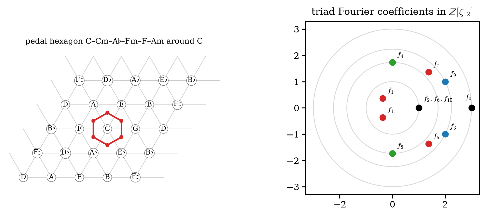
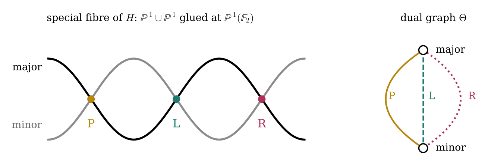

<div align="center">

# Prime cadences: Ihara zeta, graphene, and voice-leading homology on the Tonnetz

**Ergentics**

*November 2026*

[](paper/prime-cadences.pdf)
[](paper/prime-cadences.tex)
[](README.md)

</div>

---

## Abstract

The 24 major and minor triads, joined by the neo-Riemannian moves $P, L, R$, form a 3-regular graph $X$. We call the primes of its Ihara zeta function *prime cadences* and prove a number of exact statements about them. $X$ is the honeycomb lattice on a 12-cell torus; its zeta zeros are the tight-binding band energies, equal to the moduli of the triad's discrete Fourier coefficients, and $X$ is Ramanujan. Over $\mathbb{Q}$, $\zeta_X^{-1}$ factors into Weil polynomials over $\mathbb{F}_2$. The sequence of moving notes alone determines a cadence (*tune theorem*), and for other equal-tempered systems the tune determines every moving voice. The voices' net winding is a torus homology coordinate, asymptotically Gaussian with variance $m/24$, and twisting by it preserves the Riemann hypothesis on an explicit window. Three involutions of $PGL_2(\mathbb{Q}_2)$, one per move, generate a Schottky group whose Mumford curve $C$ has genus 13, reduction graph $X$ and automorphism group the transposition/inversion group. We compute its component group and gonality, find its order-12 factor in an explicit genus-5 curve over $\mathbb{F}_2$ (genus 5 is minimal), and show via a trace invariant and a 2-adic edge-length argument that $C$ admits no Čerednik–Drinfeld uniformisation except possibly by a group with torsion at a ramified or inert place above 2. We separate known results from new ones.

---

## Contents

1. [Introduction](#1-introduction)
2. [Set-up](#2-set-up)
   - 2.1 [Triads, moves and the chord graph](#21-triads-moves-and-the-chord-graph)
   - 2.2 [The Ihara zeta function](#22-the-ihara-zeta-function)
   - 2.3 [Tonnetz coordinates](#23-tonnetz-coordinates)
3. [Spectrum, graphene and arithmetic](#3-spectrum-graphene-and-arithmetic)
   - 3.1 [The arithmetic of the spectrum](#31-the-arithmetic-of-the-spectrum)
   - 3.2 [Eisenstein ideals: refuted and corrected](#32-eisenstein-ideals-refuted-and-corrected)
4. [Melody: the tune theorem](#4-melody-the-tune-theorem)
   - 4.1 [Other tuning systems](#41-other-tuning-systems)
5. [Voice threads and the winding law](#5-voice-threads-and-the-winding-law)
   - 5.1 [Flux](#51-flux)
6. [The homology law](#6-the-homology-law)
7. [The geometric object: a 2-adic Mumford curve](#7-the-geometric-object-a-2-adic-mumford-curve)
   - 7.1 [A Schottky group generated by $P, L, R$](#sec-7-1)
   - 7.2 [The tower over the two-line curve](#72-the-tower-over-the-two-line-curve)
   - 7.3 [Tropical invariants: sandpile group and gonality](#73-tropical-invariants-sandpile-group-and-gonality)
   - 7.4 [Curves over $\mathbb{F}_2$](#sec-7-4)
   - 7.5 [No Shimura curve over $\mathbb{Q}$](#sec-7-5)
   - 7.6 [No arithmetic uniformisation of $C$ at all](#sec-7-6)
   - 7.7 [Other Schottky groups with quotient $X$](#sec-7-7)
8. [What is known and what is new](#8-what-is-known-and-what-is-new)
   - [Data and code availability](#data-and-code-availability)
   - [Contributions and provenance](#contributions-and-provenance)
- [References](#references)

---

## 1. Introduction

Euler drew a lattice of fifths and thirds in 1739 [[20](#ref-20)]; Riemann's harmonic dualism and its neo-Riemannian revival [[29](#ref-29), [12](#ref-12), [13](#ref-13), [14](#ref-14)] turned that lattice into a space of chords linked by parsimonious moves. Douthett and Steinbach [[17](#ref-17)] identified the chord graph as the hexagonal "chicken-wire torus", and Crans, Fiore and Satyendra [[15](#ref-15)] showed that the $PLR$-group is dihedral of order 24 and acts simply transitively. Tymoczko and collaborators [[47](#ref-47), [9](#ref-9), [48](#ref-48)] placed these structures inside continuous voice-leading orbifolds.

On the number-theoretic side, Ihara [[24](#ref-24)] attached a zeta function to discrete subgroups of $PGL_2$ over $p$-adic fields; Serre observed that it is the zeta function of a finite regular graph, and Sunada, Hashimoto and Bass [[43](#ref-43), [22](#ref-22), [6](#ref-6)] developed the general theory (see also [[42](#ref-42), [45](#ref-45)]). Ramanujan graphs [[31](#ref-31)], named after Ramanujan's conjecture on $\tau(n)$ [[38](#ref-38)] (proved by Deligne [[16](#ref-16)]), are those whose zeta functions satisfy the analogue of the Riemann hypothesis.

This note joins these lines. Throughout, a *cadence* is a closed walk in the chord graph, and a *prime cadence* is an Ihara prime. The results are of three kinds: identifications that are classical once stated (graphene, Coxeter groups); theorems that we believe are new (tune theorem, winding law, Riemann window, the arithmetic of the spectrum); and one refuted conjecture with its correction (Eisenstein ideals). All numerical claims were checked in exact or 50-digit arithmetic; [Section 8](#8-what-is-known-and-what-is-new) lists what is known.

---

## 2. Set-up

### 2.1 Triads, moves and the chord graph

Pitch classes are $\mathbb{Z}_{12}$. A major triad with root $r$ is $\{r, r + 4, r + 7\}$ and a minor triad with root $r$ is $\{r, r + 3, r + 7\}$. The moves are

```math
\begin{aligned}
P &: \{r, r + 4, r + 7\} \leftrightarrow \{r, r + 3, r + 7\}, \\
L &: \{r, r + 4, r + 7\} \leftrightarrow \{r + 4, r + 7, r + 11\}, \\
R &: \{r, r + 4, r + 7\} \leftrightarrow \{r + 9, r, r + 4\}.
\end{aligned}
```

Each move keeps two notes and moves the third by a semitone ($P, L$) or a whole tone ($R$). Let $X$ be the graph with the 24 triads as vertices and an edge for each move; it is 3-regular with $V = 24$, $E = 36$, and bipartite (major/minor).

<a id="prop-2-1"></a>

> **Proposition 2.1 ([[15](#ref-15)]).** `[lit.]` The group generated by $P, L, R$ acting on triads is dihedral of order 24 and acts simply transitively. Hence $X$ is the Cayley graph
>
> ```math
> X \cong \mathrm{Cay}(D_{12}, \{P, L, R\}), \qquad P = L(LR)^4, \quad R = L(LR).
> ```

Let $W_3 = \mathbb{Z}_2 \ast \mathbb{Z}_2 \ast \mathbb{Z}_2 = \langle p, l, r \rangle$ be the universal Coxeter group of rank 3; its Cayley graph is the 3-regular tree $T_3$, which is the Bruhat–Tits tree of $PGL_2(\mathbb{Q}_2)$.

<a id="cor-2-2"></a>

> **Corollary 2.2.** `[GB]` The kernel $K$ of $W_3 \to D_{12}$ equals $\pi_1(X)$ and is free of rank $E - V + 1 = 13$. Non-backtracking walks in $X$ are reduced words in $W_3$, and prime cadences are in bijection with the primitive conjugacy classes of $K$. Thus $\zeta_X$ is the Ihara–Selberg zeta function of the lattice $K$ acting on $T_3$, Ihara's original setting with $q = 2$.

*Proof.* $X = K \backslash T_3$ since $D_{12}$ acts simply transitively. A free action on a tree gives a free group of rank $E - V + 1$. Closed non-backtracking, tailless walks up to rotation correspond to cyclically reduced words up to cyclic permutation, i.e. conjugacy classes in $K$. $\square$

### 2.2 The Ihara zeta function

For a finite graph, $\zeta_X(u) = \prod_{[\gamma]}(1 - u^{\ell(\gamma)})^{-1}$ over prime cycles. For $X$ $(q + 1)$-regular,

<a id="eq-2-1"></a>

```math
\zeta_X(u)^{-1} = (1 - u^2)^{E - V} \det(I - uA + qu^2 I) = \det(I - uB), \tag{2.1}
```

where $A$ is the adjacency matrix and $B$ is the $2E \times 2E$ Hashimoto (non-backtracking) matrix [[24](#ref-24), [22](#ref-22), [6](#ref-6), [27](#ref-27)]. $X$ is *Ramanujan* if every eigenvalue $\lambda \neq \pm(q + 1)$ of $A$ satisfies $|\lambda| \le 2\sqrt{q}$; equivalently all nontrivial poles lie on $|u| = q^{-1/2}$.

### 2.3 Tonnetz coordinates

Let $\mathbb{Z}^2 \ni (a, b)$ map to the pitch class $7a + 4b$ (fifths and major thirds). The kernel is the lattice $\Lambda$ with basis $P_u = (4, -4)$, $P_v = (0, 3)$; $\mathbb{Z}^2 / \Lambda \cong \mathbb{Z}_{12}$. With unit edges at $60^\circ$ the Gram matrix of $(P_u, P_v)$ is $`G = \begin{pmatrix} 16 & -6 \\ -6 & 9 \end{pmatrix}`$, $\det G = 108$. Triads are the triangles of the triangulated plane modulo $\Lambda$ (the Tonnetz torus), and $P, L, R$ are flips across the three edge directions. Dually, $X$ is the honeycomb lattice modulo $\Lambda$ ([Figure 1](#fig-1)).

<a id="fig-1"></a>

<p align="center">
  
</p>

> **Figure 1:** Left: the Tonnetz with the six triads containing C; the length-6 prime cadence around them (a held-note hexagon) is a hexagonal face of the honeycomb. Right: the twelve Fourier coefficients $f_k$ of the major triad: units (red), the Gaussian primes $2 \mp i$ (blue), $\pm i\sqrt{3}$ (green).

---

## 3. Spectrum, graphene and arithmetic

Write $\zeta = e^{2\pi i/12}$, $\omega = \zeta^4$, and $f_k = \zeta^0 + \zeta^{4k} + \zeta^{7k}$, the $k$-th Fourier coefficient of the indicator of $\{0, 4, 7\}$.

<a id="thm-3-1"></a>

> **Theorem 3.1 (spectrum).** `[E→GB]` The adjacency eigenvalues of $X$ are $\pm |f_k|$, $k \in \mathbb{Z}_{12}$. Explicitly: $\pm 3$ ($k = 0$); $\pm 1$ three times each ($k = 2, 6, 10$); $\pm\sqrt{5}$ twice ($k = 3, 9$); $\pm\sqrt{3}$ twice ($k = 4, 8$); $\pm 2\cos\frac{\pi}{12}$ and $\pm 2\cos\frac{5\pi}{12}$ twice each ($k = 1, 5, 7, 11$). In particular $X$ is Ramanujan, with largest nontrivial eigenvalue $\sqrt{5} < 2\sqrt{2}$.

*Proof.* Index triads by (type, root). From the major triad of root $r$, $P, L, R$ lead to the minor triads of roots $r, r + 4, r + 9$. Thus $`A = \begin{pmatrix} 0 & C \\ C^\ast & 0 \end{pmatrix}`$ with $C$ the circulant $I + S^4 + S^9$ ($S$ the shift). Fourier diagonalisation gives $C \mapsto g_k = 1 + \zeta^{4k} + \zeta^{9k}$, and the eigenvalues of $A$ are $\pm |g_k|$. Now $\{0, 4, 9\} = 9 + \{0, 3, 7\}$ and $\{0, 3, 7\} = 7 - \{0, 4, 7\}$; translation multiplies a Fourier coefficient by a root of unity and reflection conjugates it, so $|g_k| = |f_k|$. The values follow by direct evaluation. (This is an instance of the spectrum of a dihedral Cayley graph; cf. the discussion in [[34](#ref-34)].) The 1-dimensional representations of $D_{12}$ give $k = 0, 6$ and the 2-dimensional ones $\rho_j$ give $k = 7j$. $\square$

<a id="rem-3-2"></a>

*Remark 3.2 (graphene).* $C$ is the Bloch matrix of nearest-neighbour hopping on the honeycomb with bonds from cell $r$ to cells $r, r + 4, r + 9$; the spectrum is $\pm |\Delta(\mathbf{k})|$ (Wallace [[50](#ref-50)]) sampled at the 12 momenta of $\Lambda^\ast / \mathbb{Z}^{2\ast}$. The identification of these numbers with the triad Fourier magnitudes is in Marín Muñoz [[34](#ref-34)]. The Ramanujan property means that no allowed momentum lies in the cap $|\Delta| > 2\sqrt{2}$ around $\Gamma$ (4.8% of the Brillouin zone). The note Tonnetz is the "square" of the honeycomb: $A^2$ restricted to major triads is $3I + \mathrm{Cay}(\mathbb{Z}_{12}, \{\pm 3, \pm 4, \pm 5\})$, a square-root-lattice relation in the sense of [[2](#ref-2)].

<a id="thm-3-3"></a>

> **Theorem 3.3 (counting).** `[GB]` Let $N_m = \operatorname{tr} B^m$ and $\pi(m)$ the number of prime cadences of length $m$. Then $N_m = \sum_{j=1}^{48} u_j^{-m} + 12(1 + (-1)^m)$ where $u_j$ are the zeros of $\det(I - uA + 2u^2)$, $\pi(m) = 0$ for $m$ odd, $\pi(m) = \frac{1}{m}\sum_{d \mid m} \mu(m/d) N_d$, and $\pi(m) \sim 2^{m+1}/m$ for even $m \to \infty$.

*Proof.* Take logarithmic derivatives in [(2.1)](#eq-2-1); the factor $(1 - u^2)^{12}$ contributes $12(1 + (-1)^m)$. Möbius inversion of $N_m = \sum_{d \mid m} d\,\pi(d)$ gives $\pi(m)$. Bipartiteness kills odd $m$, and the poles $u = \pm\frac{1}{2}$ dominate, the others having $|u| \ge 2^{-1/2}$. $\square$

<a id="table-1"></a>

| $m$ | $6$ | $8$ | $10$ | $12$ | $14$ | $16$ | $20$ | $24$ | $40$ |
| :--- | ---: | ---: | ---: | ---: | ---: | ---: | ---: | ---: | ---: |
| $\pi(m)$ | $32$ | $78$ | $240$ | $576$ | $2400$ | $8196$ | $105096$ | $1394120$ | $54975717792$ |
| $\pi(m)\,m / 2^{m+1}$ | $1.500$ | $1.219$ | $1.172$ | $0.844$ | $1.025$ | $1.000$ | $1.002$ | $0.997$ | $1.000$ |

> **Table 1:** Prime cadences by length (exact, by transfer matrix; verified against [(2.1)](#eq-2-1)).

<a id="fig-2"></a>

<p align="center">
  
</p>

> **Figure 2:** Left: prime cadence counts against the prime number theorem $2^{m+1}/m$. Right: poles of $\zeta_X$; the 44 nontrivial ones lie on $|u| = 2^{-1/2}$ (Riemann hypothesis); crosses mark $u = \pm 1, \pm\frac{1}{2}$.

Chebotarev for graph coverings [[42](#ref-42), [22](#ref-22)]: $X$ is a $\mathbb{Z}_{12}$ (transposition) cover of the theta graph, so long cadences return to their starting chord with density $1/12$; we observed maximal deviation below $10^{-6}$ at $m = 40$.

### 3.1 The arithmetic of the spectrum

<a id="thm-3-4"></a>

> **Theorem 3.4.** `[E→GB]` The coefficients $f_k$ lie in $\mathbb{Z}[\zeta]$, and
>
> 1. $f_3 = 2 - i$, $f_9 = 2 + i$: the split Gaussian primes above $5$;
> 2. $f_4 = i\sqrt{3} = 1 + 2\omega$, $f_8 = -i\sqrt{3}$: the ramified prime of $\mathbb{Z}[\omega]$ above $3$;
> 3. for $k \in \{1, 5, 7, 11\}$, $f_k$ is a unit of $\mathbb{Z}[\zeta]$, with $|f_5|^2 = |f_7|^2 = 2 + \sqrt{3} = \varepsilon$, the fundamental unit of $\mathbb{Q}(\sqrt{3})$, and $|f_1|^2 = |f_{11}|^2 = \varepsilon^{-1}$; the minimal polynomial of $f_1$ is $x^4 - 2x^3 + 2x^2 + 2x + 1$.
>
> The Galois group $(\mathbb{Z}/12)^\times$ acts by $\sigma_a f_k = f_{ak}$. The element $\sigma_{11}$ is induced by inversion $x \mapsto -x$, an automorphism of $X$ exchanging major and minor. The elements $\sigma_5, \sigma_7$ are induced by the multiplications $M_5, M_7$; they are not automorphisms of $X$, but $M_7$ maps the 24 consonant triads bijectively onto the 24 transpositions and inversions of the set class $[0, 1, 4]$ and maps $X$ isomorphically onto the graph of single-note parsimonious moves among them.

*Proof.* (1)–(2): $f_3 = 1 + \zeta^{12} + \zeta^{21} = 2 + \zeta^9 = 2 - i$, and $f_4 = 1 + \zeta^{16} + \zeta^{28} = 1 + 2\omega$ with $(1 + 2\omega)^2 = -3$. (3): the minimal polynomial of $f_1$ (computed exactly) has constant term $1$, so $N_{\mathbb{Q}(\zeta)/\mathbb{Q}}(f_1) = 1$ and $f_1$ is a unit; its conjugates are the $f_k$, $k \in (\mathbb{Z}/12)^\times$. Further $f_5 = 1 + \zeta^8 + \zeta^{11}$, so $|f_5|^2 = 3 + 2(\cos 240^\circ + \cos 330^\circ + \cos 90^\circ) = 2 + \sqrt{3}$, and $|f_1|^2 |f_5|^2 = N(f_1) = 1$. Galois: $\sigma_a(\zeta^{kx}) = \zeta^{akx}$. $M_7\{0, 4, 7\} = \{0, 4, 1\}$; the edge correspondence was checked on all 36 edges. $\square$

So, read arithmetically, the eigenvalue $\sqrt{5}$ (the augmented-triad / diminished-seventh character of order 4) is the modulus of a Gaussian prime, $\sqrt{3}$ (the order-3 character) the modulus of the Eisenstein prime, and the primitive characters give square roots of $\varepsilon^{\pm 1}$.

<a id="thm-3-5"></a>

> **Theorem 3.5 ($\zeta_X$ over $\mathbb{Q}$).** `[GB]` The characteristic polynomial of $A$ is $(x - 3)(x + 3)(x - 1)^3(x + 1)^3(x^2 - 5)^2(x^2 - 3)^2(x^4 - 4x^2 + 1)^2$, and
>
> ```math
> \zeta_X(u)^{-1} = (1 - u^2)^{12}(1 - u)(1 - 2u)(1 + u)(1 + 2u)\,L_1^3 L_1'^3 L_2^2 L_2'^2 L_4^2,
> ```
>
> with $L_1 = 1 - u + 2u^2$, $L_1' = 1 + u + 2u^2$, $L_2 = 1 - u^2 + 4u^4$, $L_2' = 1 + u^2 + 4u^4$, $L_4 = 1 + 4u^2 + 9u^4 + 16u^6 + 16u^8$. Each of $L_1, L_1', L_2, L_2', L_4$ is the reversed characteristic polynomial of Frobenius of a simple isogeny class of abelian varieties over $\mathbb{F}_2$ (Honda–Tate [[44](#ref-44), [23](#ref-23)]); in LMFDB [[46](#ref-46)] labels: $L_1$: `1.2.ab`, the curve $y^2 + xy = x^3 + x^2 + 1$, Frobenius field $\mathbb{Q}(\sqrt{-7})$, which is the Euler factor at $2$ of the CM newform `49.2.a.a`; $L_1'$: `1.2.b`; $L_2$: `2.2.a_ab`, a Jacobian with endomorphism algebra $\mathbb{Q}(\sqrt{-3}, \sqrt{5})$; $L_2'$: `2.2.a_b`, endomorphism algebra $\mathbb{Q}(\sqrt{3}, \sqrt{-5})$; $L_4$: `4.2.a_e_a_j`, a simple fourfold that is not a Jacobian. The factor $(1 - u)(1 - 2u)$ is the zeta denominator of $\mathbb{P}^1_{\mathbb{F}_2}$.

*Proof.* For each eigenvalue $\lambda$ the Ihara factor is $1 - \lambda u + 2u^2$; multiply over Galois orbits. A polynomial $1 - \lambda u + 2u^2$ with $|\lambda| \le 2\sqrt{2}$ has reciprocal roots of modulus $\sqrt{2}$, so each orbit product is a Weil 2-polynomial; irreducibility over $\mathbb{Q}$ was checked, and the labels and endomorphism data were read from LMFDB. $\square$

<a id="rem-3-6"></a>

*Remark 3.6.* The Ramanujan property of $X$ is here literally the Hasse–Weil bound for these isogeny classes; the total dimension $3 \cdot 1 + 3 \cdot 1 + 2 \cdot 2 + 2 \cdot 2 + 2 \cdot 4 = 22$ equals the number of nontrivial eigenvalues. This is a factor-by-factor identification; we do not claim a variety over $\mathbb{F}_2$ whose zeta function is $\zeta_X$. Over $\mathbb{F}_4$ both surfaces become squares of elliptic curves with CM by $\mathbb{Q}(\sqrt{-15})$, and $\mathbb{Q}(\sqrt{-3}, \sqrt{5})$ is the Hilbert class field of $\mathbb{Q}(\sqrt{-15})$.

### 3.2 Eisenstein ideals: refuted and corrected

It is tempting to view the Tonnetz as $\mathbb{Z}[\omega]$ modulo an ideal. This fails.

<a id="prop-3-7"></a>

> **Proposition 3.7.** `[E→GB]` No additive surjection $\mathbb{Z}[\omega] \to \mathbb{Z}_{12}$ sending $1$ and $1 + \omega$ to a fifth and a major third (any of the 12 assignments of the Tonnetz axes) has an ideal as kernel; the multiplier ring of each kernel is $\mathbb{Z} + 12\mathbb{Z}[\omega]$. Moreover $\mathbb{Z}_{12}$ is not a quotient ring of $\mathbb{Z}[\omega]$, $\mathbb{Z}[i]$ or $\mathbb{Z}[\zeta]$.

*Proof.* A ring quotient $\mathbb{Z}[\omega] \to \mathbb{Z}_{12}$ needs a root of $x^2 + x + 1$ modulo $4$, and there is none since $2$ is inert; similarly $x^2 + 1$ has no root mod $4$ and $\Phi_{12} = x^4 - x^2 + 1$ has no root mod $3$ or mod $4$. The multiplier rings were computed exactly for all 12 maps. For example, with $\psi(a + b\omega) = 7a + 9b$, $\psi(-12 - 8\omega) = 0$ but $\psi(\omega(-12 - 8\omega)) = 8$. $\square$

<a id="thm-3-8"></a>

> **Theorem 3.8.** `[E→GB]` Let $\mathcal{O} = \mathbb{Z}[\sqrt{-3}]$, the order of conductor $2$ in $\mathbb{Q}(\sqrt{-3})$. The ring map $\psi(x + y\sqrt{-3}) = x + 3y$ induces
>
> ```math
> \mathbb{Z}_{12} \cong \mathcal{O} \big/ \bigl(\sqrt{-3}\,(1 + \sqrt{-3})\bigr),
> ```
>
> a principal ideal of norm $12$, under which the minor third is $\sqrt{-3}$, the major third $1 + \sqrt{-3}$, the fifth $1 + 2\sqrt{-3}$ and the semitone $1$. Multiplication by $\sqrt{-3}$ acts on pitch classes as $x \mapsto 3x$. Among the orders $\mathbb{Z}[f\omega]$, exactly those with $f$ even admit $\mathbb{Z}_{12}$ as a quotient ring.

*Proof.* $\psi$ is a ring map since $\psi(\sqrt{-3})^2 = 9 \equiv -3$. Its kernel contains $3 - \sqrt{-3} = -\sqrt{-3}(1 + \sqrt{-3})$, of norm $12$, and $\psi$ is onto, so this is the kernel. The basis $\{\sqrt{-3}, 1 + \sqrt{-3}\}$ is unimodular, so the triangulation by minor and major thirds is preserved. For $\mathbb{Z}[f\omega]$ one needs a root of $x^2 + fx + f^2$ (the minimal polynomial of $f\omega$) mod $4$ and mod $3$; mod $4$ this exists iff $f$ is even. $\square$

<a id="rem-3-9"></a>

*Remark 3.9.* The torus $\mathbb{C}/\mathcal{O}$ has $j = 54000$. It is not the equilateral (musical) torus: there the triad sides are equal, the period ratio is $\tau = -\frac{3}{8} + \frac{3\sqrt{3}}{8}i$ with minimal form $(9, -6, 13)$ of discriminant $-432$ and class number $6$, and the multiplier ring is the order of conductor $12$. So the *geometry* of harmony has conductor $12$ while its *arithmetic* lives in conductor $2$. The obstruction at $2$ vanishes because $\mathcal{O}/(2) \cong \mathbb{F}_2[\epsilon]/(\epsilon^2)$ is non-reduced; the major third $1 + \sqrt{-3}$ is the factor in $4 = (1 + \sqrt{-3})(1 - \sqrt{-3})$.

---

## 4. Melody: the tune theorem

Along a non-backtracking cadence $c = (T_0, T_1, \dots, T_m = T_0)$ exactly one note changes at each step; let $n_i$ be the note that arrives at step $i$. The *tune* of $c$ is the cyclic word $(n_1, \dots, n_m)$.

<a id="lem-4-1"></a>

> **Lemma 4.1.** `[E→GB]` (L1) At each triad the three moves change three different notes. (L2) Only the backtracking move changes the note that has just arrived. (L3) No major or minor triad contains two notes $1$ or $2$ semitones apart, while every move changes a note by $1$ or $2$ semitones.

*Proof.* Exhaustive check over the 72 directed edges; (L3) since the intervals of $\{0, 4, 7\}$ and $\{0, 3, 7\}$ are $3, 4, 5$ up to inversion. $\square$

<a id="thm-4-2"></a>

> **Theorem 4.2 (tune theorem).** `[E→GB]` The tune of a non-backtracking cadence determines the cadence. Consequently the map from prime cadences to tunes is injective and preserves primitivity: no prime cadence has a periodic tune.

*Proof.* By (L2), $T_i \ni n_{i-1}, n_i$. If the voices moved at $i$ and $i - 2$ differ, then $T_i = \{n_{i-2}, n_{i-1}, n_i\}$ is a consonant triad. If they coincide, then $n_{i-2} \to n_i$ is a single move of one voice and by (L3) $\{n_{i-2}, n_{i-1}, n_i\}$ is not a consonant triad. Hence the tune determines which steps move the same voice, hence the partition of steps into voices, hence each $T_i = \{n_i, n_{i-1}, \text{latest arrival of the third voice}\}$. If only two voices ever move (the 24 held-note hexagons), the held note is the unique note completing every consecutive pair to a triad. The decoding is local and commutes with rotation, so the period of the tune equals the period of the cadence. $\square$

We verified the decoder on all 131,136 rooted primes of length $\le 16$.

### 4.1 Other tuning systems

Let $N \ge 5$, let $S \subset \{1, \dots, \lfloor N/2 \rfloor\}$ be a set of *step* sizes, and let $\mathcal{C}$ be a transposition (or transposition/inversion) class of three-note chords in $\mathbb{Z}_N$ such that no two notes of a chord are a step apart. Join two chords when they differ in one note and that note moves by a step. The 12-tone case is $S = \{1, 2\}$ with the consonant triads.

<a id="thm-4-3"></a>

> **Theorem 4.3 (general reduction).** `[E→GB]` In any such system, the tune of a closed non-backtracking walk determines the full path of every voice that moves at least once: the note $n_j$ arriving at step $j$ leaves at the first later step $i$ for which $n_i - n_j \in \pm S$. In particular the tune determines the walk whenever all three voices move, and the theorem can only fail through the held notes of walks in which one voice never moves.

*Proof.* At step $i$ the departing note $d$ lies in $T_{i-1}$ and $n_i - d \in \pm S$. Any other $x \in T_{i-1} \setminus \{d\}$ lies in $T_i$ together with $n_i$, so $n_i - x \notin \pm S$. Thus $d$ is the unique note of $T_{i-1}$ at step distance from $n_i$, and a note present in the chord stays until the first arrival at step distance from it. $\square$

For walks in which a voice is held, injectivity is equivalent to a finite condition: no closed walk in the "link" graph of pairs (respectively single notes) that complete to chords with two different held notes. We checked this criterion exactly for every system with $N \le 72$, $S = \{1\}$ or $\{1, 2\}$ and either symmetry type, which gives 6028 systems, by two independent implementations (and by brute force over all closed non-backtracking walks for $N \le 24$). There is no counterexample. Non-backtracking is needed: $\mathrm{C} \to \mathrm{Cm} \to \mathrm{C}$ and $\mathrm{E} \to \mathrm{A}\flat\mathrm{m} \to \mathrm{E}$ both have the tune $(\mathrm{E}\flat, \mathrm{E})$ up to rotation.

---

## 5. Voice threads and the winding law

Track each voice continuously (in $\mathbb{Z}$, not $\mathbb{Z}_{12}$). Around a closed cadence the total displacement of the three voices is $12W$ for an integer $W$, the *winding*. A cadence also has a homology class $(u, v) \in H_1(\text{torus}) \cong \mathbb{Z}^2$ with respect to $P_u, P_v$.

<a id="thm-5-1"></a>

> **Theorem 5.1 ($W = -u$).** `[GB]` Every flip moves one vertex of the triangle by
>
> ```math
> \delta \in \{\pm(1, -2),\; \pm(1, 1),\; \pm(-2, 1)\},
> ```
>
> all in the coset lattice $\{2a + b \equiv 0 \bmod 3\}$, and the voice moves by $-\delta_a$ semitones. Hence each voice stays in a fixed coset and its continuous pitch is $-a + \text{const}$, and $W = -u$. The $u$-period permutes the three voices cyclically, the $v$-period fixes them. In particular the voices return home exactly when $u = 0$, and every voice moves by an octave exactly when $u = \pm 3$.

*Proof.* For a flip, the moving vertex is reflected across the opposite edge; in Tonnetz coordinates the six possible displacements are as listed (checked on all 72 directed moves), and the pitch change $7\delta_a + 4\delta_b$ reduces to $-\delta_a$ in $\{\pm 1, \pm 2\}$, e.g. $\delta = (1, -2)$ gives $7 - 8 = -1$. Summing along a closed cadence the $a$-displacements total the $a$-component of $uP_u + vP_v$, and since the triangle returns to itself translated by $uP_u + vP_v$, the three vertex tracks together have $a$-displacement $3 \cdot 4u = 12u$; so the total voice displacement is $-12u$. The $u$-period $(4, -4)$ changes $2a + b$ by $4 \equiv 1 \pmod 3$, cycling the cosets; $(0, 3)$ changes it by $3 \equiv 0$. $\square$

The first prime cadences with $u = \pm 3$ occur at length 24, for example the alternating cadence $(RL)^{12}$ through all 24 triads, along which each voice rises by exactly one octave. The voice colouring of honeycomb edges is the Kekulé ($\sqrt{3} \times \sqrt{3}$) colouring; it lives on the triple cover $W \bmod 3$, not on the torus.

### 5.1 Flux

For $\varphi \in \mathbb{R}$, let $A_\varphi$ be the adjacency operator twisted by $e^{i\theta s}$ on a move that shifts a voice by $s$ semitones, $\theta = \varphi/12$. On closed walks the total phase is $e^{i\varphi W}$, so $A_\varphi$ is the twist by the unitary character $\chi_\varphi : \pi_1(X) \to U(1)$, $\gamma \mapsto e^{i\varphi W(\gamma)}$; for $\varphi = 2\pi j/n$ it is an Artin–Ihara $L$-function of the $\mathbb{Z}_n$ winding cover. The Bass identity holds for unitary twists, $\det(I - uB_\varphi) = (1 - u^2)^{12}\det(I - uA_\varphi + 2u^2)$.

<a id="thm-5-2"></a>

> **Theorem 5.2 (twisted spectrum).** `[GB]` The eigenvalues of $A_\varphi$ are $\pm \lambda_k(\varphi)$ with $\lambda_k(\varphi) = |1 + \zeta^{4k} + e^{i\varphi/4}\zeta^{9k}|$, $k \in \mathbb{Z}_{12}$.

*Proof.* From the major triad of root $r$, $P$ and $L$ shift a voice by $-1$ and $R$ by $+2$. So the twisted block is $C_\theta = e^{-i\theta}(I + S^4) + e^{2i\theta}S^9$, with Fourier symbol $e^{-i\theta}(1 + \zeta^{4k} + e^{3i\theta}\zeta^{9k})$ and $3\theta = \varphi/4$. $\square$

<a id="thm-5-3"></a>

> **Theorem 5.3 (Riemann window).** `[E→GB]` For $\varphi \in [0, 2\pi)$, all eigenvalues of $A_\varphi$ satisfy $|\lambda| \le 2\sqrt{2}$ (the Riemann hypothesis for $L(u, \chi_\varphi)$) if and only if
>
> ```math
> \varphi \in \left[4\arccos\frac{3}{4},\; 2\pi - 4\arccos\frac{3}{4}\right] \approx [2.8909,\, 3.3922].
> ```
>
> Consequently, among the cyclic winding covers $X_n$ ($\mathbb{Z}_n$-covers through $W \bmod n$), $X_n$ is Ramanujan iff $n \le 2$. The double cover $X_2$ (48 triads, voice parity) is a Ramanujan 2-lift in the sense of Bilu–Linial [[8](#ref-8)], with top new eigenvalue $\sqrt{5 + 2\sqrt{2}} \approx 2.798$.

*Proof.* If $4k \not\equiv 0 \pmod{12}$ then $|1 + \zeta^{4k}| = 1$ and $\lambda_k \le 2 < 2\sqrt{2}$. If $k \in \{0, 3, 6, 9\}$ then $\zeta^{4k} = 1$ and $\lambda_k^2 = |2 + e^{i(\varphi/4 + j\pi/2)}|^2 = 5 + 4\cos(\varphi/4 + j\pi/2)$, $j = 0, 3, 2, 1$. The condition $\lambda^2 \le 8$ reads $\cos(\cdot) \le \frac{3}{4}$. For $\varphi/4 \in [0, \pi/2)$ the largest of the four cosines is $\max(\cos\frac{\varphi}{4}, \sin\frac{\varphi}{4})$, so the condition is $\frac{\varphi}{4} \in [\arccos\frac{3}{4}, \arcsin\frac{3}{4}]$, and $4\arcsin\frac{3}{4} = 2\pi - 4\arccos\frac{3}{4}$. The cover $X_n$ is Ramanujan iff all characters $\varphi = 2\pi j/n$, $1 \le j < n$, lie in the window; for $n \ge 3$, $j = 1$ gives $\varphi \le 2\pi/3 < 2.89$. For $n = 2$, $\varphi = \pi$ gives $\max\lambda^2 = 5 + 2\sqrt{2}$. $\square$

<a id="rem-5-4"></a>

*Remark 5.4.* At $\varphi = 2\pi/3$ the flux lands on a Dirac point ($\lambda_k = 0$ for some $k$), which the untwisted torus lacks. Ramanujan signings of $X$ are not rare: of the 8191 nontrivial classes of signings ($2^{13}$ characters of $\pi_1$ to $\pm 1$), 7675 are Ramanujan, the best with top eigenvalue $1 + \sqrt{2}$; the voice-parity signing ranks 7372 of 8192. Thus the musical double cover is canonical but not extremal, and the existence theorem of Marcus–Spielman–Srivastava [[33](#ref-33)] adds nothing specific here.

<a id="fig-3"></a>

<p align="center">
  
</p>

> **Figure 3:** Left: the largest twisted eigenvalue against flux; the shaded band is the Riemann window of [Theorem 5.3](#thm-5-3). Right: distribution of the voice winding $W$ over all $5.5 \times 10^{10}$ prime cadences of length $40$, against $\mathcal{N}(0, 40/24)$.

---

## 6. The homology law

<a id="thm-6-1"></a>

> **Theorem 6.1 (winding law).** `[GB]` Let $\pi(m, w)$ be the number of prime cadences of length $m$ (even) with winding $W = w$. Then, uniformly for $w = O(\sqrt{m})$,
>
> ```math
> \pi(m, w) \sim \frac{2^{m+1}}{m} \sqrt{\frac{12}{\pi m}}\, e^{-12w^2/m},
> ```
>
> so $W$ is asymptotically Gaussian with variance $m/24$. More generally the homology class $(u, v)$ has covariance $`\frac{m}{2} G^{-1} = m\begin{pmatrix} 1/24 & 1/36 \\ 1/36 & 2/27 \end{pmatrix}`$: isotropic Brownian motion on the Tonnetz plane with unit mean-square displacement per step.

*Proof sketch.* By [Theorem 5.2](#thm-5-2) and [(2.1)](#eq-2-1) for $B_\varphi$, $\operatorname{tr} B_\varphi^m = \sum_k (\alpha_k^m + \beta_k^m) + 12(1 + (-1)^m)$, where $\alpha, \beta$ solve $x^2 - \lambda x + 2 = 0$. The dominant branch near $\varphi = 0$ is $\lambda(\varphi) = |2 + e^{i\varphi/4}| = \sqrt{5 + 4\cos(\varphi/4)}$, with $\rho(\varphi) = \frac{1}{2}(\lambda + \sqrt{\lambda^2 - 8})$. Expanding, $\lambda \approx 3 - \varphi^2/48$, $d\rho/d\lambda = 2$ at $\lambda = 3$, so $\log\rho(\varphi) = \log 2 - \varphi^2/48 + O(\varphi^4)$. The number of closed non-backtracking walks with winding $w$ is $\frac{1}{2\pi}\int \operatorname{tr} B_\varphi^m e^{-i\varphi w}\,d\varphi$; the Riemann window theorem shows that away from $\varphi = 0$ (and $\varphi = \pm 2\pi$-periodic images, handled by the bipartite branch) the integrand is exponentially smaller, so Laplace's method gives a Gaussian of variance $2m/48 = m/24$; Möbius inversion passes to primes. For the full class, repeat with a two-parameter twist; the Hessian of $-\log\rho$ equals $\frac{1}{2}G^{-1}$, and $\operatorname{tr}(\frac{1}{2}G^{-1}G) = 1$ is the mean-square displacement: non-backtracking honeycomb steps have length $1/\sqrt{3}$ and persistence factor $3$. $\square$

Exact check: at $m = 40$, $\operatorname{Var}(W)/m = 0.041668$ versus $1/24 = 0.041667$ ([Figure 3](#fig-3)). [Theorem 6.1](#thm-6-1) is the graph instance of the prime geodesic theorems in homology classes [[36](#ref-36), [25](#ref-25), [28](#ref-28), [37](#ref-37)]; for graphs see [[30](#ref-30), [32](#ref-32)].

---

## 7. The geometric object: a 2-adic Mumford curve

The Ihara zeta function was born in $p$-adic geometry [[24](#ref-24), [41](#ref-41)]: the Bruhat–Tits tree $\mathcal{T}$ of $PGL_2(\mathbb{Q}_2)$ is 3-regular, a finite 3-regular graph is a quotient $\Gamma \backslash \mathcal{T}$, and when $\Gamma$ is a Schottky group Mumford's construction [[35](#ref-35), [21](#ref-21)] turns $\Gamma \backslash \mathcal{T}$ into the reduction graph of an algebraic curve. This section carries that out explicitly for the chord graph and asks how far the resulting curve is arithmetic.

<a id="sec-7-1"></a>

### 7.1 A Schottky group generated by $P, L, R$

Vertices of $\mathcal{T}$ are homothety classes of $\mathbb{Z}_2$-lattices in $\mathbb{Q}_2^2$; the three neighbours of $v_0 = [\mathbb{Z}_2^2]$ are its index-2 sublattices, indexed by $\mathbb{P}^1(\mathbb{F}_2)$. Put

```math
\sigma_P = \begin{pmatrix} 0 & 1 \\ 2 & 0 \end{pmatrix}, \qquad
\sigma_L = \begin{pmatrix} 0 & 2 \\ 1 & 0 \end{pmatrix}, \qquad
\sigma_R = \begin{pmatrix} -1 & 1 \\ 1 & 1 \end{pmatrix} \in PGL_2(\mathbb{Q}_2).
```

<a id="thm-7-1"></a>

> **Theorem 7.1 (Schottky realisation).** `[GB]`
>
> - *(a)* Each $\sigma_s$ satisfies $\sigma_s^2 = 2I$, so it is an involution of $PGL_2(\mathbb{Q}_2)$; it swaps $v_0$ with one of its neighbours, and the three neighbours reached are distinct.
> - *(b)* $W = \langle \sigma_P, \sigma_L, \sigma_R \rangle \cong \mathbb{Z}_2 \ast \mathbb{Z}_2 \ast \mathbb{Z}_2$, and $W$ acts simply transitively on the vertices of $\mathcal{T}$.
> - *(c)* Let $K$ be the kernel of $W \to PLR \cong D_{12}$, $\sigma_s \mapsto s$. Then $K$ is a Schottky group, free of rank $13$, and $K \backslash \mathcal{T} \cong X$.
> - *(d)* The Mumford curve $C = K \backslash \Omega$ has genus $13$. Its stable reduction is 24 copies of $\mathbb{P}^1_{\mathbb{F}_2}$, one per triad, glued at 36 $\mathbb{F}_2$-rational nodes, one per move, so the dual graph is $X$ ([Figure 4](#fig-4)). Every $\mathbb{F}_2$-point of every component is a node, $\#C_0(\mathbb{F}_{2^n}) = 24 \cdot 2^n - 12$, and $J(C)$ has split toric reduction.

*Proof.* (a) $\sigma_P(x, y) = (y, 2x)$ maps $\mathbb{Z}_2^2$ onto $\mathbb{Z}_2 \oplus 2\mathbb{Z}_2$ and that lattice onto $2\mathbb{Z}_2^2 \sim \mathbb{Z}_2^2$. Up to scalars, $\sigma_L = g\sigma_P g^{-1}$ with $`g = \begin{pmatrix} 0 & 1 \\ 1 & 0 \end{pmatrix}`$ and $\sigma_R = h\sigma_P h^{-1}$ with $`h = \begin{pmatrix} 1 & 0 \\ 1 & 1 \end{pmatrix}`$. Both $g, h \in GL_2(\mathbb{Z}_2)$ fix $v_0$ and send the line $\langle e_1 \rangle$ of $\mathbb{F}_2^2$ to $\langle e_2 \rangle$ and $\langle e_1 + e_2 \rangle$. (b) The orbit map $w \mapsto w v_0$ sends the Cayley tree of $\mathbb{Z}_2^{\ast 3}$ to $\mathcal{T}$, and the neighbours of $w v_0$ are $w \sigma_s v_0$. So the map is a local bijection of 3-regular trees, hence an isomorphism. This forces both freeness of the product and simple transitivity. (c) $K$ is normal of index $24$ and lies in the even (bipartition-preserving) subgroup, so it acts without inversions. It meets no vertex stabiliser, so it acts freely and is free [[41](#ref-41)]. It is discrete and cocompact with no elliptic elements, so it is Schottky [[24](#ref-24), [21](#ref-21)]. $K \backslash \mathcal{T}$ is the coset graph of $W/K$, which is the Cayley graph $X$, and its rank is $E - V + 1 = 13$. (d) This is Mumford's theorem [[35](#ref-35)]: components correspond to vertices of $K \backslash \mathcal{T}$ and double points to its edges. The point count is $24(2^n + 1) - 36$. $\square$

*Verification.* We computed the 13 Schreier generators of $K$ from a spanning tree of $X$ as integer matrices. Their determinants are $2^6$, $2^8$ and $2^{10}$; each is hyperbolic ($2v_2(\operatorname{tr}) < v_2(\det)$), and its translation length on $\mathcal{T}$ equals the length ($6$ or $8$) of its cycle in $X$. For example, the hexagon $(LP)^3$ at $E$ is $\operatorname{diag}(64, 1)$, and the word $PLRLPRPL$ is $`\begin{pmatrix} -5 & 12 \\ 12 & -80 \end{pmatrix}`$, with determinant $2^8$ and trace $-85$. We also checked simple transitivity on the ball of radius $7$ (382 reduced words, all giving distinct vertices).

<a id="prop-7-2"></a>

> **Proposition 7.2 (symmetries).** `[E→GB]` $\operatorname{Aut}(C) \cong D_{12}$. It acts on the reduction graph as the group of transpositions and inversions, the centraliser of the $PLR$-group.

*Proof.* $\operatorname{Aut}(C) = N(K)/K$ [[35](#ref-35), [21](#ref-21)], and this group injects into $\operatorname{Aut}(X)$. Indeed, if $n \in N(K)$ acts trivially on $X$, then after multiplying by an element of $K$ it fixes $v_0$. Local bijectivity of $\mathcal{T} \to X$ then makes it fix every vertex, and $PGL_2(\mathbb{Q}_2)$ acts faithfully on $\mathcal{T}$. A direct computation gives $|\operatorname{Aut}(X)| = 24$. The group $W/K$ already supplies 24 automorphisms, and they preserve the edge colours $P, L, R$. So they commute with the $PLR$-action, and they are Lewin's dual $T/I$ group [[29](#ref-29), [15](#ref-15)]. $\square$

In words: the moves $P, L, R$ build the curve, and transposition and inversion are its symmetries.

<a id="prop-7-3"></a>

> **Proposition 7.3 (not arithmetic).** `[E→GB]` No finite-index subgroup of $K$ is contained in an arithmetic lattice of $PGL_2(\mathbb{Q}_2)$ coming from a quaternion algebra over $\mathbb{Q}$.

*Proof.* A cocompact arithmetic lattice of $PGL_2(\mathbb{Q}_2)$ defined over $\mathbb{Q}$ comes from the $\mathbb{Z}[\frac{1}{2}]$-units of an order in a quaternion algebra $B/\mathbb{Q}$ that is split at $2$ and definite. Its non-central elements have reduced trace $t$ and norm $n > 0$ with $t^2 < 4n$. The quantity $\operatorname{tr}^2 / \det$ is conjugation-invariant, and an element that is hyperbolic at the real place stays hyperbolic in all its powers. The generator above has $\operatorname{tr}^2 / \det = 85^2 / 2^8 > 4$. $\square$

[Proposition 7.3](#prop-7-3) concerns this particular $K$. Other Schottky groups with quotient $X$ exist (move the fixed-point pairs of the three involutions). Whether one of them is arithmetic is the subject of [§7.5](#sec-7-5).

<a id="fig-4"></a>

<p align="center">
  
</p>

> **Figure 4:** Left: the reduction graph of $C$. Vertices are the 24 components $\mathbb{P}^1_{\mathbb{F}_2}$, edges are the 36 nodes, and solid, dashed and dotted lines are $P$, $L$ and $R$. Majors sit on the outer ring and minors on the inner ring, at their level $\ell$ ([Theorem 7.4](#thm-7-4)), which runs through the circle of fifths. Right: the same graph as the $\mathbb{Z}/12$ cover of $\Theta$, drawn as twelve levels with ramps $L : +0$, $R : +1$, $P : +4$; faint ramps wrap from level 11 to level 0.

### 7.2 The tower over the two-line curve

<a id="thm-7-4"></a>

> **Theorem 7.4 (the $\mathbb{Z}/12$ tower).** `[E→GB]` Let $W^+ = \langle \sigma_P\sigma_L, \sigma_L\sigma_R \rangle$ be the even subgroup.
>
> - *(a)* $W^+$ is a Whittaker group (the index-2 even subgroup of a group generated by three involutions), and $H = W^+ \backslash \Omega$ is a hyperelliptic Mumford curve of genus $2$ [[21](#ref-21)]. Its stable reduction is two copies of $\mathbb{P}^1_{\mathbb{F}_2}$, "major" and "minor", glued pointwise along $\mathbb{P}^1(\mathbb{F}_2) = \{P, L, R\}$. The dual graph is the theta graph $\Theta$ ([Figure 5](#fig-5)).
> - *(b)* $C \to H$ is an unramified Galois cover with group $W^+/K \cong \mathbb{Z}/12$. On reduction graphs, $X$ is the $\mathbb{Z}/12$ voltage cover of $\Theta$ with voltages $P : 4$, $L : 0$, $R : 1$, reading off $P = L\rho^4$, $R = L\rho$, $\rho = LR$. The level of a major triad with root $r$ is $5r$, and that of a minor triad with root $r$ is $5(r - 4) \bmod 12$: the levels run through the circle of fifths.
> - *(c)* A loop on $\Theta$ with net voltage $v$ lifts to a cycle of length $2 \cdot 12 / \gcd(v, 12)$. The loops $PL$, $PR$, $LR$ have voltages $4, 3, \pm 1$, and they lift to the hexatonic 6-cycle, the octatonic 8-cycle and the Hamiltonian 24-cycle.
> - *(d)* $C \to \mathbb{P}^1 = W \backslash \Omega$ is a $D_{12}$-cover branched over six points, the two fixed points of each $\sigma_s$, each with monodromy an involution.

*Proof.* (a) $W^+ \backslash \mathcal{T}$ has two vertices (the bipartition classes) and three edges. (b) $W^+/K$ is the rotation subgroup of $D_{12}$, cyclic of order $12$ and generated by $\rho$. The voltage of an edge records the power of $\rho$ picked up when the edge is crossed from major to minor, and the levels follow by solving these congruences. We checked all 36 edges. (c) A lift closes after $12/\gcd(v, 12)$ laps of two edges. (d) Riemann–Hurwitz: $24 = 24(-2) + 72$, and the $72$ comes from $6 \times 12$ ramification points of index $2$. $\square$

<a id="fig-5"></a>

<p align="center">
  
</p>

> **Figure 5:** The genus-2 curve $H$ underneath $C$: two lines meeting in the three points $P, L, R$, and its dual graph $\Theta$. The chord graph is the $\mathbb{Z}/12$ cover of $\Theta$ ([Figure 4](#fig-4), right).

<a id="cor-7-5"></a>

> **Corollary 7.5 (Ihara factors are characters of the cover).** `[E→GB]` With $\varphi_k = 1 + \zeta^k + \zeta^{4k}$ and $\zeta = e^{2\pi i/12}$ (the voltages $L, R, P \mapsto 0, 1, 4$; for each order $d$ the values $|\varphi_k|$ are those of the $|f_k|$ of [Section 3](#3-spectrum-graphene-and-arithmetic), possibly permuted within the class),
>
> ```math
> \zeta_X(u)^{-1} = \prod_{k=0}^{11} L_\Theta(u, \chi_k)^{-1}, \qquad
> L_\Theta(u, \chi_k)^{-1} = (1 - u^2)\bigl((1 + 2u^2)^2 - |\varphi_k|^2 u^2\bigr).
> ```
>
> Grouping the characters by their order $d$ gives the rational factorisation of [Theorem 3.5](#thm-3-5):
>
> | $d$ | $k$ | $\lvert\varphi_k\rvert$ | factor (without $(1 - u^2)$) |
> | --- | --- | --- | --- |
> | $1$ | $0$ | $3$ | $(1 - u)(1 + u)(1 - 2u)(1 + 2u)$ |
> | $2$ | $6$ | $1$ | $(1 - u + 2u^2)(1 + u + 2u^2)$ |
> | $3$ | $4, 8$ | $\sqrt{3}$ | $(1 + u^2 + 4u^4)^2$ |
> | $4$ | $3, 9$ | $\sqrt{5}$ | $(1 - u^2 + 4u^4)^2$ |
> | $6$ | $2, 10$ | $1$ | $(1 - u + 2u^2)^2(1 + u + 2u^2)^2$ |
> | $12$ | $1, 5, 7, 11$ | $2\cos\frac{\pi}{12},\, 2\cos\frac{5\pi}{12}$ | $(1 + 4u^2 + 9u^4 + 16u^6 + 16u^8)^2$ |
>
> Correspondingly, Chevalley–Weil gives an isogeny $J(C) \sim J(H) \times A_2 \times A_3 \times A_4 \times A_6 \times A_{12}$, where $A_d$ is the part on which $\mathbb{Z}/12$ acts through characters of exact order $d$. The dimensions are $2, 1, 2, 2, 2, 4$.

*Proof.* This is the Artin–Ihara factorisation for abelian covers [[42](#ref-42), [45](#ref-45)]. The twisted adjacency of $\Theta$ at $\chi_k$ is $`\begin{pmatrix} 0 & \varphi_k \\ \bar{\varphi}_k & 0 \end{pmatrix}`$. We checked the identity exactly in SymPy. $\square$

<a id="rem-7-6"></a>

*Remark 7.6.* The Ihara factors are *not* the Frobenius polynomials of the reduction of $J(C)$, which is a split torus. The bridge between the two is the cover $X \to \Theta$, not a congruence relation; compare [§7.5](#sec-7-5).

### 7.3 Tropical invariants: sandpile group and gonality

<a id="thm-7-7"></a>

> **Theorem 7.7.** `[E→GB]` The critical (sandpile) group of $X$ is
>
> ```math
> K(X) \cong \mathbb{Z}/2 \oplus \mathbb{Z}/2 \oplus \mathbb{Z}/8 \oplus \mathbb{Z}/736 \oplus \mathbb{Z}/6624, \qquad
> |K(X)| = 156{,}008{,}448 = 2^{15} \cdot 3^2 \cdot 23^2.
> ```
>
> Its order is $\frac{1}{24} \cdot 6 \prod_{k \neq 0}(9 - |\varphi_k|^2)$, and the factor $23^2$ comes from the order-12 characters: $(9 - (2 - \sqrt{3}))(9 - (2 + \sqrt{3})) = 46$. By Raynaud [[39](#ref-39)], $K(X)$ is the group of components of the Néron model of $J(C)$. The cycle-pairing matrix on $H_1(X, \mathbb{Z})$, which gives the valuations of the multiplicative periods of $J(C)$, has determinant $|K(X)|$ and cokernel $K(X)$.

*Proof.* Smith normal form of $3I - A$ (PARI); Kirchhoff's matrix-tree theorem [[26](#ref-26)]; the eigenvalues of $3I - A$ are $3 \pm |\varphi_k|$. $\square$

<a id="thm-7-8"></a>

> **Theorem 7.8 (gonality).** `[E→GB]` The divisorial gonality of $X$ [[4](#ref-4)] is $6$, with witness $2\,\mathrm{C} + 2\,\mathrm{Am} + \mathrm{D}\flat + \mathrm{A}\flat\mathrm{m}$, which is invariant under the inversion exchanging $\mathrm{C}$ and $\mathrm{Am}$. No involution of $X$ has a tree quotient, so the metric graph is not hyperelliptic [[11](#ref-11)]. Hence $C$ is not hyperelliptic [[3](#ref-3), Cor. 3.5], while $H$ is.

*Proof.* By vertex-transitivity, a rank-$\ge 1$ divisor class contains a divisor $D \ge (\mathrm{C})$. We searched all effective $D$ of degree $\le 6$ of this form, using Dhar burning to compute $q$-reduced divisors. The search was done twice, with independent implementations (compiled and pure Python). We enumerated all 13 involutions of $X$. $\square$

<a id="sec-7-4"></a>

### 7.4 Curves over $\mathbb{F}_2$

<a id="prop-7-9"></a>

> **Proposition 7.9.** `[E→GB]` The degree-44 polynomial $P_{44}(u) = \prod_{d > 1}(\text{factors above})$ is a 2-Weil polynomial, but it is not the zeta numerator of any curve over $\mathbb{F}_2$. Its point counts would be $N_n = 3, 39, 9, 75, 33, 27, \dots$, and $N_6 < N_2$ is impossible. Every irreducible factor is a factor of the $L$-polynomial of an explicit curve over $\mathbb{F}_2$ (checked by point counting): $y^2 + xy = x^3 + x^2 + 1$ and $y^2 + xy = x^3 + 1$ ($1 \mp u + 2u^2$); $y^2 + (x^2 + x)y = x^5 + x^3 + x^2 + x$ ($1 - u^2 + 4u^4$); $y^2 + (x^2 + x + 1)y = x^5 + x^3 + x^2 + 1$ ($1 + u^2 + 4u^4$); and, for the order-12 octic (isogeny class `4.2.a_e_a_j`, which contains no Jacobian [[46](#ref-46)]), the genus-6 curve
>
> ```math
> y^2 + (x^6 + x^5 + x^4 + x^3 + 1)\,y = x^{13} + x^3 + x, \qquad
> L(u) = (1 - 3u^2 + 4u^4)(1 + 4u^2 + 9u^4 + 16u^6 + 16u^8).
> ```

We searched all smooth hyperelliptic models over $\mathbb{F}_2$ of genus $4, 5, 6$ and $7$, up to $y \mapsto y + t(x)$ (1536, 6144, 24576 and 98304 models). Among these hyperelliptic models the octic occurs only in genus $6$, where 12 models have it. The minimal genus is smaller once non-hyperelliptic curves are allowed:

<a id="prop-7-10"></a>

> **Proposition 7.10 (the octic in genus 5).** `[E→GB]` No curve of genus $\le 4$ over $\mathbb{F}_2$ has the octic $1 + 4u^2 + 9u^4 + 16u^6 + 16u^8$ as a factor of its $L$-polynomial, and two curves of genus $5$ do. They are the smooth complete intersections in $\mathbb{P}^4 = \{(T : U : X : Y : Z)\}$
>
> ```math
> \begin{aligned}
> A:\quad & TX + TZ + Y^2 + YZ + Z^2 = 0, \\
>         & T^2 + TU + TY + TZ + U^2 + UX + UZ + XZ + Y^2 = 0, \\
>         & TY + U^2 + UX + UZ + X^2 + XY + XZ + Y^2 + YZ + Z^2 = 0; \\
> B:\quad & TX + TZ + Y^2 + YZ + Z^2 = 0, \qquad TX + UX + UY + UZ = 0, \\
>         & TU + U^2 + UX + UY + UZ + X^2 + XY + XZ + Y^2 + Z^2 = 0,
> \end{aligned}
> ```
>
> with $L_A = (1 - u + 2u^2) \cdot \text{octic}$ and $L_B = (1 + u + 2u^2) \cdot \text{octic}$, so their Jacobians are isogenous to $E \times A_{12}$ for the two elliptic curves of [Proposition 7.9](#prop-7-9).

*Proof.* Genus 4 would need $L = \text{octic}$ itself, i.e. $(N_1, N_2, N_3, N_4) = (3, 13, 9, 21)$, and this class contains no Jacobian [[46](#ref-46)]; we confirmed it by enumerating all hyperelliptic models and all quadric–cubic complete intersections in $\mathbb{P}^3$ over $\mathbb{F}_2$. Genus $\le 3$ is excluded by degree. In genus 5 the cofactor is $1 - au + 2u^2$ with $a \in \{0, \pm 1, \pm 2\}$; $a = 0$ would give a negative number of closed points of degree 4, and Dragutinović's complete census of genus-5 curves over $\mathbb{F}_2$ [[18](#ref-18)] has exactly the two classes above (none with $a = \pm 2$). We recomputed the point counts of $A$ and $B$ over $\mathbb{F}_{2^k}$, $k \le 5$, and verified smoothness by Gröbner bases. $\square$

<a id="sec-7-5"></a>

### 7.5 No Shimura curve over $\mathbb{Q}$

By Čerednik–Drinfeld [[49](#ref-49), [19](#ref-19)], in the form used by Ribet [[40](#ref-40)], the Shimura curve $X_0^D(N)$ with $2 \mid D$ has a 2-adic reduction graph. It is the bipartite double of the 2-Brandt graph of an Eichler order of level $N$ in the definite algebra of discriminant $D/2$. Its adjacency spectrum is $\pm 3$ together with $\pm a_2(f)$, for $f$ running over the $D/2$-new part of $S_2(\Gamma_0(DN/2))$.

<a id="thm-7-11"></a>

> **Theorem 7.11.** `[E→GB]` No Shimura curve over $\mathbb{Q}$ of the form $X_0^D(N)$ with $2 \mid D$, nor any of its $\Gamma_H$-variants with 24 components, has reduction graph $X$.

*Proof.* Genus 13 leaves exactly 18 pairs $(D, N)$: $D = 2p$ for 16 pairs, plus $D = 546$ and $D = 570$ with three odd primes. It also leaves four $\Gamma_H$ cases. For each, PARI's Hecke matrices give the multiset $\{|a_2(f)|\}$. In the 11 torsion-free cases it has exactly 11 elements, consistent with the Brandt class number 12. None equals the spectrum $\{1, 1, 1, \sqrt{5}^2, \sqrt{3}^2, (2\cos\frac{\pi}{12})^2, (2\cos\frac{5\pi}{12})^2\}$ of $X$ (exponents are multiplicities). The nearest cases, $(D, N) = (26, 9)$ and $(570, 1)$, agree on $1, 1, 1, \sqrt{3}, \sqrt{3}$ but have $1 + \sqrt{2}$ in place of the rest. $\square$

<a id="rem-7-12"></a>

*Remark 7.12.* The coincidence with $X_0(49)$ noted in [Theorem 3.5](#thm-3-5) therefore reflects a single factor with $a_2 = 1$, not an arithmetic structure. Over larger totally real fields see [§7.6](#sec-7-6) and [§7.7](#sec-7-7).

<a id="sec-7-6"></a>

### 7.6 No arithmetic uniformisation of $C$ at all

We now remove the restriction to $\mathbb{Q}$ as far as the curve $C$ itself is concerned. Call a subgroup $\Gamma \subset PGL_2(F_v)$, for a number field $F$ and a finite place $v$, *arithmetic* if it is commensurable with the image of $G(\mathcal{O}_E[1/v])$ for an inner form $G$ of $PGL_2$ over a subfield $E \subset F_v$ with $G(E_v) \cong PGL_2(F_v)$ and $G(E \otimes \mathbb{R})$ compact. Discreteness and cocompactness force exactly these conditions (a non-compact archimedean factor would make the image dense), so $E$ is totally real. The groups of Čerednik–Drinfeld uniformisation of Shimura curves over totally real fields are of this kind [[49](#ref-49), [19](#ref-19)]: they come from the totally definite algebra $\bar{B}$ obtained by interchanging the invariants at $v$ and at one real place.

<a id="thm-7-13"></a>

> **Theorem 7.13 (trace obstruction).** `[E→GB]` Let $F$ be any number field, $v$ any finite place, $L \supset F_v$ any complete extension, and $\Gamma \subset PGL_2(F_v)$ any torsion-free arithmetic group. Then $C_L \not\cong \Gamma \backslash \Omega_L$. More strongly, no conjugate of a finite-index subgroup of $K$ by an element of $PGL_2(L)$ is commensurable with an arithmetic group.

*Proof.* The function $\tau(g) = \operatorname{tr}(g)^2/\det(g)$ is well defined on $PGL_2$, invariant under conjugation, and is a regular function defined over the base on every inner form (on $B^\times/E^\times$ it is $\operatorname{trd}^2/\operatorname{nrd}$). If $\gamma$ lies in an arithmetic $\Gamma$, some power $\gamma^m$ lies in $G(\mathcal{O}_E[1/v])$, so $\tau(\gamma^m) \in E$ and every real conjugate of $\tau(\gamma^m)$ is the value of $\tau$ on an element of a compact form, i.e. of $\mathbb{H}^\times/\mathbb{R}^\times$, where $0 \le \tau \le 4$. For $`\gamma_0 = PLRLPRPL = \pm\begin{pmatrix} -5 & 12 \\ 12 & -80 \end{pmatrix}`$ we have $\tau(\gamma_0) = 7225/256$, and if $\mu$ is the ratio of the eigenvalues then $\tau(\gamma_0^m) = 2 + \mu^m + \mu^{-m}$ is a rational number $> 4$ for every $m \ge 1$, since $\mu > 0$, $\mu \neq 1$. It is fixed by every embedding of $E$ and violates the bound. This proves the second statement, because $\gamma_0 \in K$ ([Proposition 7.3](#prop-7-3)). For the first, an isomorphism $C_L \cong \Gamma \backslash \Omega_L$ with $\Gamma$ torsion-free is, by the uniqueness of the Schottky group of a Mumford curve [[35](#ref-35), [21](#ref-21)], a conjugacy $gKg^{-1} = \Gamma$ in $PGL_2(L)$. $\square$

[Theorem 7.13](#thm-7-13) is insensitive to the field, the place, the residue degree and passage to commensurable or conjugate groups. The only uniformisations it does not see are those by groups *with torsion*, whose quotient is $C$ even though the group is not a Schottky group (Shimura curves with elliptic points). These are controlled by edge lengths. Normalise lengths on the Bruhat–Tits tree $\mathcal{T}_v$ of $PGL_2(F_v)$ so that $v(2) = 1$; an edge then has length $1/e_v$, where $e_v$ is the ramification index of $F_v/\mathbb{Q}_2$. The skeleton of $C$ is $X$ with all 36 edges of length $1$, every vertex of valence $3$ and every component of genus $0$.

<a id="lem-7-14"></a>

> **Lemma 7.14 (edge lengths).** `[E→GB]` Let $\Gamma \subset PGL_2(F_v)$ be discrete and cocompact and $e$ an edge of $\mathcal{T}_v$ whose pointwise stabiliser $\Gamma_e$ is non-trivial and not inverted. Then the image of $e$ in the skeleton of $\Gamma \backslash \Omega$ has length at least $2/e_v$.

*Proof.* $\Gamma_e$ is finite and acts on the open annulus $A_e$ of points of $\Omega^{\mathrm{an}}$ retracting to the interior of $e$, preserving both ends. Pick $\sigma \in \Gamma_e$ of prime order $\ell$. If $\ell$ is odd, $\sigma$ is conjugate to $z \mapsto \zeta z$ with $|\zeta - 1| = 1$, the circles of $A_e$ are centred at a fixed point, and $w = z^\ell$ multiplies log-radii by $\ell$. If $\ell = 2$, $\sigma$ is conjugate to $z \mapsto -z$ or is unipotent, and on a disc $|z - c| \le r$ fixed by $\sigma$ one has $|z^2 - c^2| = |z - c|\,|z + c| = |z - c|^2$ whenever $|2c| < r$, so again the log-modulus is doubled (we confirmed both the doubling and its failure off the fixed region numerically). The further quotient by $\Gamma_e/\langle\sigma\rangle$ does not shrink moduli: a finite map of open annuli preserving ends is given by a Laurent series whose dominant exponent on each circle is a positive integer, so the log-modulus of the target is at least that of the source. The quotient of an annulus by a finite group preserving the ends is an annulus [[5](#ref-5)]. $\square$

<a id="thm-7-15"></a>

> **Theorem 7.15 (no 2-adic uniformisation with $F_v = \mathbb{Q}_2$).** `[E→GB]` Let $F$ be a totally real field and $v \mid 2$ a place with $F_v \cong \mathbb{Q}_2$ (a prime of norm $2$ that is unramified, or any degree-one place of a larger field). Let $\Gamma \subset PGL_2(F_v)$ be any arithmetic group, with or without torsion, for example the group attached to a connected component of a Shimura curve over $F$ uniformised at $v$. Then $\Gamma \backslash \Omega$ is not isomorphic to $C$ over any extension of $\mathbb{Q}_2$.

*Proof.* Suppose $\Gamma \backslash \Omega_L \cong C_L$. The quotient $\Gamma \backslash \Omega^{\mathrm{an}}$ retracts onto $\Gamma \backslash \mathcal{T}_v$, the fibres being open discs because every type-2 point of $\Gamma \backslash \Omega^{\mathrm{an}}$ has genus $0$ (it is dominated by a $\mathbb{P}^1$; Lüroth). Hence the minimal skeleton $X$ is the core of the metric graph $\Gamma \backslash \mathcal{T}_v$, with valence-2 points smoothed [[7](#ref-7), [5](#ref-5)]. Here $e_v = 1$, so an edge of $\mathcal{T}_v$ has length $1$ and an inverted edge folds to a leaf of length $\frac{1}{2}$, outside the core. By [Lemma 7.14](#lem-7-14) an edge with non-trivial stabiliser has length $\ge 2$. A skeleton edge of $X$ has length exactly $1$, so it is the image of a single edge of $\mathcal{T}_v$ with trivial stabiliser, and there is no valence-2 point on it. Every vertex of $\Gamma \backslash \mathcal{T}_v$ therefore has valence $3$ in the core (valence $2$ would create a skeleton edge of length $\ge 2$), so its three neighbours lie in three different $\Gamma_x$-orbits; thus $\Gamma_x$ fixes the three edges at $x$, and $\Gamma_x = 1$. With no inversions either, $\Gamma$ acts freely on $\mathcal{T}_v$ and is torsion-free [[41](#ref-41)], contradicting [Theorem 7.13](#thm-7-13). $\square$

<a id="rem-7-16"></a>

*Remark 7.16 (what Theorems 7.13 and 7.15 leave).* The curve $C$ is not a Shimura curve, nor a connected component of one, for any 2-adic Čerednik–Drinfeld uniformisation by a torsion-free group (any $F$, any place), nor for any uniformisation at a place with $F_v \cong \mathbb{Q}_2$. The one case not covered is a group *with torsion* at a place $v \mid 2$ with $e_v \ge 2$ or residue degree $f_v \ge 2$. There [Lemma 7.14](#lem-7-14) bounds a stabilised edge only by $2/e_v$, which can equal $1$, and the residue field $\mathbb{F}_{2^f}$ rules out reduction graph $X$ for the standard groups but not for every group with torsion.

<a id="sec-7-7"></a>

### 7.7 Other Schottky groups with quotient $X$

A different question is whether *some* Shimura curve has reduction graph $X$; its uniformising group would be torsion-free with quotient graph $X$, but its curve need not be $C$. For a totally real $F$ of degree $n$ with a prime $v$ of norm $2$, a totally definite algebra of finite discriminant $D''$ and an Eichler order of level $N$ (with $v \nmid D''N$, $n + |D''|$ even), the dual graph is the bipartite double of the Brandt graph at $v$, which needs exactly $12$ classes, all with trivial unit group modulo $\mathcal{O}_F^\times$. Eichler's mass formula then forces

```math
2^{1-n}\,|\zeta_F(-1)|\,h_F \prod_{\mathfrak{p} \mid D''}(N\mathfrak{p} - 1) \prod_{\mathfrak{p}^e \parallel N} N\mathfrak{p}^{e-1}(N\mathfrak{p} + 1) = 12.
```

Unit groups of order $4$ or $6$ (i.e. torsion) exist whenever $F(i)$ or $F(\sqrt{-3})$ embeds in the order, which Eichler's optimal-embedding criterion decides.

<a id="prop-7-17"></a>

> **Proposition 7.17 (graph-level search).** `[E→GB]`
>
> - *(a)* No real quadratic field gives reduction graph $X$ when its narrow class number is $1$. The only solutions of the mass equation are $\mathbb{Q}(\sqrt{41})$ with $N = v'\mathfrak{p}_5$ (two choices) and $\mathbb{Q}(\sqrt{137})$ with $N = v'$, where $v'$ is the conjugate of $v$, and in each the order has units of order $4$.
> - *(b)* Among totally real cubic fields of discriminant $\le 5200$ and quartic fields of discriminant $\le 60000$ with a prime of norm $2$ and narrow class number $1$ (which, by $|\zeta_F(-1)| \ge d_F^{3/2}/(2\pi^2)^n$, contain all cubic and quartic solutions for such fields), the mass equation has $13$ solutions, and $6$ of them pass the torsion test. One of these, $F$ of discriminant $733$ with $D'' = \mathfrak{p}_{13}$, has an 11-dimensional space of Hilbert newforms, as torsion-freeness requires, but the eigenvalues of $T_v$ are $0, 0$ and the roots of an irreducible cubic, so the spectrum is not that of $X$ [[46](#ref-46)]. The same happens for $F$ of discriminant $148$ with $D'' = \mathfrak{p}_{25}$, $N = \mathfrak{p}_5$: dimension $11$, but the eigenvalues include $0$ and $1 + \sqrt{2}$. The remaining four, $F$ of discriminant $469$ ($D'' = \mathfrak{p}_4$, $N = \mathfrak{p}_7$), $316$ ($D'' = \mathfrak{p}_{37}$) and $2777$ ($N = \mathfrak{p}_{71}$, or $N = \mathfrak{p}_8^2$), await the same spectral comparison.

*Proof.* Exact enumeration with PARI/GP: totally real fields (`nflist`), narrow class groups (`bnrclassno`), $\zeta_F(-1)$ (Siegel's formula, cross-checked by `lfun`), splitting of $v$ in $F(i)$ and $F(\sqrt{-3})$ (`rnfidealprimedec`). The spectral data are the Hecke eigenvalues of the LMFDB Hilbert modular forms of the given level. $\square$

---

## 8. What is known and what is new

**Known.** The chord graph as a torus and its dihedral group [[17](#ref-17), [13](#ref-13), [15](#ref-15)]; triad Fourier magnitudes and the $M_5/M_7$ duality [[29](#ref-29), [1](#ref-1)]; the identification of the Tonnetz spectrum with Fourier magnitudes [[34](#ref-34)]; the honeycomb spectrum [[50](#ref-50)]; Ihara–Bass, Artin–Ihara $L$-functions and graph Chebotarev [[24](#ref-24), [43](#ref-43), [22](#ref-22), [6](#ref-6), [42](#ref-42)]; homology-class prime geodesic theorems [[36](#ref-36), [25](#ref-25), [28](#ref-28), [37](#ref-37), [30](#ref-30), [32](#ref-32)]; the $[0, 1, 4]$ Tonnetz family [[13](#ref-13), [10](#ref-10)]; Honda–Tate and LMFDB data [[44](#ref-44), [23](#ref-23), [46](#ref-46)]; Schottky groups, Bruhat–Tits trees and Mumford curves, including Whittaker groups [[24](#ref-24), [41](#ref-41), [35](#ref-35), [21](#ref-21)]; graph Jacobians and component groups [[26](#ref-26), [39](#ref-39), [4](#ref-4)]; specialisation and hyperelliptic graphs [[3](#ref-3), [11](#ref-11)]; Čerednik–Drinfeld uniformisation [[49](#ref-49), [19](#ref-19), [40](#ref-40)].

**New, to the best of our search.** The Coxeter description of prime cadences as primitive classes of a rank-13 free lattice in $W_3$ (an easy observation); [Theorem 4.2](#thm-4-2) (tune theorem); [Theorem 5.1](#thm-5-1) ($W = -u$); [Theorem 5.3](#thm-5-3) (Riemann window, only the double winding cover is Ramanujan); the constant $1/24$ and the isotropic covariance in [Theorem 6.1](#thm-6-1); the arithmetic reading of [Theorem 3.4](#thm-3-4); the Galois-twin isomorphism with the $[0, 1, 4]$ flip graph stated for $X$; the factorisation of [Theorem 3.5](#thm-3-5) into named isogeny classes; and the ideal presentation of [Theorem 3.8](#thm-3-8). In [Section 7](#7-the-geometric-object-a-2-adic-mumford-curve): the explicit Schottky group generated by $P, L, R$ and its genus-13 Mumford curve with $\operatorname{Aut} = T/I$ ([Theorem 7.1](#thm-7-1), [Proposition 7.2](#prop-7-2)); the $\mathbb{Z}/12$ tower over the two-line curve and the reading of the Ihara factors as its characters ([Theorem 7.4](#thm-7-4), [Corollary 7.5](#cor-7-5)); the sandpile group and gonality ([Theorems 7.7](#thm-7-7), [7.8](#thm-7-8)); the octic inside a genus-6 hyperelliptic Jacobian over $\mathbb{F}_2$ ([Proposition 7.9](#prop-7-9)) and minimal genus 5 for it ([Proposition 7.10](#prop-7-10), using the census [[18](#ref-18)]); the exclusion of Shimura curves over $\mathbb{Q}$ ([Theorem 7.11](#thm-7-11)); the trace obstruction and the 2-adic edge-length argument ([Theorems 7.13](#thm-7-13), [7.15](#thm-7-15), [Lemma 7.14](#lem-7-14)); the graph-level mass search ([Proposition 7.17](#prop-7-17)); and the general reduction for other tuning systems ([Theorem 4.3](#thm-4-3)).

**Refuted.** The Tonnetz as $\mathbb{Z}[\omega]/I$, $\mathbb{Z}[i]/I$ or $\mathbb{Z}[\zeta]/I$ ([Proposition 3.7](#prop-3-7)); a genus-22 curve over $\mathbb{F}_2$ with zeta numerator $P_{44}$; hyperellipticity of $C$; an arithmetic (Shimura) realisation over $\mathbb{Q}$; any arithmetic uniformisation of $C$ by a torsion-free group (any totally real field, any place), and any at a place with $F_v \cong \mathbb{Q}_2$; a genus-4 curve over $\mathbb{F}_2$ containing the octic.

**Open.** (1) Is $C$ uniformised by an arithmetic group *with torsion* at a place $v \mid 2$ with $e_v \ge 2$ or $f_v \ge 2$ ([Remark 7.16](#rem-7-16))? (2) Does some Shimura curve have reduction graph $X$? This is excluded over $\mathbb{Q}$, over real quadratic fields of narrow class number $1$, and for two cubic cases. It is open for the four remaining cubic and quartic cases of [Proposition 7.17](#prop-7-17), for narrow class number $> 1$ and for degree $\ge 5$. (3) A proof of the held-note step of [Theorem 4.3](#thm-4-3) for all $N$ (verified for $N \le 72$).

### Data and code availability

All computations are reproducible from the scripts accompanying this paper (directory [`code/`](code/) of the source repository, with recorded outputs in [`audits/`](audits/)): exact prime counts to $m = 40$, 50-digit zeta checks, the decoder test, the signing census, multiplier rings and LMFDB look-ups (Python, SymPy, mpmath); [Section 7](#7-the-geometric-object-a-2-adic-mumford-curve) (PARI/GP via `cypari2`, SymPy, numba, networkx); [§4.1](#41-other-tuning-systems), [§7.6](#sec-7-6), [§7.7](#sec-7-7) and [Proposition 7.10](#prop-7-10). Each part has an independent audit script; together they pass 31/31, 36/36, 23/23, 59/59 and 27/27 checks.

### Contributions and provenance

**Author contributions.** Ergentics is the sole author. Ergentics chose the research direction and set every question pursued here, wrote the prompts that steered the work, and reviewed the results. Grok Bot, an AI assistant working with Ergentics, carried out the proofs, computations, audits, figures and literature checks listed below. In line with standard practice on AI disclosure, Grok Bot is not listed as an author, and responsibility for the content rests with the author.

**Marker scheme.** Each numbered result carries a tag: `[GB]` statement, proof and computation by Grok Bot; `[E]` by Ergentics; `[E→GB]` question or direction set by Ergentics, with the statement, proof and computation by Grok Bot; `[lit.]` a result from the cited literature, re-checked by Grok Bot; `[X]` cross-verified, or changed, in Ergentics' own program, which is a separate forum and tool. No result carries `[X]` yet. Tags were reconstructed from the working record and are subject to the author's review.

**Ergentics.** The starting point: the Tonnetz and the graph Riemann hypothesis. The phasor (Fourier) prompt behind the spectral and arithmetic readings ([Theorems 3.1](#thm-3-1), [3.4](#thm-3-4)). The melodic-primes question and the redirect "Where does the melody fit?" ([Section 4](#4-melody-the-tune-theorem)). The push towards Eisenstein integers ([Proposition 3.7](#prop-3-7), [Theorem 3.8](#thm-3-8)). The call that the geometric object deserves its own focus ([Section 7](#7-the-geometric-object-a-2-adic-mumford-curve)). The instruction to chase down the open questions ([§4.1](#41-other-tuning-systems), [§7.6](#sec-7-6), [§7.7](#sec-7-7), [Proposition 7.10](#prop-7-10)). Review of the drafts.

**Grok Bot.**

- Sections 2–3: the Coxeter description; [Theorems 3.1](#thm-3-1), [3.3](#thm-3-3), [3.4](#thm-3-4), [3.5](#thm-3-5) (graphene identification, exact counts to $m = 40$, cyclotomic arithmetic, Weil factorisation and the explicit curves); [Proposition 3.7](#prop-3-7) and [Theorem 3.8](#thm-3-8) (Eisenstein refutation and the order of conductor 2).
- Sections 4–6: [Lemma 4.1](#lem-4-1), [Theorem 4.2](#thm-4-2) and its decoder test; [Theorem 4.3](#thm-4-3) and the held-note criterion for 6028 systems; [Theorems 5.1](#thm-5-1), [5.2](#thm-5-2), [5.3](#thm-5-3), [6.1](#thm-6-1) (winding, flux, Riemann window, homology law).
- [Section 7](#7-the-geometric-object-a-2-adic-mumford-curve): the Schottky group and the curve $C$ ([Theorem 7.1](#thm-7-1), [Propositions 7.2](#prop-7-2), [7.3](#prop-7-3)); the $\mathbb{Z}/12$ tower and [Corollary 7.5](#cor-7-5); the sandpile group and gonality ([Theorems 7.7](#thm-7-7), [7.8](#thm-7-8)); [Propositions 7.9](#prop-7-9), [7.10](#prop-7-10); [Theorem 7.11](#thm-7-11); the trace obstruction, edge-length lemma and 2-adic theorem ([Theorems 7.13](#thm-7-13), [7.15](#thm-7-15), [Lemma 7.14](#lem-7-14)); the mass-formula search ([Proposition 7.17](#prop-7-17)).
- All figures; the independent audit scripts (31, 36, 23, 59 and 27 checks); verification of every citation (bibliographic data and DOIs); the separation of known, new, refuted and open results ([Section 8](#8-what-is-known-and-what-is-new)); the accompanying explanatory videos and their audio, which are not part of this paper.

**Cross-verification `[X]`.** Results that are reproduced, reconciled or changed in Ergentics' own program will be marked `[X]` and listed in [`CONTRIBUTIONS.md`](CONTRIBUTIONS.md). None has been recorded so far.

**Acknowledgements.** We thank the LMFDB collaboration for open data, and D. Dragutinović for making the census of genus-5 curves over $\mathbb{F}_2$ public.

---

## References

<a id="ref-1"></a>**\[1\]** E. Amiot, *Music Through Fourier Space: Discrete Fourier Transform in Music Theory*, Springer, 2016. [doi:10.1007/978-3-319-45581-5](https://doi.org/10.1007/978-3-319-45581-5).

<a id="ref-2"></a>**\[2\]** J. Arkinstall, M. H. Teimourpour, L. Feng, R. El-Ganainy, H. Schomerus, Topological tight-binding models from nontrivial square roots, *Phys. Rev. B* **95** (2017) 165109. [doi:10.1103/physrevb.95.165109](https://doi.org/10.1103/physrevb.95.165109).

<a id="ref-3"></a>**\[3\]** M. Baker, Specialization of linear systems from curves to graphs, *Algebra Number Theory* **2** (2008) 613–653. [doi:10.2140/ant.2008.2.613](https://doi.org/10.2140/ant.2008.2.613).

<a id="ref-4"></a>**\[4\]** M. Baker, S. Norine, Riemann–Roch and Abel–Jacobi theory on a finite graph, *Adv. Math.* **215** (2007) 766–788. [doi:10.1016/j.aim.2007.04.012](https://doi.org/10.1016/j.aim.2007.04.012).

<a id="ref-5"></a>**\[5\]** M. Baker, S. Payne, J. Rabinoff, On the structure of non-archimedean analytic curves, in *Tropical and Non-Archimedean Geometry*, Contemp. Math. **605**, Amer. Math. Soc., 2013, 93–121. [doi:10.1090/conm/605/12113](https://doi.org/10.1090/conm/605/12113).

<a id="ref-6"></a>**\[6\]** H. Bass, The Ihara–Selberg zeta function of a tree lattice, *Internat. J. Math.* **3** (1992) 717–797. [doi:10.1142/s0129167x92000357](https://doi.org/10.1142/s0129167x92000357).

<a id="ref-7"></a>**\[7\]** V. G. Berkovich, *Spectral Theory and Analytic Geometry over Non-Archimedean Fields*, Math. Surveys Monogr. **33**, Amer. Math. Soc., 1990. [doi:10.1090/surv/033](https://doi.org/10.1090/surv/033).

<a id="ref-8"></a>**\[8\]** Y. Bilu, N. Linial, Lifts, discrepancy and nearly optimal spectral gap, *Combinatorica* **26** (2006) 495–519. [doi:10.1007/s00493-006-0029-7](https://doi.org/10.1007/s00493-006-0029-7).

<a id="ref-9"></a>**\[9\]** C. Callender, I. Quinn, D. Tymoczko, Generalized voice-leading spaces, *Science* **320** (2008) 346–348. [doi:10.1126/science.1153021](https://doi.org/10.1126/science.1153021).

<a id="ref-10"></a>**\[10\]** M. J. Catanzaro, Generalized Tonnetze, *J. Math. Music* **5** (2011) 117–139. [doi:10.1080/17459737.2011.614448](https://doi.org/10.1080/17459737.2011.614448).

<a id="ref-11"></a>**\[11\]** M. Chan, Tropical hyperelliptic curves, *J. Algebraic Combin.* **37** (2013) 331–359. [doi:10.1007/s10801-012-0369-x](https://doi.org/10.1007/s10801-012-0369-x).

<a id="ref-12"></a>**\[12\]** R. Cohn, Maximally smooth cycles, hexatonic systems, and the analysis of late-romantic triadic progressions, *Music Analysis* **15** (1996) 9–40. [doi:10.2307/854168](https://doi.org/10.2307/854168).

<a id="ref-13"></a>**\[13\]** R. Cohn, Neo-Riemannian operations, parsimonious trichords, and their *Tonnetz* representations, *J. Music Theory* **41** (1997) 1–66. [doi:10.2307/843761](https://doi.org/10.2307/843761).

<a id="ref-14"></a>**\[14\]** R. Cohn, *Audacious Euphony: Chromatic Harmony and the Triad's Second Nature*, Oxford University Press, 2012. [doi:10.1093/acprof:oso/9780199772698.001.0001](https://doi.org/10.1093/acprof:oso/9780199772698.001.0001).

<a id="ref-15"></a>**\[15\]** A. S. Crans, T. M. Fiore, R. Satyendra, Musical actions of dihedral groups, *Amer. Math. Monthly* **116** (2009) 479–495. [doi:10.1080/00029890.2009.11920965](https://doi.org/10.1080/00029890.2009.11920965).

<a id="ref-16"></a>**\[16\]** P. Deligne, La conjecture de Weil. I, *Publ. Math. IHÉS* **43** (1974) 273–307. [doi:10.1007/bf02684373](https://doi.org/10.1007/bf02684373).

<a id="ref-17"></a>**\[17\]** J. Douthett, P. Steinbach, Parsimonious graphs: a study in parsimony, contextual transformations, and modes of limited transposition, *J. Music Theory* **42** (1998) 241–263. [doi:10.2307/843877](https://doi.org/10.2307/843877).

<a id="ref-18"></a>**\[18\]** D. Dragutinović, Computing binary curves of genus five, *J. Pure Appl. Algebra* **228** (2024), no. 4, 107522. [doi:10.1016/j.jpaa.2023.107522](https://doi.org/10.1016/j.jpaa.2023.107522); [arXiv:2202.07809](https://arxiv.org/abs/2202.07809).

<a id="ref-19"></a>**\[19\]** V. G. Drinfeld, Coverings of $p$-adic symmetric regions, *Funct. Anal. Appl.* **10** (1976) 107–115 (Russian original: *Funktsional. Anal. i Prilozhen.* **10** (1976), no. 2, 29–40). [doi:10.1007/bf01077936](https://doi.org/10.1007/bf01077936).

<a id="ref-20"></a>**\[20\]** L. Euler, *Tentamen novae theoriae musicae*, St. Petersburg Academy, 1739 (Eneström index E33).

<a id="ref-21"></a>**\[21\]** L. Gerritzen, M. van der Put, *Schottky Groups and Mumford Curves*, Lecture Notes in Math. **817**, Springer, 1980. [doi:10.1007/bfb0089957](https://doi.org/10.1007/bfb0089957).

<a id="ref-22"></a>**\[22\]** K. Hashimoto, Zeta functions of finite graphs and representations of $p$-adic groups, *Adv. Stud. Pure Math.* **15** (1989) 211–280. [doi:10.1016/b978-0-12-330580-0.50015-x](https://doi.org/10.1016/b978-0-12-330580-0.50015-x).

<a id="ref-23"></a>**\[23\]** T. Honda, Isogeny classes of abelian varieties over finite fields, *J. Math. Soc. Japan* **20** (1968) 83–95. [doi:10.2969/jmsj/02010083](https://doi.org/10.2969/jmsj/02010083).

<a id="ref-24"></a>**\[24\]** Y. Ihara, On discrete subgroups of the two by two projective linear group over $p$-adic fields, *J. Math. Soc. Japan* **18** (1966) 219–235. [doi:10.2969/jmsj/01830219](https://doi.org/10.2969/jmsj/01830219).

<a id="ref-25"></a>**\[25\]** A. Katsuda, T. Sunada, Closed orbits in homology classes, *Publ. Math. IHÉS* **71** (1990) 5–32. [doi:10.1007/bf02699875](https://doi.org/10.1007/bf02699875).

<a id="ref-26"></a>**\[26\]** G. Kirchhoff, Ueber die Auflösung der Gleichungen, auf welche man bei der Untersuchung der linearen Vertheilung galvanischer Ströme geführt wird, *Ann. Phys. Chem.* **72** (1847) 497–508. [doi:10.1002/andp.18471481202](https://doi.org/10.1002/andp.18471481202).

<a id="ref-27"></a>**\[27\]** M. Kotani, T. Sunada, Zeta functions of finite graphs, *J. Math. Sci. Univ. Tokyo* **7** (2000) 7–25.

<a id="ref-28"></a>**\[28\]** S. P. Lalley, Renewal theorems in symbolic dynamics, with applications to geodesic flows, noneuclidean tessellations and their fractal limits, *Acta Math.* **163** (1989) 1–55. [doi:10.1007/bf02392732](https://doi.org/10.1007/bf02392732).

<a id="ref-29"></a>**\[29\]** D. Lewin, *Generalized Musical Intervals and Transformations*, Yale University Press, 1987 (ISBN 0-300-03493-8).

<a id="ref-30"></a>**\[30\]** D. Liu, Asymptotic expansion for cycles in homology classes for graphs, [arXiv:math-ph/0407072](https://arxiv.org/abs/math-ph/0407072) (2004).

<a id="ref-31"></a>**\[31\]** A. Lubotzky, R. Phillips, P. Sarnak, Ramanujan graphs, *Combinatorica* **8** (1988) 261–277. [doi:10.1007/bf02126799](https://doi.org/10.1007/bf02126799).

<a id="ref-32"></a>**\[32\]** Y. Luo, A. Roy, Homological spectral graph theory and weighted cycle counting, [arXiv:2403.01550](https://arxiv.org/abs/2403.01550) (2024).

<a id="ref-33"></a>**\[33\]** A. W. Marcus, D. A. Spielman, N. Srivastava, Interlacing families I: bipartite Ramanujan graphs of all degrees, *Ann. of Math.* **182** (2015) 307–325. [doi:10.4007/annals.2015.182.1.7](https://doi.org/10.4007/annals.2015.182.1.7).

<a id="ref-34"></a>**\[34\]** C. Marín Muñoz, The Tonnetz spectrum is the generating triad's Fourier balance profile, preprint, Zenodo, 2026. [doi:10.5281/zenodo.23121105](https://doi.org/10.5281/zenodo.23121105).

<a id="ref-35"></a>**\[35\]** D. Mumford, An analytic construction of degenerating curves over complete local rings, *Compositio Math.* **24** (1972) 129–174.

<a id="ref-36"></a>**\[36\]** R. Phillips, P. Sarnak, Geodesics in homology classes, *Duke Math. J.* **55** (1987) 287–297. [doi:10.1215/s0012-7094-87-05515-3](https://doi.org/10.1215/s0012-7094-87-05515-3).

<a id="ref-37"></a>**\[37\]** M. Pollicott, R. Sharp, Asymptotic expansions for closed orbits in homology classes, *Geom. Dedicata* **87** (2001) 123–160. [doi:10.1023/a:1012097314447](https://doi.org/10.1023/a:1012097314447).

<a id="ref-38"></a>**\[38\]** S. Ramanujan, On certain arithmetical functions, *Trans. Cambridge Philos. Soc.* **22** (1916) 159–184.

<a id="ref-39"></a>**\[39\]** M. Raynaud, Spécialisation du foncteur de Picard, *Publ. Math. IHÉS* **38** (1970) 27–76. [doi:10.1007/bf02684651](https://doi.org/10.1007/bf02684651).

<a id="ref-40"></a>**\[40\]** K. A. Ribet, On modular representations of $\operatorname{Gal}(\overline{\mathbb{Q}}/\mathbb{Q})$ arising from modular forms, *Invent. Math.* **100** (1990) 431–476. [doi:10.1007/bf01231195](https://doi.org/10.1007/bf01231195).

<a id="ref-41"></a>**\[41\]** J.-P. Serre, *Trees*, Springer, 1980 (transl. of *Arbres, amalgames, $SL_2$*, Astérisque 46, 1977). [doi:10.1007/978-3-642-61856-7](https://doi.org/10.1007/978-3-642-61856-7).

<a id="ref-42"></a>**\[42\]** H. M. Stark, A. A. Terras, Zeta functions of finite graphs and coverings, *Adv. Math.* **121** (1996) 124–165. [doi:10.1006/aima.1996.0050](https://doi.org/10.1006/aima.1996.0050).

<a id="ref-43"></a>**\[43\]** T. Sunada, $L$-functions in geometry and some applications, in *Curvature and Topology of Riemannian Manifolds*, Lecture Notes in Math. **1201**, Springer, 1986, 266–284. [doi:10.1007/bfb0075662](https://doi.org/10.1007/bfb0075662).

<a id="ref-44"></a>**\[44\]** J. Tate, Endomorphisms of abelian varieties over finite fields, *Invent. Math.* **2** (1966) 134–144. [doi:10.1007/bf01404549](https://doi.org/10.1007/bf01404549).

<a id="ref-45"></a>**\[45\]** A. Terras, *Zeta Functions of Graphs: A Stroll through the Garden*, Cambridge University Press, 2011. [doi:10.1017/cbo9780511760426](https://doi.org/10.1017/cbo9780511760426).

<a id="ref-46"></a>**\[46\]** The LMFDB Collaboration, *The L-functions and modular forms database*, [https://www.lmfdb.org](https://www.lmfdb.org), accessed November 2026.

<a id="ref-47"></a>**\[47\]** D. Tymoczko, The geometry of musical chords, *Science* **313** (2006) 72–74. [doi:10.1126/science.1126287](https://doi.org/10.1126/science.1126287).

<a id="ref-48"></a>**\[48\]** D. Tymoczko, The generalized Tonnetz, *J. Music Theory* **56** (2012) 1–52. [doi:10.1215/00222909-1546958](https://doi.org/10.1215/00222909-1546958).

<a id="ref-49"></a>**\[49\]** I. V. Čerednik, Uniformization of algebraic curves by discrete arithmetic subgroups of $PGL_2(k_w)$ with compact quotients, *Math. USSR Sb.* **29** (1976) 55–78. [doi:10.1070/sm1976v029n01abeh003651](https://doi.org/10.1070/sm1976v029n01abeh003651).

<a id="ref-50"></a>**\[50\]** P. R. Wallace, The band theory of graphite, *Phys. Rev.* **71** (1947) 622–634. [doi:10.1103/physrev.71.622](https://doi.org/10.1103/physrev.71.622).
